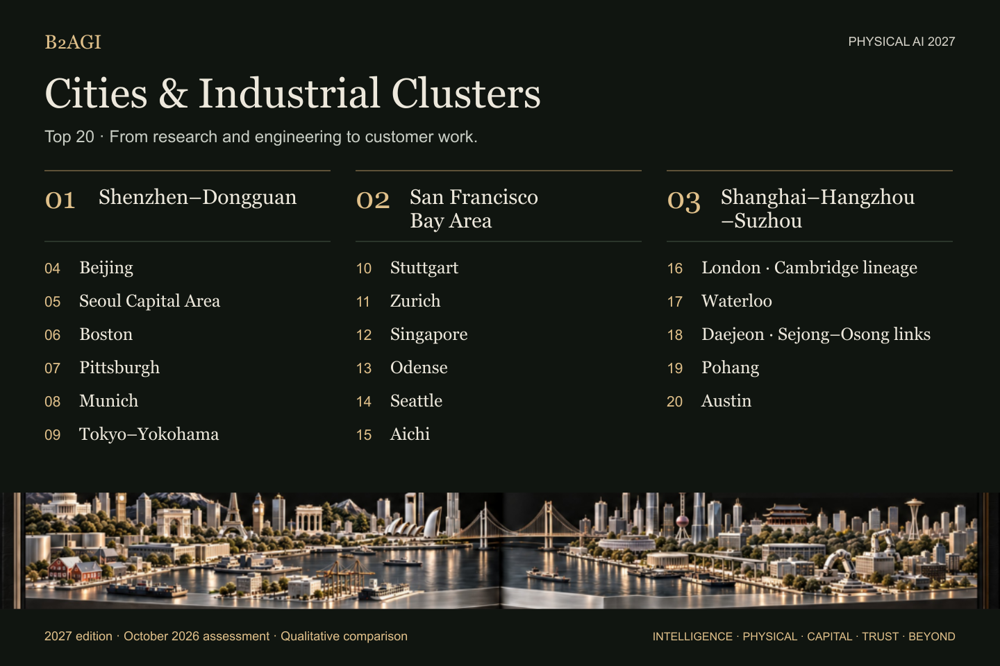

# B2AGI Physical AI 2027

## Cluster Atlas · Top 20

**2027 edition · October 2026 assessment · First published 12 October 2026 · v1.0**

This atlas compares 20 industrial regions through their research networks, engineering capacity and customer activity.

Shenzhen–Dongguan links robot engineering and incubation with manufacturing access. The San Francisco Bay Area connects robotics platforms, learning research and shared facilities. Shanghai–Hangzhou–Suzhou brings together training infrastructure, robot products and physical-system research.

[Explore the regions](#cluster-overview) · [Country Atlas](README.md#country-overview) · [Comparison method](METHODOLOGY.md#cluster-comparison)

## Cluster overview

| Rank | Region | Assessment focus |
| --- | --- | --- |
| 1 | 🇨🇳 [Shenzhen–Dongguan](clusters/pearl-river-delta-core-shenzhendongguan--cluster-01/README.md) | Robot engineering, incubation and manufacturing access |
| 2 | 🇺🇸 [San Francisco Bay Area](clusters/san-francisco-bay-area--cluster-02/README.md) | Robotics platforms, learning research and shared facilities |
| 3 | 🇨🇳 [Shanghai–Hangzhou–Suzhou](clusters/yangtze-river-delta-core-shanghaihangzhousuzhou--cluster-03/README.md) | Training infrastructure, robot products and physical research |
| 4 | 🇨🇳 [Beijing](clusters/beijing-region--cluster-04/README.md) | Robot learning, driving trials and growth funding |
| 5 | 🇰🇷 [Seoul Capital Area](clusters/seoul-capital-area--cluster-05/README.md) | Building deliveries, robot development and capital access |
| 6 | 🇺🇸 [Boston](clusters/boston-region--cluster-06/README.md) | Hardware startups and shared robotics experimentation |
| 7 | 🇺🇸 [Pittsburgh](clusters/pittsburgh-region--cluster-07/README.md) | Research transfer and manufacturing demonstrations |
| 8 | 🇩🇪 [Munich](clusters/munich-region--cluster-08/README.md) | Industrial logistics integration and growth financing |
| 9 | 🇯🇵 [Tokyo–Yokohama](clusters/tokyoyokohama-core--cluster-09/README.md) | Robot control, integration and testing access |
| 10 | 🇩🇪 [Stuttgart](clusters/stuttgart-region--cluster-10/README.md) | AI manipulation and automotive testing infrastructure |
| 11 | 🇨🇭 [Zurich](clusters/zurich-region--cluster-11/README.md) | Learned inspection control and research commercialization |
| 12 | 🇸🇬 [Singapore](clusters/singapore--cluster-12/README.md) | Robot integration for customer infrastructure |
| 13 | 🇩🇰 [Odense](clusters/odense--cluster-13/README.md) | Mobile and collaborative-robot development |
| 14 | 🇺🇸 [Seattle](clusters/seattle-region--cluster-14/README.md) | Logistics adopters, drone engineering and robot-data tools |
| 15 | 🇯🇵 [Aichi](clusters/aichi-manufacturing-region--cluster-15/README.md) | Manufacturing development and robot testing facilities |
| 16 | 🇬🇧 [London · Cambridge lineage](clusters/london-core-cambridge-research-and-startup-lineage--cluster-16/README.md) | Action models, robot learning and driving development |
| 17 | 🇨🇦 [Waterloo](clusters/waterloo-core--cluster-17/README.md) | Industrial AMRs, automation integration and services |
| 18 | 🇰🇷 [Daejeon · Sejong–Osong links](clusters/daejeon-core-sejongosong-transport-links--cluster-18/README.md) | Research platforms, technology transfer and demonstration labs |
| 19 | 🇰🇷 [Pohang](clusters/pohang-industrial-robotics-and-manufacturing-research-region--cluster-19/README.md) | Robot manufacture and steel-industry development |
| 20 | 🇺🇸 [Austin](clusters/austin-region--cluster-20/README.md) | Humanoid development, customer trials and growth capital |

## Regional scope

Each profile defines its regional boundary and identifies the locations of the cited activity.

- **Shanghai–Hangzhou–Suzhou:** The analytical region includes all three cities. The cited activities are located in Shanghai and Hangzhou.
- **London and Cambridge:** Cambridge contributes research and founding lineage to the London profile.
- **Daejeon, Sejong and Osong:** Sejong and Osong retain their transport-link roles in the Daejeon profile.
- **Austin:** Apptronik's robot development is based in Austin; its Mercedes customer trials took place in Germany.

## Research and data

The assessment uses qualitative comparison. Individual profiles provide the selection rationale, evidence scope and original source references.

[Comparison method](METHODOLOGY.md#cluster-comparison) · [JSON](data/clusters.en.json) · [CSV](data/clusters.en.csv)

## Publication

Published by [B2AGI](https://b2agi.com), 2026. Cite the cluster record, source-reference ID and revision used.

[Corrections](https://github.com/b2agi/physical-ai-ranking-2027/issues) · [Reuse terms](RIGHTS.md) · [Contact](mailto:aei.b2agi@gmail.com).
