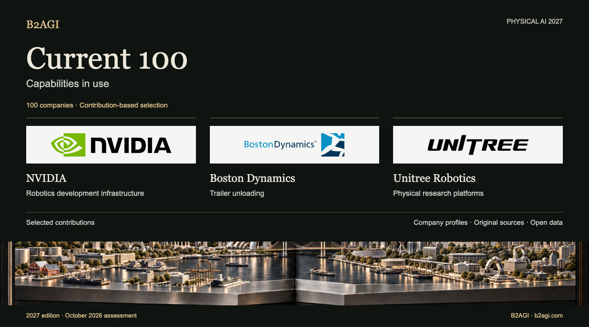

# B2AGI Physical AI Companies · Current 100 · 2027

## Current 100 · Companies

**2027 edition · October 2026 assessment · First published 12 October 2026 · v1.0**

Current 100 examines capabilities adopted in operations, production, education and research, together with completed technology transfers and capital contributions. Each company is selected for a specific contribution, from customer work to components and development platforms.

[Explore all 100 companies](#company-directory) · [Next 100](NEXT_100.md) · [Selection method](METHODOLOGY.md#company-selection) · [Download data](#research-and-data)

### Selected contributions

| Record ID | Company | Selected contribution |
| --- | --- | --- |
| C067 | [NVIDIA](companies/nvidia--c067/README.md) | Robotics development infrastructure |
| C016 | [Boston Dynamics](companies/boston-dynamics--c016/README.md) | Trailer unloading |
| C095 | [Unitree Robotics](companies/unitree-robotics--c095/README.md) | Physical research platforms |

Group membership follows the contribution assessed for this edition. Section headings identify the group; record IDs remain stable across group changes.

## Company directory

| Record ID | Company | Selected contribution |
| --- | --- | --- |
| C001 | [42dot](companies/42dot--c001/README.md) | Ride requests and reservations |
| C002 | [AgiBot](companies/agibot--c002/README.md) | Production-line robot deployment |
| C003 | [Agile Robots](companies/agile-robots--c003/README.md) | Logistics automation integration |
| C004 | [Agility Robotics](companies/agility-robotics--c004/README.md) | Tote transfers |
| N099 | [AIDIN Robotics](companies/aidin-robotics--n099/README.md) | Force-sensing components |
| C005 | [Amazon](companies/amazon--c005/README.md) | Fulfillment adoption |
| C006 | [Ambi Robotics](companies/ambi-robotics--c006/README.md) | Logistics sorting |
| C007 | [AMP Robotics / AMP](companies/amp-robotics-amp--c007/README.md) | Material sorting |
| C008 | [ANYbotics](companies/anybotics--c008/README.md) | Industrial inspection |
| C009 | [Applied Intuition](companies/applied-intuition--c009/README.md) | Vehicle simulation and testing |
| C010 | [Autonomous a2z](companies/autonomous-a2z--c010/README.md) | Supervised passenger shuttle |
| C011 | [Baidu](companies/baidu--c011/README.md) | Driverless passenger service |
| C012 | [Bedrock Robotics](companies/bedrock-robotics--c012/README.md) | Autonomous excavation |
| C013 | [Berkshire Grey](companies/berkshire-grey--c013/README.md) | Parcel sorting |
| C101 | [BlackRock](companies/blackrock--c101/README.md) | Robotics investment funds |
| C015 | [Booster Robotics](companies/booster-robotics--c015/README.md) | Research and competition robots |
| C016 | [Boston Dynamics](companies/boston-dynamics--c016/README.md) | Trailer unloading |
| C017 | [Brain Corp](companies/brain-corp--c017/README.md) | Cleaning autonomy |
| C018 | [Built Robotics](companies/built-robotics--c018/README.md) | Autonomous solar construction |
| C019 | [Burro](companies/burro--c019/README.md) | Farm transport |
| C020 | [Carbon Robotics](companies/carbon-robotics--c020/README.md) | Laser weeding |
| C021 | [CATL](companies/catl--c021/README.md) | Manufacturing adoption and batteries |
| C022 | [Cognex](companies/cognex--c022/README.md) | Industrial inspection vision |
| C023 | [Corvus Robotics](companies/corvus-robotics--c023/README.md) | Inventory drones |
| C024 | [Coupang](companies/coupang--c024/README.md) | Fulfillment operations |
| C025 | [Covariant](companies/covariant--c025/README.md) | Learned picking |
| C026 | [DeepRobotics](companies/deeprobotics--c026/README.md) | Tunnel inspection hardware |
| C029 | [Dexterity](companies/dexterity--c029/README.md) | Trailer loading |
| C030 | [Diligent Robotics](companies/diligent-robotics--c030/README.md) | Hospital deliveries |
| C104 | [DJI](companies/dji--c104/README.md) | Aerial infrastructure-inspection supply |
| C105 | [Doosan Robotics](companies/doosan-robotics--c105/README.md) | Supplied manipulation research platform |
| C032 | [Dreame Technology](companies/dreame-technology--c032/README.md) | Home-cleaning perception |
| C033 | [Dyna Robotics](companies/dyna-robotics--c033/README.md) | Garment folding |
| C034 | [Ecovacs](companies/ecovacs--c034/README.md) | Home cleaning |
| N017 | [Elephant Robotics](companies/elephant-robotics--n017/README.md) | Educational robot kits |
| N020 | [Farm-ng](companies/farm-ng--n020/README.md) | Agricultural development platforms |
| C035 | [Field AI](companies/field-ai--c035/README.md) | Construction inspection autonomy |
| C036 | [Figure AI](companies/figure-ai--c036/README.md) | Humanoid factory pilot |
| C037 | [Flexiv](companies/flexiv--c037/README.md) | Force-controlled food processing |
| C038 | [Formic](companies/formic--c038/README.md) | Packaging and palletizing services |
| C039 | [ForwardX Robotics](companies/forwardx-robotics--c039/README.md) | Warehouse picking assistance |
| C040 | [Foxglove](companies/foxglove--c040/README.md) | Robot-log analysis |
| C041 | [Galbot](companies/galbot--c041/README.md) | Production-line robot supply |
| C043 | [Gaussian Robotics / Gausium](companies/gaussian-robotics-gausium--c043/README.md) | Store cleaning |
| C045 | [Geek+](companies/geek--c045/README.md) | Warehouse transport |
| C046 | [GelSight](companies/gelsight--c046/README.md) | Tactile research instrumentation |
| C047 | [GXO](companies/gxo--c047/README.md) | Customer logistics integration |
| C048 | [HAI Robotics](companies/hai-robotics--c048/README.md) | Warehouse robot systems |
| N030 | [HaptX](companies/haptx--n030/README.md) | Tactile teleoperation |
| C049 | [Hesai](companies/hesai--c049/README.md) | LiDAR components |
| C050 | [Horizon Robotics](companies/horizon-robotics--c050/README.md) | Driver-assistance computing |
| C051 | [Hyundai Motor Group](companies/hyundai-motor-group--c051/README.md) | Strategic robotics ownership |
| C052 | [InOrbit](companies/inorbit--c052/README.md) | Robot operations tools |
| C053 | [Intuitive Surgical](companies/intuitive-surgical--c053/README.md) | Robotic bronchoscopy assistance |
| N037 | [JLG — Canvas Robotics](companies/jlg-canvas-robotics--n037/README.md) | Construction robotics technology transfer |
| C054 | [John Deere](companies/john-deere--c054/README.md) | Selective spraying |
| C055 | [Keenon Robotics](companies/keenon-robotics--c055/README.md) | Restaurant and hotel service robots |
| C057 | [Kodiak Robotics / Kodiak AI](companies/kodiak-robotics-kodiak-ai--c057/README.md) | Off-road transport |
| C058 | [Locus Robotics](companies/locus-robotics--c058/README.md) | Picking assistance |
| C061 | [Meituan](companies/meituan--c061/README.md) | Autonomous delivery operations |
| C062 | [Mobile Industrial Robots / MiR](companies/mobile-industrial-robots-mir--c062/README.md) | AMR container transport |
| C063 | [Momenta](companies/momenta--c063/README.md) | Production driving intelligence |
| C064 | [Mytra](companies/mytra--c064/README.md) | Inventory buffering and sequencing |
| C065 | [NAVER / NAVER LABS](companies/naver-naver-labs--c065/README.md) | Building-integrated robot operations |
| C066 | [Nearthlab](companies/nearthlab--c066/README.md) | Wind-turbine inspection |
| N053 | [Nimble Robotics](companies/nimble-robotics--n053/README.md) | Robotic fulfillment supply |
| C067 | [NVIDIA](companies/nvidia--c067/README.md) | Robotics development infrastructure |
| C068 | [Orbbec](companies/orbbec--c068/README.md) | Depth sensing |
| C069 | [OrionStar](companies/orionstar--c069/README.md) | Factory process transport |
| C070 | [OSARO](companies/osaro--c070/README.md) | Learned packaging |
| C071 | [Parallel Domain](companies/parallel-domain--c071/README.md) | Synthetic perception data |
| C072 | [Path Robotics](companies/path-robotics--c072/README.md) | Robotic welding |
| C073 | [Pickle Robot](companies/pickle-robot--c073/README.md) | Trailer unloading |
| C074 | [Plus One Robotics](companies/plus-one-robotics--c074/README.md) | Parcel vision and exception handling |
| C075 | [Pudu Robotics](companies/pudu-robotics--c075/README.md) | Office cleaning |
| C076 | [Quicktron](companies/quicktron--c076/README.md) | Warehouse shelf transport |
| C078 | [RightHand Robotics](companies/righthand-robotics--c078/README.md) | Warehouse picking |
| C079 | [Roborock](companies/roborock--c079/README.md) | Object pickup and cleaning |
| C080 | [ROBOTIS](companies/robotis--c080/README.md) | Research actuators and platforms |
| C081 | [Roboto AI](companies/roboto-ai--c081/README.md) | Robot operations analysis |
| C082 | [Robust.AI](companies/robust-ai--c082/README.md) | Collaborative tote transport |
| C083 | [Rockwell Automation](companies/rockwell-automation--c083/README.md) | MES and AMR integration |
| C084 | [Saildrone](companies/saildrone--c084/README.md) | Ocean observation |
| C085 | [Samsung Electronics](companies/samsung-electronics--c085/README.md) | Strategic robotics ownership |
| C086 | [Sarcos → Palladyne AI](companies/sarcos-palladyne-ai--c086/README.md) | Maintenance automation software |
| C087 | [Seoul Robotics](companies/seoul-robotics--c087/README.md) | Factory vehicle perception |
| N072 | [Shadow Robot](companies/shadow-robot--n072/README.md) | Dexterous research-hand supply |
| C090 | [SoftBank](companies/softbank--c090/README.md) | Warehouse-automation ownership and investment vehicle |
| C091 | [Standard Robots](companies/standard-robots--c091/README.md) | AMR pallet transport |
| C092 | [Superbin](companies/superbin--c092/README.md) | AI recycling collection |
| C093 | [Symbotic](companies/symbotic--c093/README.md) | Logistics automation systems |
| C094 | [Syrius Robotics / Syrius Technology](companies/syrius-robotics-syrius-technology--c094/README.md) | Picking-assistance AMRs |
| C103 | [UBTECH](companies/ubtech--c103/README.md) | Industrial humanoid supply and factory tasks |
| C095 | [Unitree Robotics](companies/unitree-robotics--c095/README.md) | Physical research platforms |
| C096 | [Universal Robots](companies/universal-robots--c096/README.md) | Greenhouse harvesting hardware |
| C097 | [Viam](companies/viam--c097/README.md) | Fleet operations software |
| C098 | [VisionNav Robotics](companies/visionnav-robotics--c098/README.md) | Autonomous forklift logistics |
| C102 | [Waymo](companies/waymo--c102/README.md) | Driverless passenger-service operation |
| C099 | [XYZ Robotics](companies/xyz-robotics--c099/README.md) | Warehouse unloading supply |
| C100 | [Zipline](companies/zipline--c100/README.md) | Autonomous aerial delivery |

## Research and data

Each profile contains its selection rationale, evidence scope and original source references. Customer operation, supplier disclosure and research validation retain their respective dates and conditions.

[Selection comparisons](COMPANY_SELECTIONS.md) · [JSON](data/current-100.en.json) · [CSV](data/current-100.en.csv) · [Country Atlas](README.md#country-overview) · [Cluster Atlas](CLUSTERS.md)

## Publication

Published by [B2AGI](https://b2agi.com), 2026. Cite the company record, source-reference ID and revision used.

[Corrections](https://github.com/b2agi/physical-ai-ranking-2027/issues) · [Reuse terms](RIGHTS.md) · [Contact](mailto:aei.b2agi@gmail.com).
