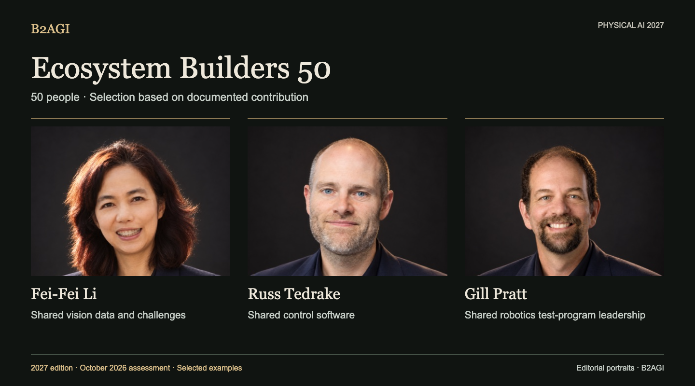

# B2AGI Physical AI 2027

## Ecosystem Builders 50 · People

*Editorial portrait artwork · [Image credits](PEOPLE_IMAGE_CREDITS.md).*

**2027 edition · October 2026 assessment · First published 12 October 2026 · v1.0**

Ecosystem Builders 50 examines the shared capabilities that allow others to develop and use Physical AI: tools, education, standards, finance, research facilities and testing programmes. Each profile identifies the person’s documented contribution.

[Explore all 50 people](#people-directory) · [Influence 50](INFLUENCE_50.md) · [Selection method](METHODOLOGY.md#people-selection) · [Download data](#research-and-data)

### Selected contributions

| Record ID | Person | Selected contribution |
| --- | --- | --- |
| E013 | [Fei-Fei Li](people/fei-fei-li--e013/README.md) | Shared vision data and challenges |
| E022 | [Russ Tedrake](people/russ-tedrake--e022/README.md) | Shared control software |
| P010 | [Gill Pratt](people/gill-pratt--p010/README.md) | Shared robotics test-program leadership |

Group membership follows the contribution assessed for this edition. Section headings identify the group; record IDs remain stable across group changes.

## People directory

| Record ID | Person | Selected contribution |
| --- | --- | --- |
| E001 | [Aaron Ames](people/aaron-ames--e001/README.md) | Shared gait-planning tools |
| E002 | [Aaron Prather](people/aaron-prather--e002/README.md) | Industry testing workshops |
| E003 | [Andra Keay](people/andra-keay--e003/README.md) | Robotics community support |
| E004 | [Ayanna Howard](people/ayanna-howard--e004/README.md) | Accessible STEM technology transfer |
| E005 | [Brian Gerkey](people/brian-gerkey--e005/README.md) | Open robotics architecture |
| E052 | [Bruce Leak](people/bruce-leak--e052/README.md) | Founder and board support |
| E047 | [Cho Kyu-nam](people/cho-kyu-nam--e047/README.md) | Public industry discussion |
| E007 | [Christian Hubicki](people/christian-hubicki--e007/README.md) | Control and simulation education |
| E008 | [Craig Schlenoff](people/craig-schlenoff--e008/README.md) | Shared robotics evaluation |
| E053 | [Cyril Ebersweiler](people/cyril-ebersweiler--e053/README.md) | Hardware startup support |
| P006 | [Daniela Rus](people/daniela-rus--p006/README.md) | Robotics doctoral mentoring |
| E009 | [Dennis Hong](people/dennis-hong--e009/README.md) | Research and education platforms |
| E010 | [Elena Messina](people/elena-messina--e010/README.md) | Joint standards and testing |
| E011 | [Elham Tabassi](people/elham-tabassi--e011/README.md) | AI risk-management framework |
| E012 | [Erico Guizzo](people/erico-guizzo--e012/README.md) | Robotics editorial resources |
| E013 | [Fei-Fei Li](people/fei-fei-li--e013/README.md) | Shared vision data and challenges |
| E014 | [Francesca Rossi](people/francesca-rossi--e014/README.md) | Autonomous-system design ethics |
| P009 | [Geordie Rose](people/geordie-rose--p009/README.md) | Robotics partner investment and support |
| P010 | [Gill Pratt](people/gill-pratt--p010/README.md) | Shared robotics test-program leadership |
| E050 | [Han Jae-kwon](people/han-jae-kwon--e050/README.md) | Public robotics education |
| E044 | [He Wang](people/he-wang--e044/README.md) | Shared dexterous-grasp benchmark and tools |
| E015 | [Henrik Christensen](people/henrik-christensen--e015/README.md) | Shared robotics roadmaps |
| P036 | [Jiyang Gao](people/jiyang-gao--p036/README.md) | Dataset-and-model programme coordination |
| E036 | [Jung Kim](people/jung-kim--e036/README.md) | Startup-development programs |
| P015 | [Karol Hausman](people/karol-hausman--p015/README.md) | Robot-learning infrastructure |
| E016 | [Li Zexiang](people/li-zexiang--e016/README.md) | Startup education and manufacturing support |
| E037 | [Liang Jing](people/liang-jing--e037/README.md) | Standards working-group operations |
| E051 | [Lior Susan](people/lior-susan--e051/README.md) | Industrial startup organization |
| E030 | [Liu Lianqing](people/liu-lianqing--e030/README.md) | Robotics doctoral supervision |
| E017 | [Matt Beane](people/matt-beane--e017/README.md) | Work and skill-transition research |
| E018 | [Matthew Johnson-Roberson](people/matthew-johnson-roberson--e018/README.md) | Robotics doctoral supervision |
| E055 | [Mayank Mittal](people/mayank-mittal--e055/README.md) | Public robot-learning infrastructure |
| E056 | [Morgan Quigley](people/morgan-quigley--e056/README.md) | ROS architecture |
| E020 | [Pieter Abbeel](people/pieter-abbeel--e020/README.md) | Robotics-control education |
| E049 | [Qin Xiugong](people/qin-xiugong--e049/README.md) | Shared standards terminology |
| E048 | [Qu Daokui](people/qu-daokui--e048/README.md) | Research commercialization |
| E022 | [Russ Tedrake](people/russ-tedrake--e022/README.md) | Shared control software |
| E023 | [Ryan Gariepy](people/ryan-gariepy--e023/README.md) | Developer exchange and education |
| E024 | [Rémi Cadène / Remi Cadene](people/remi-cadene-remi-cadene--e024/README.md) | Open robot-learning tools |
| E039 | [Shi Lin](people/shi-lin--e039/README.md) | Joint evaluation-standard authorship |
| E025 | [Sun Lining](people/sun-lining--e025/README.md) | Regional research and talent programs |
| E026 | [Tom Ryden](people/tom-ryden--e026/README.md) | Shared facility operations |
| E027 | [Tully Foote](people/tully-foote--e027/README.md) | ROS units and coordinate conventions |
| E028 | [Vincent Vanhoucke](people/vincent-vanhoucke--e028/README.md) | Research-team formation |
| E043 | [Wang Tianmiao](people/wang-tianmiao--e043/README.md) | Talent and startup support |
| E045 | [Wei Kai](people/wei-kai--e045/README.md) | Joint evaluation-standard authorship |
| E054 | [Wendy Tan White](people/wendy-tan-white--e054/README.md) | Shared development organization |
| E032 | [Xiong Rong](people/xiong-rong--e032/README.md) | Student research platforms |
| E041 | [Yuh Joon-ku](people/yuh-joon-ku--e041/README.md) | Research-agenda editing |
| E029 | [Zhang Jianwei](people/zhang-jianwei--e029/README.md) | Multi-institution research coordination |

## Research and data

Profiles document the selection rationale, evidence scope and original sources, with shared attribution for joint work.

[Group-assignment comparisons](PEOPLE_SELECTIONS.md) · [JSON](data/ecosystem-builders-50.en.json) · [CSV](data/ecosystem-builders-50.en.csv) · [Current 100](CURRENT_100.md) · [Next 100](NEXT_100.md)

## Publication

Published by [B2AGI](https://b2agi.com), 2026. Cite the person’s record, source-reference ID and revision used.

[Corrections](https://github.com/b2agi/physical-ai-ranking-2027/issues) · [Reuse terms](RIGHTS.md) · [Contact](mailto:aei.b2agi@gmail.com).
