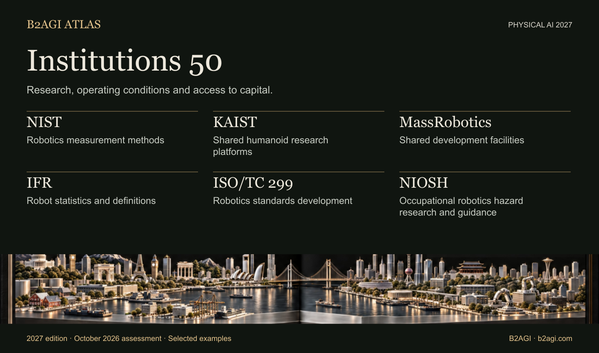

# B2AGI Physical AI Institutions 50 · 2027

## Institutions 50

**2027 edition · October 2026 assessment · First published 12 October 2026 · v1.0**

Institutions 50 examines the research, testing, standards, regulatory and capital-market activities that support Physical AI. Each profile identifies a specific contribution. Technical authorship, funding, certification and market access retain their separate roles.

[Explore all 50 institutions](#institution-directory) · [Selection method](METHODOLOGY.md#institution-selection) · [Full edition](README.md#edition-directory) · [Download data](#research-and-data)

### Selected contributions

| Record ID | Institution or programme | Selected contribution |
| --- | --- | --- |
| I006 | [CMU Robotics Institute](institutions/cmu-robotics-institute--i006/README.md) | Robotics research and education |
| I033 | [NIST](institutions/nist--i033/README.md) | Robotics measurement methods |
| I016 | [IFR](institutions/ifr--i016/README.md) | Robot statistics and definitions |

## Institution directory

| Record ID | Institution or programme | Selected contribution |
| --- | --- | --- |
| I001 | [ARM Institute](institutions/arm-institute--i001/README.md) | Manufacturing adoption support |
| I003 | [ASTM F45](institutions/astm-f45--i003/README.md) | Mobile-robot performance standards |
| I047 | [Beijing Humanoid Robot Innovation Center](institutions/beijing-humanoid-robot-innovation-center--i047/README.md) | Shared robot-training data |
| I004 | [BIGAI](institutions/bigai--i004/README.md) | Shared robotics research tools |
| I005 | [CESI](institutions/cesi--i005/README.md) | Embodied-intelligence data-quality guidance co-authorship |
| I006 | [CMU Robotics Institute](institutions/cmu-robotics-institute--i006/README.md) | Robotics research and education |
| I007 | [DARPA SubT](institutions/darpa-subt--i007/README.md) | Shared physical test environments |
| I008 | [DFKI Robotics Innovation Center](institutions/dfki-robotics-innovation-center--i008/README.md) | Industrial robotics research |
| I009 | [ETRI](institutions/etri--i009/README.md) | Robotics technology transfer |
| I010 | [euRobotics](institutions/eurobotics--i010/README.md) | Robotics research ecosystem |
| I011 | [FAA](institutions/faa--i011/README.md) | BVLOS package-delivery authorization |
| I012 | [Harvard Wyss Institute](institutions/harvard-wyss-institute--i012/README.md) | Assistive-robot research and licensing |
| I013 | [HIT Robotics Technology and Systems Research Unit](institutions/hit-robotics-technology-and-systems-research-unit--i013/README.md) | Physical robotics research infrastructure |
| I014 | [HKEX / HKSCC](institutions/hkex-hkscc--i014/README.md) | Listing and clearing access |
| I015 | [IEC Robotics Product Safety Standards](institutions/iec-robotics-product-safety-standards--i015/README.md) | Robot-product safety standards |
| I016 | [IFR](institutions/ifr--i016/README.md) | Robot statistics and definitions |
| I017 | [ISO/TC 299](institutions/iso-tc-299--i017/README.md) | Robotics standards development |
| I018 | [KAIST](institutions/kaist--i018/README.md) | Shared humanoid research platforms |
| I020 | [KEIT](institutions/keit--i020/README.md) | Robotics research funding |
| I022 | [KIAT](institutions/kiat--i022/README.md) | Robotics R&D funding |
| I023 | [KIRIA](institutions/kiria--i023/README.md) | Robot testing and certification |
| I024 | [KITECH](institutions/kitech--i024/README.md) | Robot digital-twin research |
| I050 | [KRX](institutions/krx--i050/README.md) | Robotics listing and disclosure access |
| I025 | [KTL](institutions/ktl--i025/README.md) | Wearable-robot testing |
| I026 | [LeRobot / Hugging Face](institutions/lerobot-hugging-face--i026/README.md) | Shared robot-learning infrastructure |
| I027 | [MassRobotics](institutions/massrobotics--i027/README.md) | Shared development facilities |
| I028 | [MIIT](institutions/miit--i028/README.md) | Robotics application policy |
| I029 | [MIT CSAIL](institutions/mit-csail--i029/README.md) | Human-robot interaction research |
| I030 | [NASA Jet Propulsion Laboratory](institutions/nasa-jet-propulsion-laboratory--i030/README.md) | Planetary robotics operations |
| I031 | [Nasdaq](institutions/nasdaq--i031/README.md) | Robotics public-market access |
| I048 | [National Robot Testing and Evaluation Center, Shanghai Headquarters](institutions/national-robot-testing-and-evaluation-center-shanghai-headquarters--i048/README.md) | Shanghai robot certification |
| I053 | [New York Stock Exchange / NYSE](institutions/new-york-stock-exchange-nyse--i053/README.md) | Historical issuer trading access |
| I032 | [NHTSA](institutions/nhtsa--i032/README.md) | Automated-driving recall reporting |
| I054 | [NIOSH / Center for Occupational Robotics Research](institutions/niosh-center-for-occupational-robotics-research--i054/README.md) | Occupational robotics hazard research and guidance |
| I033 | [NIST](institutions/nist--i033/README.md) | Robotics measurement methods |
| I034 | [Open Robotics / OSRF](institutions/open-robotics-osrf--i034/README.md) | Open robotics software infrastructure |
| I035 | [Open X-Embodiment consortium](institutions/open-x-embodiment-consortium--i035/README.md) | Shared learning data and models |
| I036 | [OSHA Robotics Safety Guidance](institutions/osha-robotics-safety-guidance--i036/README.md) | Workplace robotics safety guidance |
| I037 | [POSTECH](institutions/postech--i037/README.md) | Joint hospital-robotics research and evaluation |
| I038 | [RAI Institute](institutions/rai-institute--i038/README.md) | Public robot-learning tools |
| I039 | [SAC](institutions/sac--i039/README.md) | National standards administration |
| I040 | [SEC](institutions/sec--i040/README.md) | Issuer disclosure review |
| I041 | [Shanghai AI Lab](institutions/shanghai-ai-lab--i041/README.md) | Shared simulation research |
| I051 | [Shanghai Stock Exchange](institutions/shanghai-stock-exchange--i051/README.md) | Industrial issuer market access |
| I052 | [Shenzhen Stock Exchange](institutions/shenzhen-stock-exchange--i052/README.md) | Industrial issuer market access |
| I046 | [SIA](institutions/sia--i046/README.md) | Industrial technology transfer |
| I042 | [Toyota Research Institute](institutions/toyota-research-institute--i042/README.md) | Robot learning and control research |
| I043 | [UC Berkeley BAIR: RAIL BridgeData](institutions/uc-berkeley-bair-rail-bridgedata--i043/README.md) | Shared robot data and training tools |
| I044 | [XbotPark](institutions/xbotpark--i044/README.md) | Startup manufacturing support |
| I045 | [Zhejiang University Robotics Research](institutions/zhejiang-university-robotics-research--i045/README.md) | Robotics education |

## Research and data

Institutions, consortia and named programmes are selected for documented contributions within the scope of each profile. Record IDs provide stable references across editions.

[JSON](data/institutions-50.en.json) · [CSV](data/institutions-50.en.csv) · [Safety-evidence comparison](INSTITUTION_SELECTIONS.md) · [All 390 records](data/ranking2027.en.json)

## Publication

Published by [B2AGI](https://b2agi.com), 2026. Cite the institution record, source-reference ID and revision used.

[Corrections](https://github.com/b2agi/physical-ai-ranking-2027/issues) · [Reuse terms](RIGHTS.md) · [Contact](mailto:aei.b2agi@gmail.com).
