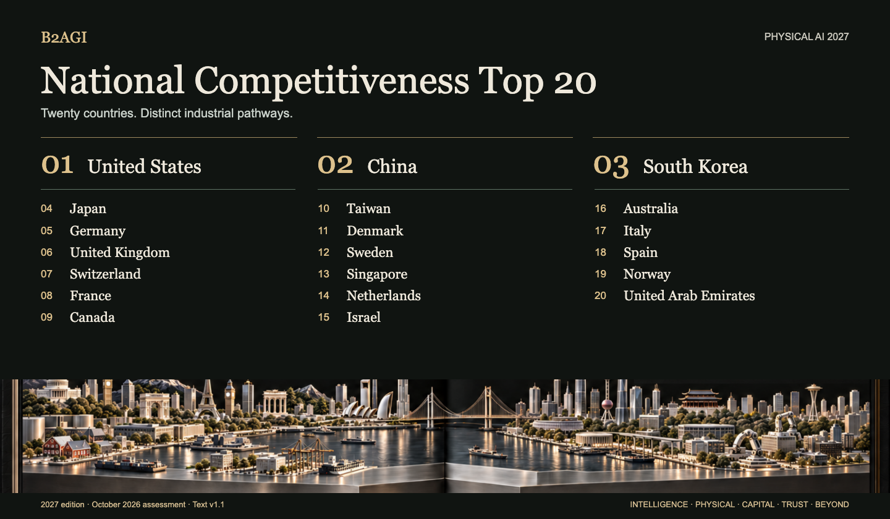

# 20 دولة · B2AGI 2027

طبعة 2027 · مرجع التقييم: أكتوبر 2026.

ترتيب نوعي، وليس نتيجة حساب درجة مركبة.

الواجهة وأسماء الدول بالعربية. أسماء بقية السجلات والأدوار وأسس الاختيار ونطاق الأدلة بالنص الإنجليزي.

| المرتبة | الاسم | الدور · الإنجليزية |
| --- | --- | --- |
| 1 | [الولايات المتحدة](countries/united-states--country-01/README.md) | Robotics platforms, customer deployment and growth capital |
| 2 | [الصين](countries/china--country-02/README.md) | Robot hardware and integrated manufacturing networks |
| 3 | [كوريا الجنوبية](countries/south-korea--country-03/README.md) | Robot coordination, learned control and research commercialization |
| 4 | [اليابان](countries/japan--country-04/README.md) | Perception and motion planning in factory processes |
| 5 | [ألمانيا](countries/germany--country-05/README.md) | Industrial manipulation, integration and testing |
| 6 | [المملكة المتحدة](countries/united-kingdom--country-06/README.md) | On-device robotics models and dexterous learning |
| 7 | [سويسرا](countries/switzerland--country-07/README.md) | Learned control for industrial inspection |
| 8 | [فرنسا](countries/france--country-08/README.md) | Open robot-learning tools and manipulation models |
| 9 | [كندا](countries/canada--country-09/README.md) | Manipulation learning and autonomous-truck integration |
| 10 | [تايوان](countries/taiwan--country-10/README.md) | Semiconductor fabrication, packaging and robotics infrastructure |
| 11 | [الدنمارك](countries/denmark--country-11/README.md) | Mobile logistics and collaborative-robot platforms |
| 12 | [السويد](countries/sweden--country-12/README.md) | Industry-linked robotics research and doctoral training |
| 13 | [سنغافورة](countries/singapore--country-13/README.md) | Local integration for power-tunnel inspection |
| 14 | [هولندا](countries/netherlands--country-14/README.md) | Warehouse integration and automation finance |
| 15 | [إسرائيل](countries/israel--country-15/README.md) | Manipulation development and national AI computing |
| 16 | [أستراليا](countries/australia--country-16/README.md) | Autonomous mining and construction field trials |
| 17 | [إيطاليا](countries/italy--country-17/README.md) | Industrial integration and warehouse validation |
| 18 | [إسبانيا](countries/spain--country-18/README.md) | Robotics engineering and AI inspection development |
| 19 | [النرويج](countries/norway--country-19/README.md) | Humanoid engineering and manufacturing development |
| 20 | [الإمارات العربية المتحدة](countries/united-arab-emirates--country-20/README.md) | Adoption and operation of autonomous passenger services |

[الفهرس](README.md) · [الموقع بالعربية](https://b2agi.com/ar/rankings/physical-ai-2027/)

