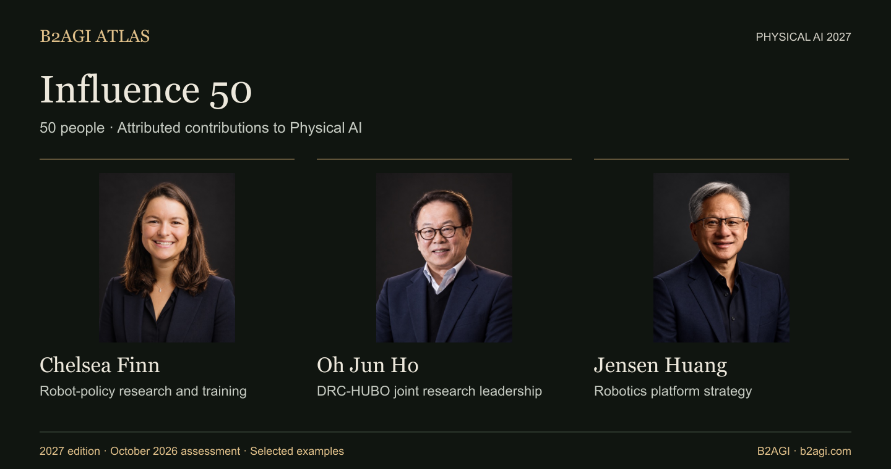

# 50 شخصية مؤثرة · B2AGI 2027

طبعة 2027 · مرجع التقييم: أكتوبر 2026.

اختيار بحسب المساهمة. المعرّفات ليست مراتب.

الواجهة وأسماء الدول بالعربية. أسماء بقية السجلات والأدوار وأسس الاختيار ونطاق الأدلة بالنص الإنجليزي.

| المعرّف | الاسم | الدور · الإنجليزية |
| --- | --- | --- |
| P001 | [Abhinav Gupta](people/abhinav-gupta--p001/README.md) | Semantic navigation research |
| P002 | [Anca Dragan](people/anca-dragan--p002/README.md) | Intent-aware motion planning |
| P003 | [Andrea Thomaz](people/andrea-thomaz--p003/README.md) | Hospital delivery product strategy |
| P043 | [Brett Adcock](people/brett-adcock--p043/README.md) | Humanoid industrial strategy |
| E006 | [Chelsea Finn](people/chelsea-finn--e006/README.md) | Robot-policy research and training |
| P004 | [Chen Jianyu](people/chen-jianyu--p004/README.md) | Corresponding research authorship |
| P048 | [Cheon Hong-seok](people/cheon-hong-seok--p048/README.md) | Shared robotics business management |
| P005 | [Chris Urmson](people/chris-urmson--p005/README.md) | Driverless-trucking operating decision |
| P007 | [Deepak Pathak](people/deepak-pathak--p007/README.md) | Adaptive locomotion research |
| P029 | [Ding Han](people/ding-han--p029/README.md) | Robotic surface-machining leadership |
| P008 | [Euisun Chung](people/euisun-chung--p008/README.md) | Strategic ownership participation |
| P034 | [Hang Zhao](people/hang-zhao--p034/README.md) | Foundation-model research leadership |
| P011 | [Hod Lipson](people/hod-lipson--p011/README.md) | Robot self-modeling research |
| P050 | [Huang Xiaoqing](people/huang-xiaoqing--p050/README.md) | Cloud-robot control research |
| P040 | [Hyoun Jin Kim](people/hyoun-jin-kim--p040/README.md) | Aerial-manipulation research |
| P038 | [In So Kweon](people/in-so-kweon--p038/README.md) | DRC-HUBO joint research leadership |
| P042 | [Jaeheung Park](people/jaeheung-park--p042/README.md) | Balance-control research |
| P012 | [Jeff Cardenas](people/jeff-cardenas--p012/README.md) | Industrial market-entry strategy |
| P049 | [Jemin Hwangbo](people/jemin-hwangbo--p049/README.md) | Sim-to-real control research |
| P013 | [Jensen Huang](people/jensen-huang--p013/README.md) | Robotics platform strategy |
| P014 | [Jonathan Hurst](people/jonathan-hurst--p014/README.md) | Biped hardware design |
| P016 | [Ken Goldberg](people/ken-goldberg--p016/README.md) | Learned grasping research |
| P039 | [Kim Yong-jae](people/kim-yong-jae--p039/README.md) | Lightweight assistive-robot research |
| P037 | [Kyoungchul Kong](people/kyoungchul-kong--p037/README.md) | Assistive-robot team leadership |
| P047 | [Kyu-Jin Cho](people/kyu-jin-cho--p047/README.md) | Variable-stiffness robotic design |
| P041 | [Leng Xiaokun](people/leng-xiaokun--p041/README.md) | Humanoid research funding strategy |
| P017 | [Linxi “Jim” Fan](people/linxi-jim-fan--p017/README.md) | Reward-generation research |
| P018 | [Marc Raibert](people/marc-raibert--p018/README.md) | Dynamic locomotion research |
| P019 | [Masayoshi Son](people/masayoshi-son--p019/README.md) | Strategic transaction decisions |
| P020 | [Melonee Wise](people/melonee-wise--p020/README.md) | Product and engineering organization |
| P021 | [Nick Paine](people/nick-paine--p021/README.md) | Actuator design and control |
| P051 | [Nikita Rudin](people/nikita-rudin--p051/README.md) | Parallel locomotion-training research |
| E019 | [Oh Jun Ho](people/oh-jun-ho--e019/README.md) | DRC-HUBO joint research leadership |
| P022 | [Oussama Khatib](people/oussama-khatib--p022/README.md) | Underwater teleoperation research |
| P023 | [Park Jong Hoon](people/park-jong-hoon--p023/README.md) | Vertical-integration strategy |
| P024 | [Peng Zhihui](people/peng-zhihui--p024/README.md) | Robot product-development leadership |
| P030 | [Qiao Hong](people/qiao-hong--p030/README.md) | Robot control-method research |
| P035 | [Richie Chen](people/richie-chen--p035/README.md) | ACR co-development |
| P025 | [Rodney Brooks](people/rodney-brooks--p025/README.md) | Layered robot control |
| E021 | [Rolf Dieter Schraft](people/rolf-dieter-schraft--e021/README.md) | Robot-programming method research |
| P026 | [Sabine Hauert](people/sabine-hauert--p026/README.md) | Swarm-control research leadership |
| P044 | [Seok Sang-ok](people/seok-sang-ok--p044/README.md) | Integrated robotics service strategy |
| P027 | [Sergey Levine](people/sergey-levine--p027/README.md) | Learned visual-feedback research |
| P033 | [Wang Hesheng](people/wang-hesheng--p033/README.md) | Joint perception research |
| E033 | [Wang Tianran](people/wang-tianran--e033/README.md) | Industrial robot product-development leadership |
| P028 | [Wang Xingxing](people/wang-xingxing--p028/README.md) | Quadruped design and control |
| P032 | [Wang Yaonan](people/wang-yaonan--p032/README.md) | Industrial inspection project leadership |
| E034 | [Zhao Mingguo](people/zhao-mingguo--e034/README.md) | Joint humanoid-soccer research leadership |
| P046 | [Zhou Jian](people/zhou-jian--p046/README.md) | Humanoid research investment |
| P031 | [Zhu Qiuguo](people/zhu-qiuguo--p031/README.md) | Quadruped stability-control research |

[الفهرس](README.md) · [الموقع بالعربية](https://b2agi.com/ar/rankings/physical-ai-2027/)

<!-- B2AGI EPAI SIGNATURE -->
---

**B2AGI | EPAI**  
Embodied Physical Agentic Intelligence  
[Research & Publications](https://b2agi.com/) · [White Paper](https://github.com/b2agi/physical-ai-white-paper-2027) · [Industry Atlas](https://github.com/b2agi/physical-ai-ranking-2027)
<!-- /B2AGI EPAI SIGNATURE -->
