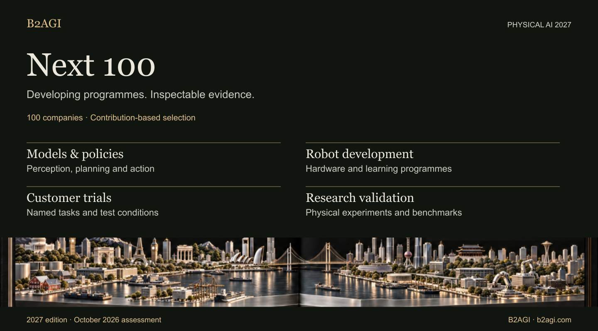

# الشركات: Next 100 · B2AGI 2027

طبعة 2027 · مرجع التقييم: أكتوبر 2026.

اختيار بحسب المساهمة. المعرّفات ليست مراتب.

الواجهة وأسماء الدول بالعربية. أسماء بقية السجلات والأدوار وأسس الاختيار ونطاق الأدلة بالنص الإنجليزي.

| المعرّف | الاسم | الدور · الإنجليزية |
| --- | --- | --- |
| N001 | [1X Technologies](companies/1x-technologies--n001/README.md) | Whole-body policy learning |
| N100 | [AeiROBOT](companies/aeirobot--n100/README.md) | Research and competition platforms |
| N002 | [Aeva](companies/aeva--n002/README.md) | Industrial sensing |
| N003 | [Aigen](companies/aigen--n003/README.md) | Agricultural field trials |
| N004 | [Alibaba](companies/alibaba--n004/README.md) | Robotic perception and action models |
| N005 | [Ambarella](companies/ambarella--n005/README.md) | Robot inference integration development |
| N006 | [Anthropic](companies/anthropic--n006/README.md) | Language-model control research |
| N007 | [Apple](companies/apple--n007/README.md) | Robot interaction and learning data |
| N008 | [Apptronik](companies/apptronik--n008/README.md) | Humanoid customer trials |
| N009 | [Astribot](companies/astribot--n009/README.md) | Manipulation-policy research |
| N010 | [Autodesk](companies/autodesk--n010/README.md) | Learned assembly |
| N011 | [BeingBeyond](companies/beingbeyond--n011/README.md) | Video-based robot learning |
| N012 | [BeyondHoneycomb](companies/beyondhoneycomb--n012/README.md) | Cooking-state sensing |
| N013 | [bitsensing](companies/bitsensing--n013/README.md) | Radar shuttle trials |
| N101 | [Black Sesame](companies/black-sesame--n101/README.md) | Robotics compute kits |
| N014 | [ByteDance](companies/bytedance--n014/README.md) | Robot action-model research |
| N015 | [Config](companies/config--n015/README.md) | Robot data and task models |
| N016 | [DEEPX](companies/deepx--n016/README.md) | Robotics edge computing |
| N018 | [EngineAI](companies/engineai--n018/README.md) | Learning and deployment tools |
| N019 | [Faraday Dynamics](companies/faraday-dynamics--n019/README.md) | Robot actuators |
| N104 | [Flexion Robotics](companies/flexion-robotics--n104/README.md) | Whole-body task policies |
| N021 | [Flexxbotics](companies/flexxbotics--n021/README.md) | Inspection-to-rework integration |
| N022 | [Floatic](companies/floatic--n022/README.md) | Collaborative picking trials |
| N023 | [Fourier Intelligence](companies/fourier-intelligence--n023/README.md) | Robot training and deployment tools |
| N024 | [Galaxea AI](companies/galaxea-ai--n024/README.md) | Physical manipulation learning |
| C044 | [Gecko Robotics](companies/gecko-robotics--c044/README.md) | Robot-assisted component inspection |
| N025 | [Generalist AI](companies/generalist-ai--n025/README.md) | Manipulation-model research |
| N026 | [Genesis AI](companies/genesis-ai--n026/README.md) | Physical manipulation development |
| N027 | [Genisom AI](companies/genisom-ai--n027/README.md) | Robot software development tools |
| N028 | [Gole Robotics](companies/gole-robotics--n028/README.md) | Construction transport trials |
| N029 | [Google DeepMind](companies/google-deepmind--n029/README.md) | On-device robotics models |
| N111 | [Hello Robot](companies/hello-robot--n111/README.md) | Open-vocabulary mobile manipulation development |
| N031 | [Helm.ai](companies/helm-ai--n031/README.md) | Driving-model development |
| N032 | [Hexagon](companies/hexagon--n032/README.md) | Humanoid training and validation |
| N033 | [Honda](companies/honda--n033/README.md) | Dexterous teleoperation assistance |
| N113 | [Hugging Face](companies/hugging-face--n113/README.md) | Compact perception-to-action model research |
| N034 | [Intel](companies/intel--n034/README.md) | Neuromorphic robot-control research |
| N035 | [Intrinsic](companies/intrinsic--n035/README.md) | AI manufacturing integration |
| N036 | [JD.com](companies/jd-com--n036/README.md) | Multi-source action learning |
| N039 | [KNOWIN](companies/knowin--n039/README.md) | Closed-loop policy research |
| N040 | [Leju Robotics](companies/leju-robotics--n040/README.md) | Robot development tools |
| N041 | [LG Electronics](companies/lg-electronics--n041/README.md) | Household manipulation development |
| N042 | [LimX Dynamics](companies/limx-dynamics--n042/README.md) | Hardware-linked development tools |
| N043 | [Lumos Robotics](companies/lumos-robotics--n043/README.md) | Manipulation data platforms |
| N044 | [Machina Labs](companies/machina-labs--n044/README.md) | Closed-loop forming |
| N045 | [MakinaRocks](companies/makinarocks--n045/README.md) | Robot maintenance models |
| N102 | [Maven Robotics](companies/maven-robotics--n102/README.md) | Logistics deployment development |
| N046 | [Mentee Robotics / Mentee by Mobileye](companies/mentee-robotics-mentee-by-mobileye--n046/README.md) | Physical manipulation learning |
| N047 | [Meta](companies/meta--n047/README.md) | Collaborative robotics benchmarks |
| N048 | [Microsoft](companies/microsoft--n048/README.md) | Robot planning and action models |
| N096 | [Mobilint](companies/mobilint--n096/README.md) | Robot-policy encoder integration research |
| N097 | [Mobiltech](companies/mobiltech--n097/README.md) | Spatial data assets |
| N049 | [MORAI](companies/morai--n049/README.md) | Driving simulation tools |
| N051 | [Near Earth Autonomy](companies/near-earth-autonomy--n051/README.md) | Autonomous aircraft integration |
| N052 | [NEURA Robotics](companies/neura-robotics--n052/README.md) | Robotics learning platforms |
| N054 | [Noetix Robotics](companies/noetix-robotics--n054/README.md) | Reinforcement-learning tools |
| N095 | [Nota AI](companies/nota-ai--n095/README.md) | Robot inference runtime |
| N055 | [Nuro](companies/nuro--n055/README.md) | Robotaxi employee trials |
| N056 | [Outrider](companies/outrider--n056/README.md) | Autonomous yard trials |
| N057 | [PaXini](companies/paxini--n057/README.md) | Tactile manipulation |
| N058 | [Persona AI](companies/persona-ai--n058/README.md) | Teleoperated welding |
| N059 | [Physical Intelligence](companies/physical-intelligence--n059/README.md) | Open policy development tools |
| N060 | [Qualcomm](companies/qualcomm--n060/README.md) | Robotics computing environment |
| N061 | [Raion Robotics](companies/raion-robotics--n061/README.md) | Quadruped control development |
| N062 | [RealMan](companies/realman--n062/README.md) | Robot data and teleoperation |
| N064 | [Realtime Robotics](companies/realtime-robotics--n064/README.md) | Motion-planning optimization |
| N065 | [Reliable Robotics](companies/reliable-robotics--n065/README.md) | Airborne detect-and-avoid research |
| N109 | [Rhoda AI](companies/rhoda-ai--n109/README.md) | Video-pretrained industrial manipulation research |
| N066 | [Richtech Robotics](companies/richtech-robotics--n066/README.md) | AI beverage manipulation |
| N110 | [RIVR](companies/rivr--n110/README.md) | Terrain-aware parcel-delivery trials |
| N067 | [RLWRLD](companies/rlwrld--n067/README.md) | Physical policy research |
| N105 | [RoboForce](companies/roboforce--n105/README.md) | Industrial robot pilots |
| N068 | [RobotEra](companies/robotera--n068/README.md) | Predictive manipulation-policy development |
| N069 | [ROBROS](companies/robros--n069/README.md) | Learned block sorting |
| N070 | [Sanctuary AI](companies/sanctuary-ai--n070/README.md) | Contact-task learning |
| N071 | [Saronic](companies/saronic--n071/README.md) | Autonomous surface-vessel trials |
| C088 | [Siemens](companies/siemens--c088/README.md) | Factory integration trials |
| N073 | [Skild AI](companies/skild-ai--n073/README.md) | Multi-robot manipulation |
| N074 | [Sony](companies/sony--n074/README.md) | Tool-use learning |
| N075 | [Spirit AI](companies/spirit-ai--n075/README.md) | Physical policy deployment support |
| N103 | [Standard Bots](companies/standard-bots--n103/README.md) | Robot development and education |
| N076 | [Sunday](companies/sunday--n076/README.md) | Household robotics development |
| N078 | [TARS Robotics](companies/tars-robotics--n078/README.md) | Manipulation data and devkits |
| N079 | [Tencent](companies/tencent--n079/README.md) | Robot platform integration |
| N080 | [Tesla](companies/tesla--n080/README.md) | Humanoid production preparation |
| N108 | [Torc Robotics](companies/torc-robotics--n108/README.md) | Autonomous highway-freight validation |
| N107 | [Toyota Motor Corporation / Toyota Research Institute](companies/toyota-motor-corporation-toyota-research-institute--n107/README.md) | Whole-body manipulation-policy development |
| N081 | [Vayu Robotics](companies/vayu-robotics--n081/README.md) | Learned delivery mobility |
| N082 | [Vention](companies/vention--n082/README.md) | Industrial perception tools |
| N083 | [Vueron](companies/vueron--n083/README.md) | Road sensing trials |
| N084 | [Waabi](companies/waabi--n084/README.md) | Autonomous truck integration |
| N112 | [Wayve](companies/wayve--n112/README.md) | Linguistic driving-control research |
| N085 | [WIRobotics](companies/wirobotics--n085/README.md) | Research robot models |
| N086 | [Wonik Robotics](companies/wonik-robotics--n086/README.md) | Sensing robot hands |
| N087 | [World Labs](companies/world-labs--n087/README.md) | Generated robotics simulation development |
| N088 | [X Square Robot](companies/x-square-robot--n088/README.md) | Policy training tools |
| N089 | [Xiaomi](companies/xiaomi--n089/README.md) | Physical action-model research |
| N092 | [Xingyuanzhi](companies/xingyuanzhi--n092/README.md) | Robot perception and action development |
| N090 | [XPENG Robotics / IRON](companies/xpeng-robotics-iron--n090/README.md) | Humanoid hardware development |
| N093 | [Yuequan Bionic](companies/yuequan-bionic--n093/README.md) | Biomimetic hand prototypes |

[الفهرس](README.md) · [الموقع بالعربية](https://b2agi.com/ar/rankings/physical-ai-2027/)

