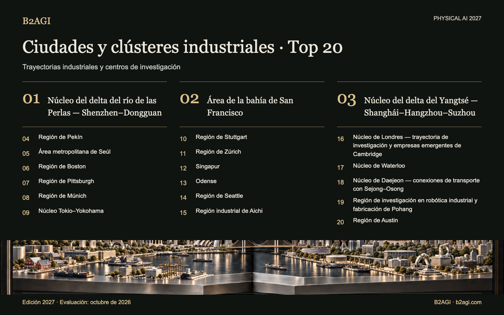

# B2AGI Physical AI · Clasificación de 20 ciudades y clústeres industriales · 2027

Examina 20 regiones que conectan investigación, fabricación y adopción por clientes. Sus límites y escalas difieren; cada perfil identifica los lugares concretos de actividad.

Edición 2027 · Evaluación de octubre de 2026 · Clasificación cualitativa.

Fundamentos y alcance de la evidencia: original en inglés.

### Perfiles para empezar

[Núcleo del delta del río de las Perlas — Shenzhen–Dongguan](clusters/pearl-river-delta-core-shenzhendongguan--cluster-01/README.md) · [Área de la bahía de San Francisco](clusters/san-francisco-bay-area--cluster-02/README.md) · [Núcleo del delta del Yangtsé — Shanghái–Hangzhou–Suzhou](clusters/yangtze-river-delta-core-shanghaihangzhousuzhou--cluster-03/README.md)

| Puesto | Nombre | Contribución / función |
| --- | --- | --- |
| 1 | [Núcleo del delta del río de las Perlas — Shenzhen–Dongguan](clusters/pearl-river-delta-core-shenzhendongguan--cluster-01/README.md) | Ingeniería robótica, incubación y acceso a fabricación |
| 2 | [Área de la bahía de San Francisco](clusters/san-francisco-bay-area--cluster-02/README.md) | Plataformas robóticas, investigación de aprendizaje e instalaciones compartidas |
| 3 | [Núcleo del delta del Yangtsé — Shanghái–Hangzhou–Suzhou](clusters/yangtze-river-delta-core-shanghaihangzhousuzhou--cluster-03/README.md) | Infraestructura de entrenamiento, productos robóticos e investigación de sistemas físicos |
| 4 | [Región de Pekín](clusters/beijing-region--cluster-04/README.md) | Aprendizaje robótico, pruebas de conducción y financiación de crecimiento |
| 5 | [Área metropolitana de Seúl](clusters/seoul-capital-area--cluster-05/README.md) | Reparto en edificios, desarrollo robótico y acceso a capital |
| 6 | [Región de Boston](clusters/boston-region--cluster-06/README.md) | Empresas emergentes de hardware y experimentación robótica compartida |
| 7 | [Región de Pittsburgh](clusters/pittsburgh-region--cluster-07/README.md) | Transferencia de investigación y demostraciones de fabricación |
| 8 | [Región de Múnich](clusters/munich-region--cluster-08/README.md) | Integración logística industrial y financiación de crecimiento |
| 9 | [Núcleo Tokio–Yokohama](clusters/tokyoyokohama-core--cluster-09/README.md) | Control e integración robótica y acceso a pruebas |
| 10 | [Región de Stuttgart](clusters/stuttgart-region--cluster-10/README.md) | Manipulación con IA e infraestructura de pruebas de automoción |
| 11 | [Región de Zúrich](clusters/zurich-region--cluster-11/README.md) | Control de inspección basado en aprendizaje y comercialización de investigación |
| 12 | [Singapur](clusters/singapore--cluster-12/README.md) | Integración robótica para infraestructura de clientes |
| 13 | [Odense](clusters/odense--cluster-13/README.md) | Desarrollo de robots móviles y colaborativos |
| 14 | [Región de Seattle](clusters/seattle-region--cluster-14/README.md) | Usuarios logísticos, ingeniería de drones y herramientas de datos robóticos |
| 15 | [Región industrial de Aichi](clusters/aichi-manufacturing-region--cluster-15/README.md) | Desarrollo de fabricación e instalaciones de pruebas robóticas |
| 16 | [Núcleo de Londres — trayectoria de investigación y empresas emergentes de Cambridge](clusters/london-core-cambridge-research-and-startup-lineage--cluster-16/README.md) | Modelos de acción, aprendizaje robótico y desarrollo de conducción |
| 17 | [Núcleo de Waterloo](clusters/waterloo-core--cluster-17/README.md) | AMR industriales, integración de automatización y servicios |
| 18 | [Núcleo de Daejeon — conexiones de transporte con Sejong–Osong](clusters/daejeon-core-sejongosong-transport-links--cluster-18/README.md) | Plataformas de investigación, transferencia tecnológica y laboratorios de demostración |
| 19 | [Región de investigación en robótica industrial y fabricación de Pohang](clusters/pohang-industrial-robotics-and-manufacturing-research-region--cluster-19/README.md) | Fabricación de robots y desarrollo para la industria siderúrgica |
| 20 | [Región de Austin](clusters/austin-region--cluster-20/README.md) | Desarrollo de humanoides, pruebas con clientes y capital de crecimiento |

Edición en inglés: [B2AGI Physical AI City & Cluster Ranking 20 · 2027](../../CLUSTERS.md)
