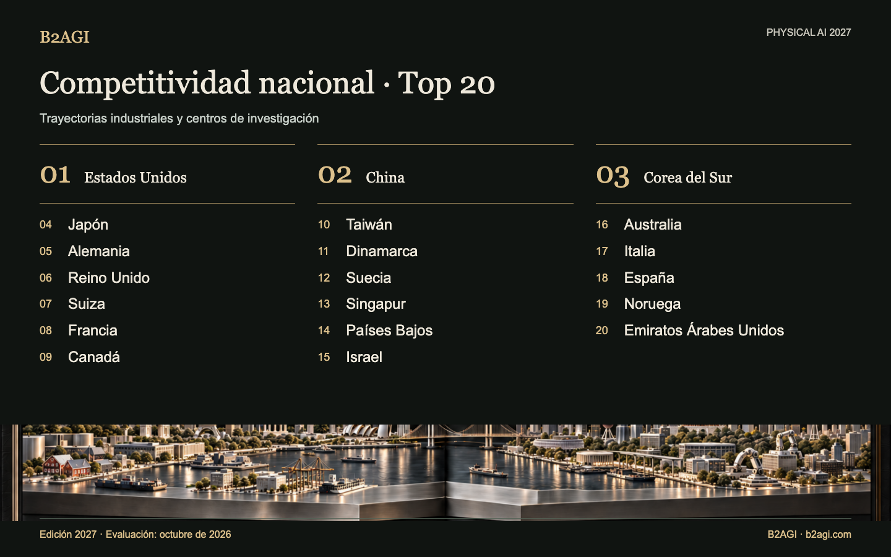

# B2AGI Physical AI · Clasificación de competitividad nacional: 20 países · 2027

Compara la investigación, el desarrollo de productos, las operaciones de clientes y la capacidad industrial futura de 20 países y economías. La clasificación procede de una evaluación cualitativa desde cinco perspectivas; no se calcula con una puntuación agregada.

Edición 2027 · Evaluación de octubre de 2026 · Clasificación cualitativa.

Fundamentos y alcance de la evidencia: original en inglés.

### Perfiles para empezar

[España](countries/spain--country-18/README.md) · [Estados Unidos](countries/united-states--country-01/README.md) · [China](countries/china--country-02/README.md)

| Puesto | País / economía | Contribución / función |
| --- | --- | --- |
| 1 | [Estados Unidos](countries/united-states--country-01/README.md) | Plataformas robóticas, adopción por clientes y capital de crecimiento |
| 2 | [China](countries/china--country-02/README.md) | Hardware robótico y redes de fabricación integradas |
| 3 | [Corea del Sur](countries/south-korea--country-03/README.md) | Coordinación robótica, control basado en aprendizaje y comercialización de investigación |
| 4 | [Japón](countries/japan--country-04/README.md) | Percepción y planificación de movimientos en procesos industriales |
| 5 | [Alemania](countries/germany--country-05/README.md) | Manipulación industrial, integración y pruebas |
| 6 | [Reino Unido](countries/united-kingdom--country-06/README.md) | Modelos robóticos en el dispositivo y aprendizaje de manipulación diestra |
| 7 | [Suiza](countries/switzerland--country-07/README.md) | Control basado en aprendizaje para la inspección industrial |
| 8 | [Francia](countries/france--country-08/README.md) | Herramientas abiertas de aprendizaje robótico y modelos de manipulación |
| 9 | [Canadá](countries/canada--country-09/README.md) | Aprendizaje de manipulación e integración de camiones autónomos |
| 10 | [Taiwán](countries/taiwan--country-10/README.md) | Fabricación de semiconductores, encapsulado e infraestructura robótica |
| 11 | [Dinamarca](countries/denmark--country-11/README.md) | Logística móvil y plataformas de robots colaborativos |
| 12 | [Suecia](countries/sweden--country-12/README.md) | Investigación robótica vinculada a la industria y formación doctoral |
| 13 | [Singapur](countries/singapore--country-13/README.md) | Integración local para inspeccionar túneles eléctricos |
| 14 | [Países Bajos](countries/netherlands--country-14/README.md) | Integración de almacenes y financiación de automatización |
| 15 | [Israel](countries/israel--country-15/README.md) | Desarrollo de manipulación y capacidad nacional de cómputo para IA |
| 16 | [Australia](countries/australia--country-16/README.md) | Minería autónoma y pruebas de construcción sobre el terreno |
| 17 | [Italia](countries/italy--country-17/README.md) | Integración industrial y validación de almacenes |
| 18 | [España](countries/spain--country-18/README.md) | Ingeniería robótica y desarrollo de inspección con IA |
| 19 | [Noruega](countries/norway--country-19/README.md) | Ingeniería de humanoides y desarrollo de fabricación |
| 20 | [Emiratos Árabes Unidos](countries/united-arab-emirates--country-20/README.md) | Adopción y operación de servicios autónomos de pasajeros |

Edición en inglés: [B2AGI Physical AI Country Ranking 20 · 2027](../../README.md#country-overview)
