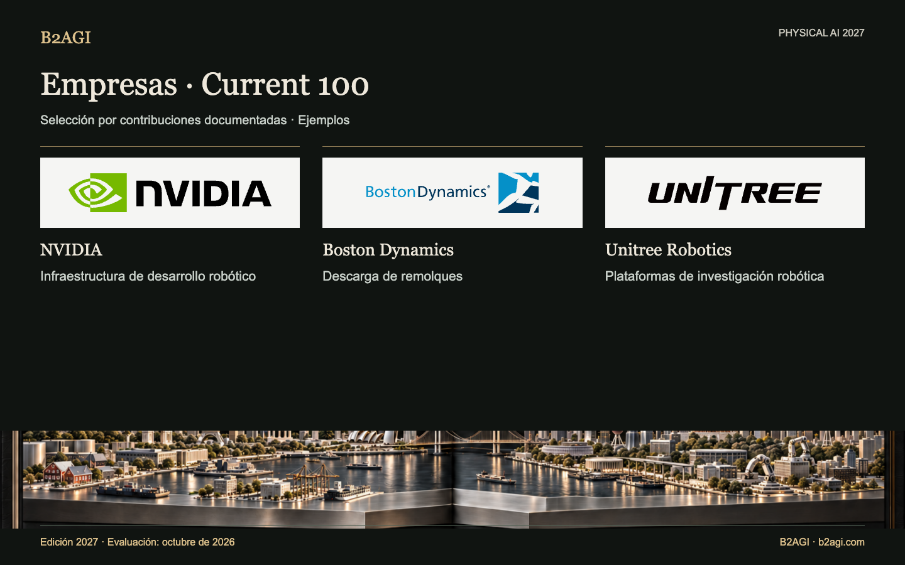

# B2AGI Physical AI · Empresas: Current 100 · 2027

Reúne tecnologías y productos adoptados en producción, operaciones, educación o investigación, además de transferencias tecnológicas y contribuciones de capital ya realizadas. Cada perfil identifica una tarea del cliente o un papel de suministro.

Edición 2027 · Evaluación de octubre de 2026 · Selección por contribución. Los ID no indican posiciones.

Fundamentos y alcance de la evidencia: original en inglés.

### Perfiles para empezar

[NVIDIA](companies/nvidia--c067/README.md) · [Boston Dynamics](companies/boston-dynamics--c016/README.md) · [Unitree Robotics](companies/unitree-robotics--c095/README.md)

| ID | Nombre | Contribución / función |
| --- | --- | --- |
| C001 | [42dot](companies/42dot--c001/README.md) | Solicitudes y reservas de viajes |
| C002 | [AgiBot](companies/agibot--c002/README.md) | Despliegue de robots en líneas de producción |
| C003 | [Agile Robots](companies/agile-robots--c003/README.md) | Integración de automatización logística |
| C004 | [Agility Robotics](companies/agility-robotics--c004/README.md) | Traslado de contenedores logísticos |
| N099 | [AIDIN Robotics](companies/aidin-robotics--n099/README.md) | Componentes de detección de fuerza |
| C005 | [Amazon](companies/amazon--c005/README.md) | Adopción en preparación de pedidos |
| C006 | [Ambi Robotics](companies/ambi-robotics--c006/README.md) | Clasificación logística |
| C007 | [AMP Robotics / AMP](companies/amp-robotics-amp--c007/README.md) | Clasificación de materiales |
| C008 | [ANYbotics](companies/anybotics--c008/README.md) | Inspección industrial |
| C009 | [Applied Intuition](companies/applied-intuition--c009/README.md) | Simulación y pruebas de vehículos |
| C010 | [Autonomous a2z](companies/autonomous-a2z--c010/README.md) | Servicio de transporte de pasajeros supervisado |
| C011 | [Baidu](companies/baidu--c011/README.md) | Servicio de pasajeros sin conductor |
| C012 | [Bedrock Robotics](companies/bedrock-robotics--c012/README.md) | Excavación autónoma |
| C013 | [Berkshire Grey](companies/berkshire-grey--c013/README.md) | Clasificación de paquetes |
| C101 | [BlackRock](companies/blackrock--c101/README.md) | Fondos de inversión en robótica |
| C015 | [Booster Robotics](companies/booster-robotics--c015/README.md) | Robots para investigación y competiciones |
| C016 | [Boston Dynamics](companies/boston-dynamics--c016/README.md) | Descarga de remolques |
| C017 | [Brain Corp](companies/brain-corp--c017/README.md) | Limpieza autónoma |
| C018 | [Built Robotics](companies/built-robotics--c018/README.md) | Construcción autónoma de instalaciones solares |
| C019 | [Burro](companies/burro--c019/README.md) | Transporte agrícola |
| C020 | [Carbon Robotics](companies/carbon-robotics--c020/README.md) | Desherbado con láser |
| C021 | [CATL](companies/catl--c021/README.md) | Adopción en fabricación y baterías |
| C022 | [Cognex](companies/cognex--c022/README.md) | Visión para inspección industrial |
| C023 | [Corvus Robotics](companies/corvus-robotics--c023/README.md) | Drones de inventario |
| C024 | [Coupang](companies/coupang--c024/README.md) | Operaciones de preparación de pedidos |
| C025 | [Covariant](companies/covariant--c025/README.md) | Recogida de objetos mediante aprendizaje |
| C026 | [DeepRobotics](companies/deeprobotics--c026/README.md) | Hardware para inspección de túneles |
| C029 | [Dexterity](companies/dexterity--c029/README.md) | Carga de remolques |
| C030 | [Diligent Robotics](companies/diligent-robotics--c030/README.md) | Reparto hospitalario |
| C104 | [DJI](companies/dji--c104/README.md) | Suministro de equipos aéreos de inspección de infraestructura |
| C105 | [Doosan Robotics](companies/doosan-robotics--c105/README.md) | Suministro de una plataforma de investigación en manipulación |
| C032 | [Dreame Technology](companies/dreame-technology--c032/README.md) | Percepción para limpieza doméstica |
| C033 | [Dyna Robotics](companies/dyna-robotics--c033/README.md) | Plegado de prendas |
| C034 | [Ecovacs](companies/ecovacs--c034/README.md) | Limpieza doméstica |
| N017 | [Elephant Robotics](companies/elephant-robotics--n017/README.md) | Kits de robots educativos |
| N020 | [Farm-ng](companies/farm-ng--n020/README.md) | Plataformas de desarrollo agrícola |
| C035 | [Field AI](companies/field-ai--c035/README.md) | Autonomía para inspección de obras |
| C036 | [Figure AI](companies/figure-ai--c036/README.md) | Prueba piloto de humanoides en fábrica |
| C037 | [Flexiv](companies/flexiv--c037/README.md) | Procesamiento de alimentos con control de fuerza |
| C038 | [Formic](companies/formic--c038/README.md) | Servicios de embalaje y paletizado |
| C039 | [ForwardX Robotics](companies/forwardx-robotics--c039/README.md) | Asistencia en recogida de pedidos en almacenes |
| C040 | [Foxglove](companies/foxglove--c040/README.md) | Análisis de registros robóticos |
| C041 | [Galbot](companies/galbot--c041/README.md) | Suministro de robots para líneas de producción |
| C043 | [Gaussian Robotics / Gausium](companies/gaussian-robotics-gausium--c043/README.md) | Limpieza de establecimientos |
| C045 | [Geek+](companies/geek--c045/README.md) | Transporte en almacenes |
| C046 | [GelSight](companies/gelsight--c046/README.md) | Instrumentación de investigación táctil |
| C047 | [GXO](companies/gxo--c047/README.md) | Integración logística para clientes |
| C048 | [HAI Robotics](companies/hai-robotics--c048/README.md) | Sistemas robóticos de almacén |
| N030 | [HaptX](companies/haptx--n030/README.md) | Teleoperación táctil |
| C049 | [Hesai](companies/hesai--c049/README.md) | Componentes LiDAR |
| C050 | [Horizon Robotics](companies/horizon-robotics--c050/README.md) | Computación para asistencia a la conducción |
| C051 | [Hyundai Motor Group](companies/hyundai-motor-group--c051/README.md) | Participación estratégica en empresas robóticas |
| C052 | [InOrbit](companies/inorbit--c052/README.md) | Herramientas de operación robótica |
| C053 | [Intuitive Surgical](companies/intuitive-surgical--c053/README.md) | Asistencia robótica en broncoscopia |
| N037 | [JLG — Canvas Robotics](companies/jlg-canvas-robotics--n037/README.md) | Transferencia tecnológica de robótica de construcción |
| C054 | [John Deere](companies/john-deere--c054/README.md) | Pulverización selectiva |
| C055 | [Keenon Robotics](companies/keenon-robotics--c055/README.md) | Robots de servicio para restaurantes y hoteles |
| C057 | [Kodiak Robotics / Kodiak AI](companies/kodiak-robotics-kodiak-ai--c057/README.md) | Transporte fuera de carretera |
| C058 | [Locus Robotics](companies/locus-robotics--c058/README.md) | Asistencia en recogida de pedidos |
| C061 | [Meituan](companies/meituan--c061/README.md) | Operaciones de reparto autónomo |
| C062 | [Mobile Industrial Robots / MiR](companies/mobile-industrial-robots-mir--c062/README.md) | Transporte de contenedores con AMR |
| C063 | [Momenta](companies/momenta--c063/README.md) | Inteligencia de conducción para vehículos de producción |
| C064 | [Mytra](companies/mytra--c064/README.md) | Almacenamiento intermedio y secuenciación de inventario |
| C065 | [NAVER / NAVER LABS](companies/naver-naver-labs--c065/README.md) | Operación robótica integrada en edificios |
| C066 | [Nearthlab](companies/nearthlab--c066/README.md) | Inspección de aerogeneradores |
| N053 | [Nimble Robotics](companies/nimble-robotics--n053/README.md) | Suministro de soluciones robóticas de preparación de pedidos |
| C067 | [NVIDIA](companies/nvidia--c067/README.md) | Infraestructura de desarrollo robótico |
| C068 | [Orbbec](companies/orbbec--c068/README.md) | Detección de profundidad |
| C069 | [OrionStar](companies/orionstar--c069/README.md) | Transporte entre procesos de fábrica |
| C070 | [OSARO](companies/osaro--c070/README.md) | Embalaje mediante aprendizaje |
| C071 | [Parallel Domain](companies/parallel-domain--c071/README.md) | Datos sintéticos de percepción |
| C072 | [Path Robotics](companies/path-robotics--c072/README.md) | Soldadura robótica |
| C073 | [Pickle Robot](companies/pickle-robot--c073/README.md) | Descarga de remolques |
| C074 | [Plus One Robotics](companies/plus-one-robotics--c074/README.md) | Visión para paquetes y gestión de excepciones |
| C075 | [Pudu Robotics](companies/pudu-robotics--c075/README.md) | Limpieza de oficinas |
| C076 | [Quicktron](companies/quicktron--c076/README.md) | Transporte de estanterías de almacén |
| C078 | [RightHand Robotics](companies/righthand-robotics--c078/README.md) | Recogida de pedidos en almacenes |
| C079 | [Roborock](companies/roborock--c079/README.md) | Recogida de objetos y limpieza |
| C080 | [ROBOTIS](companies/robotis--c080/README.md) | Actuadores y plataformas de investigación |
| C081 | [Roboto AI](companies/roboto-ai--c081/README.md) | Análisis de operaciones robóticas |
| C082 | [Robust.AI](companies/robust-ai--c082/README.md) | Transporte colaborativo de contenedores logísticos |
| C083 | [Rockwell Automation](companies/rockwell-automation--c083/README.md) | Integración de MES y AMR |
| C084 | [Saildrone](companies/saildrone--c084/README.md) | Observación oceánica |
| C085 | [Samsung Electronics](companies/samsung-electronics--c085/README.md) | Participación estratégica en empresas robóticas |
| C086 | [Sarcos → Palladyne AI](companies/sarcos-palladyne-ai--c086/README.md) | Software de automatización de mantenimiento |
| C087 | [Seoul Robotics](companies/seoul-robotics--c087/README.md) | Percepción de vehículos en fábrica |
| N072 | [Shadow Robot](companies/shadow-robot--n072/README.md) | Suministro de manos diestras para investigación |
| C090 | [SoftBank](companies/softbank--c090/README.md) | Participaciones en automatización de almacenes y vehículo de inversión |
| C091 | [Standard Robots](companies/standard-robots--c091/README.md) | Transporte de palés con AMR |
| C092 | [Superbin](companies/superbin--c092/README.md) | Recogida de reciclaje con IA |
| C093 | [Symbotic](companies/symbotic--c093/README.md) | Sistemas de automatización logística |
| C094 | [Syrius Robotics / Syrius Technology](companies/syrius-robotics-syrius-technology--c094/README.md) | AMR de asistencia en recogida de pedidos |
| C103 | [UBTECH](companies/ubtech--c103/README.md) | Suministro de humanoides industriales y tareas de fábrica |
| C095 | [Unitree Robotics](companies/unitree-robotics--c095/README.md) | Plataformas de investigación robótica |
| C096 | [Universal Robots](companies/universal-robots--c096/README.md) | Hardware para cosecha en invernaderos |
| C097 | [Viam](companies/viam--c097/README.md) | Software de operación de flotas robóticas |
| C098 | [VisionNav Robotics](companies/visionnav-robotics--c098/README.md) | Logística con carretillas elevadoras autónomas |
| C102 | [Waymo](companies/waymo--c102/README.md) | Operación de servicios de pasajeros sin conductor |
| C099 | [XYZ Robotics](companies/xyz-robotics--c099/README.md) | Suministro de equipos de descarga de almacenes |
| C100 | [Zipline](companies/zipline--c100/README.md) | Reparto aéreo autónomo |

Edición en inglés: [B2AGI Physical AI Companies · Current 100 · 2027](../../CURRENT_100.md)
