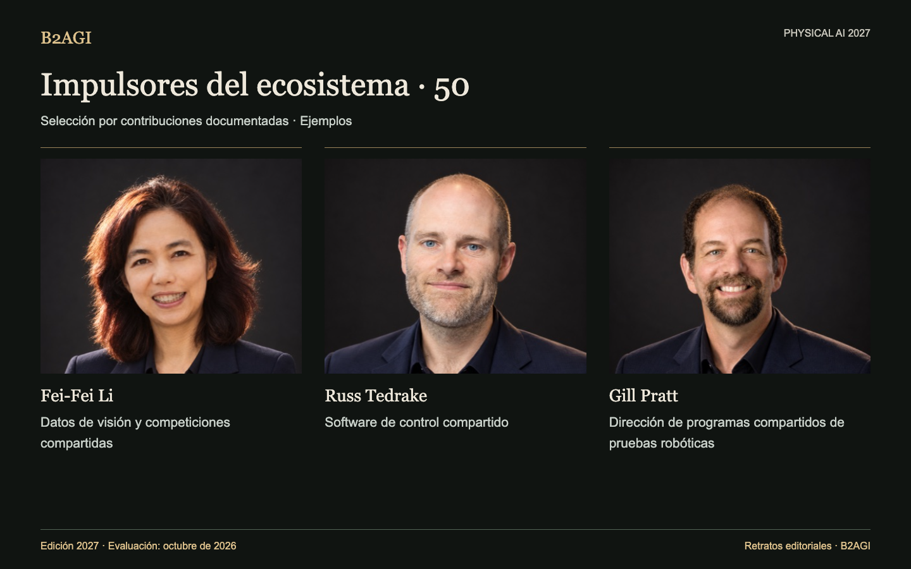

# B2AGI Physical AI · Impulsores del ecosistema: 50 · 2027

Documenta a quienes proporcionan herramientas, instalaciones, educación, normas y apoyo financiero para otros investigadores y empresas. Cada perfil identifica su contribución concreta.

Edición 2027 · Evaluación de octubre de 2026 · Selección por contribución. Los ID no indican posiciones.

Fundamentos y alcance de la evidencia: original en inglés.

### Perfiles para empezar

[Fei-Fei Li](people/fei-fei-li--e013/README.md) · [Russ Tedrake](people/russ-tedrake--e022/README.md) · [Gill Pratt](people/gill-pratt--p010/README.md)

| ID | Nombre | Contribución / función |
| --- | --- | --- |
| E001 | [Aaron Ames](people/aaron-ames--e001/README.md) | Herramientas compartidas de planificación de marcha |
| E002 | [Aaron Prather](people/aaron-prather--e002/README.md) | Talleres de pruebas industriales |
| E003 | [Andra Keay](people/andra-keay--e003/README.md) | Apoyo a la comunidad robótica |
| E004 | [Ayanna Howard](people/ayanna-howard--e004/README.md) | Transferencia de tecnología STEM accesible |
| E005 | [Brian Gerkey](people/brian-gerkey--e005/README.md) | Arquitectura robótica abierta |
| E052 | [Bruce Leak](people/bruce-leak--e052/README.md) | Apoyo a fundadores y consejos de administración |
| E047 | [Cho Kyu-nam](people/cho-kyu-nam--e047/README.md) | Debate público del sector |
| E007 | [Christian Hubicki](people/christian-hubicki--e007/README.md) | Educación en control y simulación |
| E008 | [Craig Schlenoff](people/craig-schlenoff--e008/README.md) | Evaluación robótica compartida |
| E053 | [Cyril Ebersweiler](people/cyril-ebersweiler--e053/README.md) | Apoyo a empresas emergentes de hardware |
| P006 | [Daniela Rus](people/daniela-rus--p006/README.md) | Mentoría doctoral en robótica |
| E009 | [Dennis Hong](people/dennis-hong--e009/README.md) | Plataformas de investigación y educación |
| E010 | [Elena Messina](people/elena-messina--e010/README.md) | Normas y pruebas conjuntas |
| E011 | [Elham Tabassi](people/elham-tabassi--e011/README.md) | Marco de gestión de riesgos de IA |
| E012 | [Erico Guizzo](people/erico-guizzo--e012/README.md) | Recursos editoriales de robótica |
| E013 | [Fei-Fei Li](people/fei-fei-li--e013/README.md) | Datos de visión y competiciones compartidas |
| E014 | [Francesca Rossi](people/francesca-rossi--e014/README.md) | Ética del diseño de sistemas autónomos |
| P009 | [Geordie Rose](people/geordie-rose--p009/README.md) | Inversión y apoyo de socios robóticos |
| P010 | [Gill Pratt](people/gill-pratt--p010/README.md) | Dirección de programas compartidos de pruebas robóticas |
| E050 | [Han Jae-kwon](people/han-jae-kwon--e050/README.md) | Educación robótica para el público |
| E044 | [He Wang](people/he-wang--e044/README.md) | Pruebas de referencia y herramientas compartidas de agarre diestro |
| E015 | [Henrik Christensen](people/henrik-christensen--e015/README.md) | Hojas de ruta robóticas compartidas |
| P036 | [Jiyang Gao](people/jiyang-gao--p036/README.md) | Coordinación de programas de conjuntos de datos y modelos |
| E036 | [Jung Kim](people/jung-kim--e036/README.md) | Programas de desarrollo de empresas emergentes |
| P015 | [Karol Hausman](people/karol-hausman--p015/README.md) | Infraestructura de aprendizaje robótico |
| E016 | [Li Zexiang](people/li-zexiang--e016/README.md) | Educación emprendedora y apoyo a fabricación |
| E037 | [Liang Jing](people/liang-jing--e037/README.md) | Operación de grupos de trabajo de normalización |
| E051 | [Lior Susan](people/lior-susan--e051/README.md) | Organización de empresas emergentes industriales |
| E030 | [Liu Lianqing](people/liu-lianqing--e030/README.md) | Dirección doctoral en robótica |
| E017 | [Matt Beane](people/matt-beane--e017/README.md) | Investigación de transformación del trabajo y las competencias |
| E018 | [Matthew Johnson-Roberson](people/matthew-johnson-roberson--e018/README.md) | Dirección doctoral en robótica |
| E055 | [Mayank Mittal](people/mayank-mittal--e055/README.md) | Infraestructura pública de aprendizaje robótico |
| E056 | [Morgan Quigley](people/morgan-quigley--e056/README.md) | Arquitectura de ROS |
| E020 | [Pieter Abbeel](people/pieter-abbeel--e020/README.md) | Educación en control robótico |
| E049 | [Qin Xiugong](people/qin-xiugong--e049/README.md) | Terminología compartida de normas |
| E048 | [Qu Daokui](people/qu-daokui--e048/README.md) | Comercialización de investigación |
| E022 | [Russ Tedrake](people/russ-tedrake--e022/README.md) | Software de control compartido |
| E023 | [Ryan Gariepy](people/ryan-gariepy--e023/README.md) | Intercambio y educación de desarrolladores |
| E024 | [Rémi Cadène / Remi Cadene](people/remi-cadene-remi-cadene--e024/README.md) | Herramientas abiertas de aprendizaje robótico |
| E039 | [Shi Lin](people/shi-lin--e039/README.md) | Autoría conjunta de normas de evaluación |
| E025 | [Sun Lining](people/sun-lining--e025/README.md) | Programas regionales de investigación y formación de talento |
| E026 | [Tom Ryden](people/tom-ryden--e026/README.md) | Operación de instalaciones compartidas |
| E027 | [Tully Foote](people/tully-foote--e027/README.md) | Convenciones de unidades y coordenadas de ROS |
| E028 | [Vincent Vanhoucke](people/vincent-vanhoucke--e028/README.md) | Formación de equipos de investigación |
| E043 | [Wang Tianmiao](people/wang-tianmiao--e043/README.md) | Apoyo a talento y empresas emergentes |
| E045 | [Wei Kai](people/wei-kai--e045/README.md) | Autoría conjunta de normas de evaluación |
| E054 | [Wendy Tan White](people/wendy-tan-white--e054/README.md) | Organización de desarrollo compartida |
| E032 | [Xiong Rong](people/xiong-rong--e032/README.md) | Plataformas de investigación para estudiantes |
| E041 | [Yuh Joon-ku](people/yuh-joon-ku--e041/README.md) | Edición de la agenda de investigación |
| E029 | [Zhang Jianwei](people/zhang-jianwei--e029/README.md) | Coordinación de investigación entre instituciones |

Edición en inglés: [B2AGI Physical AI People · Ecosystem Builders 50 · 2027](../../ECOSYSTEM_BUILDERS_50.md)

<!-- B2AGI EPAI SIGNATURE -->
---

**B2AGI | EPAI**  
Embodied Physical Agentic Intelligence  
[Research & Publications](https://b2agi.com/) · [White Paper](https://github.com/b2agi/physical-ai-white-paper-2027) · [Industry Atlas](https://github.com/b2agi/physical-ai-ranking-2027)
<!-- /B2AGI EPAI SIGNATURE -->
