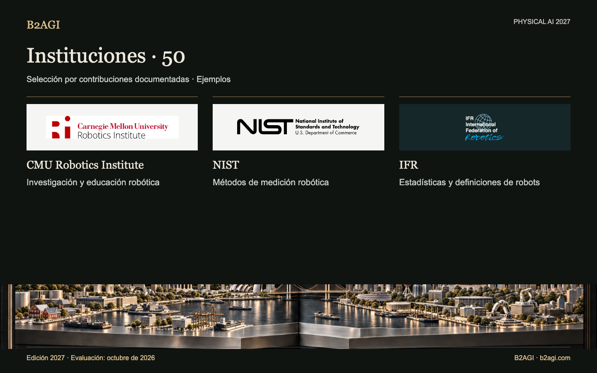

# B2AGI Physical AI · Instituciones: 50 · 2027

Reúne instituciones y programas que apoyan la investigación, las pruebas, la normalización, la regulación, el desarrollo industrial y el acceso a mercados de capitales. Distingue autoría técnica, financiación, certificación y apoyo operativo.

Edición 2027 · Evaluación de octubre de 2026 · Selección por contribución. Los ID no indican posiciones.

Fundamentos y alcance de la evidencia: original en inglés.

### Perfiles para empezar

[NIST](institutions/nist--i033/README.md) · [KAIST](institutions/kaist--i018/README.md) · [MassRobotics](institutions/massrobotics--i027/README.md)

| ID | Nombre | Contribución / función |
| --- | --- | --- |
| I001 | [ARM Institute](institutions/arm-institute--i001/README.md) | Apoyo a la adopción en fabricación |
| I003 | [ASTM F45](institutions/astm-f45--i003/README.md) | Normas de rendimiento de robots móviles |
| I047 | [Beijing Humanoid Robot Innovation Center](institutions/beijing-humanoid-robot-innovation-center--i047/README.md) | Datos compartidos de entrenamiento robótico |
| I004 | [BIGAI](institutions/bigai--i004/README.md) | Herramientas compartidas de investigación robótica |
| I005 | [CESI](institutions/cesi--i005/README.md) | Coautoría de directrices de calidad de datos para IA corporizada |
| I006 | [CMU Robotics Institute](institutions/cmu-robotics-institute--i006/README.md) | Investigación y educación robótica |
| I007 | [DARPA SubT](institutions/darpa-subt--i007/README.md) | Entornos físicos compartidos de pruebas |
| I008 | [DFKI Robotics Innovation Center](institutions/dfki-robotics-innovation-center--i008/README.md) | Investigación robótica industrial |
| I009 | [ETRI](institutions/etri--i009/README.md) | Transferencia tecnológica de robótica |
| I010 | [euRobotics](institutions/eurobotics--i010/README.md) | Ecosistema de investigación robótica |
| I011 | [FAA](institutions/faa--i011/README.md) | Autorización de reparto de paquetes más allá de la línea de visión |
| I012 | [Harvard Wyss Institute](institutions/harvard-wyss-institute--i012/README.md) | Investigación y licencias de robots asistenciales |
| I013 | [HIT Robotics Technology and Systems Research Unit](institutions/hit-robotics-technology-and-systems-research-unit--i013/README.md) | Infraestructura de investigación de robótica física |
| I014 | [HKEX / HKSCC](institutions/hkex-hkscc--i014/README.md) | Acceso a cotización y compensación |
| I015 | [IEC Robotics Product Safety Standards](institutions/iec-robotics-product-safety-standards--i015/README.md) | Normas de seguridad de productos robóticos |
| I016 | [IFR](institutions/ifr--i016/README.md) | Estadísticas y definiciones de robots |
| I017 | [ISO/TC 299](institutions/iso-tc-299--i017/README.md) | Desarrollo de normas robóticas |
| I018 | [KAIST](institutions/kaist--i018/README.md) | Plataformas compartidas de investigación de humanoides |
| I020 | [KEIT](institutions/keit--i020/README.md) | Financiación de investigación robótica |
| I022 | [KIAT](institutions/kiat--i022/README.md) | Financiación de I+D robótica |
| I023 | [KIRIA](institutions/kiria--i023/README.md) | Pruebas y certificación de robots |
| I024 | [KITECH](institutions/kitech--i024/README.md) | Investigación de gemelos digitales robóticos |
| I050 | [KRX](institutions/krx--i050/README.md) | Acceso a cotización e información pública de empresas robóticas |
| I025 | [KTL](institutions/ktl--i025/README.md) | Pruebas de robots vestibles |
| I026 | [LeRobot / Hugging Face](institutions/lerobot-hugging-face--i026/README.md) | Infraestructura compartida de aprendizaje robótico |
| I027 | [MassRobotics](institutions/massrobotics--i027/README.md) | Instalaciones de desarrollo compartidas |
| I028 | [MIIT](institutions/miit--i028/README.md) | Política de aplicaciones robóticas |
| I029 | [MIT CSAIL](institutions/mit-csail--i029/README.md) | Investigación de interacción entre personas y robots |
| I030 | [NASA Jet Propulsion Laboratory](institutions/nasa-jet-propulsion-laboratory--i030/README.md) | Operación robótica de exploración planetaria |
| I031 | [Nasdaq](institutions/nasdaq--i031/README.md) | Acceso al mercado bursátil para empresas robóticas |
| I048 | [National Robot Testing and Evaluation Center, Shanghai Headquarters](institutions/national-robot-testing-and-evaluation-center-shanghai-headquarters--i048/README.md) | Certificación de robots en Shanghái |
| I053 | [New York Stock Exchange / NYSE](institutions/new-york-stock-exchange-nyse--i053/README.md) | Acceso histórico de emisores a negociación bursátil |
| I032 | [NHTSA](institutions/nhtsa--i032/README.md) | Informes de llamadas a revisión de sistemas de conducción automatizada |
| I054 | [NIOSH / Center for Occupational Robotics Research](institutions/niosh-center-for-occupational-robotics-research--i054/README.md) | Investigación y orientación sobre riesgos de robótica laboral |
| I033 | [NIST](institutions/nist--i033/README.md) | Métodos de medición robótica |
| I034 | [Open Robotics / OSRF](institutions/open-robotics-osrf--i034/README.md) | Infraestructura abierta de software robótico |
| I035 | [Open X-Embodiment consortium](institutions/open-x-embodiment-consortium--i035/README.md) | Datos y modelos compartidos de aprendizaje |
| I036 | [OSHA Robotics Safety Guidance](institutions/osha-robotics-safety-guidance--i036/README.md) | Orientación sobre seguridad robótica en el trabajo |
| I037 | [POSTECH](institutions/postech--i037/README.md) | Investigación y evaluación conjunta de robots hospitalarios |
| I038 | [RAI Institute](institutions/rai-institute--i038/README.md) | Herramientas públicas de aprendizaje robótico |
| I039 | [SAC](institutions/sac--i039/README.md) | Administración de normas nacionales |
| I040 | [SEC](institutions/sec--i040/README.md) | Revisión de información pública de emisores |
| I041 | [Shanghai AI Lab](institutions/shanghai-ai-lab--i041/README.md) | Investigación compartida de simulación |
| I051 | [Shanghai Stock Exchange](institutions/shanghai-stock-exchange--i051/README.md) | Acceso al mercado para emisores industriales |
| I052 | [Shenzhen Stock Exchange](institutions/shenzhen-stock-exchange--i052/README.md) | Acceso al mercado para emisores industriales |
| I046 | [SIA](institutions/sia--i046/README.md) | Transferencia tecnológica industrial |
| I042 | [Toyota Research Institute](institutions/toyota-research-institute--i042/README.md) | Investigación de aprendizaje y control robótico |
| I043 | [UC Berkeley BAIR: RAIL BridgeData](institutions/uc-berkeley-bair-rail-bridgedata--i043/README.md) | Herramientas compartidas de datos y entrenamiento robótico |
| I044 | [XbotPark](institutions/xbotpark--i044/README.md) | Apoyo a fabricación de empresas emergentes |
| I045 | [Zhejiang University Robotics Research](institutions/zhejiang-university-robotics-research--i045/README.md) | Educación robótica |

Edición en inglés: [B2AGI Physical AI Institutions 50 · 2027](../../INSTITUTIONS_50.md)
