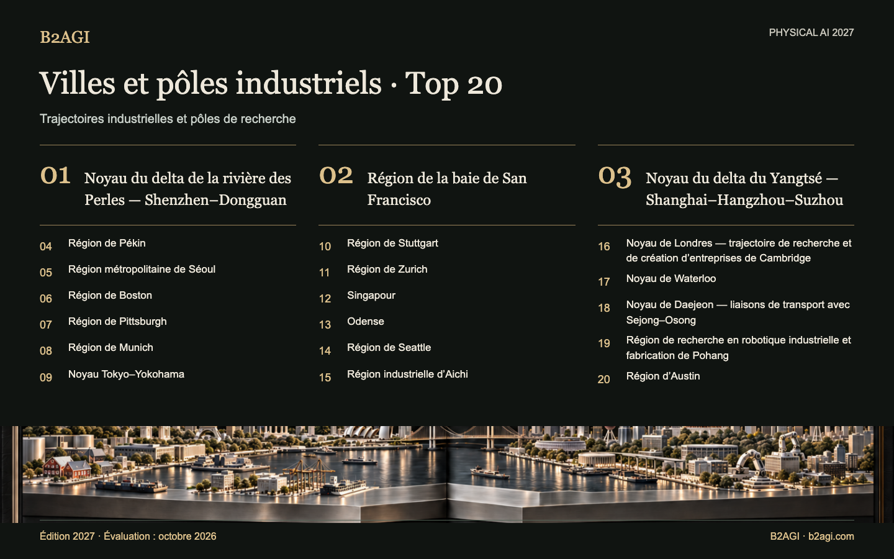

# B2AGI Physical AI · Classement de 20 villes et pôles industriels · 2027

Illustration conceptuelle.

Présente 20 régions reliant recherche, fabrication et adoption par les clients. Leurs limites et leurs échelles diffèrent ; chaque profil précise les lieux d’activité.

Édition 2027 · Évaluation d’octobre 2026 · Classement qualitatif.

Motifs et portée des éléments probants : original anglais.

### Profils pour commencer

[Noyau du delta de la rivière des Perles — Shenzhen–Dongguan](clusters/pearl-river-delta-core-shenzhendongguan--cluster-01/README.md) · [Région de la baie de San Francisco](clusters/san-francisco-bay-area--cluster-02/README.md) · [Noyau du delta du Yangtsé — Shanghai–Hangzhou–Suzhou](clusters/yangtze-river-delta-core-shanghaihangzhousuzhou--cluster-03/README.md)

| Rang | Nom | Contribution / rôle |
| --- | --- | --- |
| 1 | [Noyau du delta de la rivière des Perles — Shenzhen–Dongguan](clusters/pearl-river-delta-core-shenzhendongguan--cluster-01/README.md) | Ingénierie robotique, incubation et accès à la fabrication |
| 2 | [Région de la baie de San Francisco](clusters/san-francisco-bay-area--cluster-02/README.md) | Plateformes robotiques, recherche sur l’apprentissage et installations partagées |
| 3 | [Noyau du delta du Yangtsé — Shanghai–Hangzhou–Suzhou](clusters/yangtze-river-delta-core-shanghaihangzhousuzhou--cluster-03/README.md) | Infrastructure d’entraînement, produits robotiques et recherche sur les systèmes physiques |
| 4 | [Région de Pékin](clusters/beijing-region--cluster-04/README.md) | Apprentissage robotique, essais de conduite et financement de croissance |
| 5 | [Région métropolitaine de Séoul](clusters/seoul-capital-area--cluster-05/README.md) | Livraisons dans les bâtiments, développement robotique et accès au capital |
| 6 | [Région de Boston](clusters/boston-region--cluster-06/README.md) | Jeunes entreprises de matériel et expérimentation robotique partagée |
| 7 | [Région de Pittsburgh](clusters/pittsburgh-region--cluster-07/README.md) | Transfert de recherche et démonstrations de fabrication |
| 8 | [Région de Munich](clusters/munich-region--cluster-08/README.md) | Intégration logistique industrielle et financement de croissance |
| 9 | [Noyau Tokyo–Yokohama](clusters/tokyoyokohama-core--cluster-09/README.md) | Commande et intégration robotiques, accès aux essais |
| 10 | [Région de Stuttgart](clusters/stuttgart-region--cluster-10/README.md) | Manipulation par IA et infrastructure d’essais automobiles |
| 11 | [Région de Zurich](clusters/zurich-region--cluster-11/README.md) | Commande apprise pour l’inspection et valorisation de la recherche |
| 12 | [Singapour](clusters/singapore--cluster-12/README.md) | Intégration robotique pour les infrastructures des clients |
| 13 | [Odense](clusters/odense--cluster-13/README.md) | Développement de robots mobiles et collaboratifs |
| 14 | [Région de Seattle](clusters/seattle-region--cluster-14/README.md) | Utilisateurs logistiques, ingénierie de drones et outils de données robotiques |
| 15 | [Région industrielle d’Aichi](clusters/aichi-manufacturing-region--cluster-15/README.md) | Développement de la fabrication et installations d’essais robotiques |
| 16 | [Noyau de Londres — trajectoire de recherche et de création d’entreprises de Cambridge](clusters/london-core-cambridge-research-and-startup-lineage--cluster-16/README.md) | Modèles d’action, apprentissage robotique et développement de la conduite |
| 17 | [Noyau de Waterloo](clusters/waterloo-core--cluster-17/README.md) | Robots mobiles autonomes industriels, intégration de l’automatisation et services |
| 18 | [Noyau de Daejeon — liaisons de transport avec Sejong–Osong](clusters/daejeon-core-sejongosong-transport-links--cluster-18/README.md) | Plateformes de recherche, transfert technologique et laboratoires de démonstration |
| 19 | [Région de recherche en robotique industrielle et fabrication de Pohang](clusters/pohang-industrial-robotics-and-manufacturing-research-region--cluster-19/README.md) | Fabrication de robots et développement pour la sidérurgie |
| 20 | [Région d’Austin](clusters/austin-region--cluster-20/README.md) | Développement d’humanoïdes, essais chez les clients et capital de croissance |

Version anglaise : [B2AGI Physical AI City & Cluster Ranking 20 · 2027](../../CLUSTERS.md)
