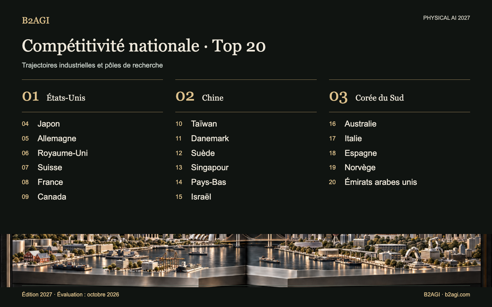

# B2AGI Physical AI · Classement de compétitivité nationale : 20 pays · 2027

Illustration conceptuelle.

Compare la recherche, le développement de produits, les activités des clients et les capacités industrielles futures de 20 pays et économies. Le classement repose sur cinq perspectives qualitatives, sans calcul de score agrégé.

Édition 2027 · Évaluation d’octobre 2026 · Classement qualitatif.

Motifs et portée des éléments probants : original anglais.

### Profils pour commencer

[France](countries/france--country-08/README.md) · [États-Unis](countries/united-states--country-01/README.md) · [Chine](countries/china--country-02/README.md)

| Rang | Pays / économie | Contribution / rôle |
| --- | --- | --- |
| 1 | [États-Unis](countries/united-states--country-01/README.md) | Plateformes robotiques, déploiement chez les clients et capital de croissance |
| 2 | [Chine](countries/china--country-02/README.md) | Matériel robotique et réseaux de fabrication intégrés |
| 3 | [Corée du Sud](countries/south-korea--country-03/README.md) | Coordination robotique, commande fondée sur l’apprentissage et valorisation de la recherche |
| 4 | [Japon](countries/japan--country-04/README.md) | Perception et planification des mouvements dans les procédés industriels |
| 5 | [Allemagne](countries/germany--country-05/README.md) | Manipulation industrielle, intégration et essais |
| 6 | [Royaume-Uni](countries/united-kingdom--country-06/README.md) | Modèles robotiques embarqués et apprentissage de la manipulation dextre |
| 7 | [Suisse](countries/switzerland--country-07/README.md) | Commande apprise pour l’inspection industrielle |
| 8 | [France](countries/france--country-08/README.md) | Outils ouverts d’apprentissage robotique et modèles de manipulation |
| 9 | [Canada](countries/canada--country-09/README.md) | Apprentissage de la manipulation et intégration de camions autonomes |
| 10 | [Taïwan](countries/taiwan--country-10/README.md) | Fabrication de semi-conducteurs, encapsulation et infrastructure robotique |
| 11 | [Danemark](countries/denmark--country-11/README.md) | Logistique mobile et plateformes de robots collaboratifs |
| 12 | [Suède](countries/sweden--country-12/README.md) | Recherche robotique liée à l’industrie et formation doctorale |
| 13 | [Singapour](countries/singapore--country-13/README.md) | Intégration locale pour l’inspection de tunnels électriques |
| 14 | [Pays-Bas](countries/netherlands--country-14/README.md) | Intégration d’entrepôts et financement de l’automatisation |
| 15 | [Israël](countries/israel--country-15/README.md) | Développement de la manipulation et capacité nationale de calcul pour l’IA |
| 16 | [Australie](countries/australia--country-16/README.md) | Exploitation minière autonome et essais de construction sur le terrain |
| 17 | [Italie](countries/italy--country-17/README.md) | Intégration industrielle et validation en entrepôt |
| 18 | [Espagne](countries/spain--country-18/README.md) | Ingénierie robotique et développement de l’inspection par IA |
| 19 | [Norvège](countries/norway--country-19/README.md) | Ingénierie des humanoïdes et développement de leur fabrication |
| 20 | [Émirats arabes unis](countries/united-arab-emirates--country-20/README.md) | Adoption et exploitation de services autonomes de transport de passagers |

Version anglaise : [B2AGI Physical AI Country Ranking 20 · 2027](../../README.md#country-overview)

<!-- B2AGI EPAI SIGNATURE -->
---

**B2AGI | EPAI**  
Embodied Physical Agentic Intelligence  
[Research & Publications](https://b2agi.com/) · [White Paper](https://github.com/b2agi/physical-ai-white-paper-2027) · [Industry Atlas](https://github.com/b2agi/physical-ai-ranking-2027)
<!-- /B2AGI EPAI SIGNATURE -->
