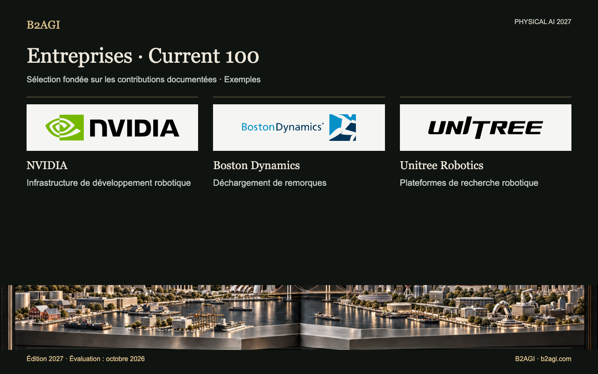

# B2AGI Physical AI · Entreprises : Current 100 · 2027

Illustration conceptuelle.

Réunit des technologies et produits adoptés dans la production, l’exploitation, l’éducation ou la recherche, ainsi que des transferts technologiques et contributions de capital déjà réalisés. Chaque profil décrit une tâche du client ou un rôle de fournisseur.

Édition 2027 · Évaluation d’octobre 2026 · Sélection par contribution. Les identifiants ne sont pas des rangs.

Motifs et portée des éléments probants : original anglais.

### Profils pour commencer

[NVIDIA](companies/nvidia--c067/README.md) · [Boston Dynamics](companies/boston-dynamics--c016/README.md) · [Unitree Robotics](companies/unitree-robotics--c095/README.md)

| ID | Nom | Contribution / rôle |
| --- | --- | --- |
| C001 | [42dot](companies/42dot--c001/README.md) | Demandes de trajet et réservations |
| C002 | [AgiBot](companies/agibot--c002/README.md) | Déploiement de robots sur les lignes de production |
| C003 | [Agile Robots](companies/agile-robots--c003/README.md) | Intégration de l’automatisation logistique |
| C004 | [Agility Robotics](companies/agility-robotics--c004/README.md) | Transfert de bacs logistiques |
| N099 | [AIDIN Robotics](companies/aidin-robotics--n099/README.md) | Composants de détection de force |
| C005 | [Amazon](companies/amazon--c005/README.md) | Adoption dans la préparation des commandes |
| C006 | [Ambi Robotics](companies/ambi-robotics--c006/README.md) | Tri logistique |
| C007 | [AMP Robotics / AMP](companies/amp-robotics-amp--c007/README.md) | Tri des matériaux |
| C008 | [ANYbotics](companies/anybotics--c008/README.md) | Inspection industrielle |
| C009 | [Applied Intuition](companies/applied-intuition--c009/README.md) | Simulation et essais de véhicules |
| C010 | [Autonomous a2z](companies/autonomous-a2z--c010/README.md) | Navette de passagers supervisée |
| C011 | [Baidu](companies/baidu--c011/README.md) | Service de transport de passagers sans conducteur |
| C012 | [Bedrock Robotics](companies/bedrock-robotics--c012/README.md) | Excavation autonome |
| C013 | [Berkshire Grey](companies/berkshire-grey--c013/README.md) | Tri des colis |
| C101 | [BlackRock](companies/blackrock--c101/README.md) | Fonds d’investissement en robotique |
| C015 | [Booster Robotics](companies/booster-robotics--c015/README.md) | Robots pour la recherche et les compétitions |
| C016 | [Boston Dynamics](companies/boston-dynamics--c016/README.md) | Déchargement de remorques |
| C017 | [Brain Corp](companies/brain-corp--c017/README.md) | Nettoyage autonome |
| C018 | [Built Robotics](companies/built-robotics--c018/README.md) | Construction autonome d’installations solaires |
| C019 | [Burro](companies/burro--c019/README.md) | Transport agricole |
| C020 | [Carbon Robotics](companies/carbon-robotics--c020/README.md) | Désherbage au laser |
| C021 | [CATL](companies/catl--c021/README.md) | Adoption dans la fabrication et batteries |
| C022 | [Cognex](companies/cognex--c022/README.md) | Vision pour l’inspection industrielle |
| C023 | [Corvus Robotics](companies/corvus-robotics--c023/README.md) | Drones d’inventaire |
| C024 | [Coupang](companies/coupang--c024/README.md) | Opérations de préparation des commandes |
| C025 | [Covariant](companies/covariant--c025/README.md) | Préhension fondée sur l’apprentissage |
| C026 | [DeepRobotics](companies/deeprobotics--c026/README.md) | Matériel d’inspection de tunnels |
| C029 | [Dexterity](companies/dexterity--c029/README.md) | Chargement de remorques |
| C030 | [Diligent Robotics](companies/diligent-robotics--c030/README.md) | Livraisons hospitalières |
| C104 | [DJI](companies/dji--c104/README.md) | Fourniture d’équipements aériens d’inspection d’infrastructures |
| C105 | [Doosan Robotics](companies/doosan-robotics--c105/README.md) | Fourniture d’une plateforme de recherche en manipulation |
| C032 | [Dreame Technology](companies/dreame-technology--c032/README.md) | Perception pour le nettoyage domestique |
| C033 | [Dyna Robotics](companies/dyna-robotics--c033/README.md) | Pliage de vêtements |
| C034 | [Ecovacs](companies/ecovacs--c034/README.md) | Nettoyage domestique |
| N017 | [Elephant Robotics](companies/elephant-robotics--n017/README.md) | Kits de robots éducatifs |
| N020 | [Farm-ng](companies/farm-ng--n020/README.md) | Plateformes de développement agricole |
| C035 | [Field AI](companies/field-ai--c035/README.md) | Autonomie pour l’inspection de chantiers |
| C036 | [Figure AI](companies/figure-ai--c036/README.md) | Projet pilote d’humanoïdes en usine |
| C037 | [Flexiv](companies/flexiv--c037/README.md) | Transformation alimentaire avec commande en force |
| C038 | [Formic](companies/formic--c038/README.md) | Services d’emballage et de palettisation |
| C039 | [ForwardX Robotics](companies/forwardx-robotics--c039/README.md) | Assistance à la préparation des commandes en entrepôt |
| C040 | [Foxglove](companies/foxglove--c040/README.md) | Analyse des journaux robotiques |
| C041 | [Galbot](companies/galbot--c041/README.md) | Fourniture de robots pour les lignes de production |
| C043 | [Gaussian Robotics / Gausium](companies/gaussian-robotics-gausium--c043/README.md) | Nettoyage des commerces |
| C045 | [Geek+](companies/geek--c045/README.md) | Transport en entrepôt |
| C046 | [GelSight](companies/gelsight--c046/README.md) | Instrumentation de recherche tactile |
| C047 | [GXO](companies/gxo--c047/README.md) | Intégration logistique pour les clients |
| C048 | [HAI Robotics](companies/hai-robotics--c048/README.md) | Systèmes robotiques d’entrepôt |
| N030 | [HaptX](companies/haptx--n030/README.md) | Téléopération tactile |
| C049 | [Hesai](companies/hesai--c049/README.md) | Composants LiDAR |
| C050 | [Horizon Robotics](companies/horizon-robotics--c050/README.md) | Calcul pour l’aide à la conduite |
| C051 | [Hyundai Motor Group](companies/hyundai-motor-group--c051/README.md) | Participation stratégique dans des entreprises robotiques |
| C052 | [InOrbit](companies/inorbit--c052/README.md) | Outils d’exploitation robotique |
| C053 | [Intuitive Surgical](companies/intuitive-surgical--c053/README.md) | Assistance robotique à la bronchoscopie |
| N037 | [JLG — Canvas Robotics](companies/jlg-canvas-robotics--n037/README.md) | Transfert technologique de robotique de construction |
| C054 | [John Deere](companies/john-deere--c054/README.md) | Pulvérisation sélective |
| C055 | [Keenon Robotics](companies/keenon-robotics--c055/README.md) | Robots de service pour les restaurants et les hôtels |
| C057 | [Kodiak Robotics / Kodiak AI](companies/kodiak-robotics-kodiak-ai--c057/README.md) | Transport hors route |
| C058 | [Locus Robotics](companies/locus-robotics--c058/README.md) | Assistance à la préparation des commandes |
| C061 | [Meituan](companies/meituan--c061/README.md) | Exploitation de livraisons autonomes |
| C062 | [Mobile Industrial Robots / MiR](companies/mobile-industrial-robots-mir--c062/README.md) | Transport de conteneurs par robots mobiles autonomes |
| C063 | [Momenta](companies/momenta--c063/README.md) | Intelligence de conduite pour les véhicules de série |
| C064 | [Mytra](companies/mytra--c064/README.md) | Stockage tampon et séquencement des stocks |
| C065 | [NAVER / NAVER LABS](companies/naver-naver-labs--c065/README.md) | Exploitation robotique intégrée aux bâtiments |
| C066 | [Nearthlab](companies/nearthlab--c066/README.md) | Inspection d’éoliennes |
| N053 | [Nimble Robotics](companies/nimble-robotics--n053/README.md) | Fourniture de solutions robotiques de préparation des commandes |
| C067 | [NVIDIA](companies/nvidia--c067/README.md) | Infrastructure de développement robotique |
| C068 | [Orbbec](companies/orbbec--c068/README.md) | Détection de profondeur |
| C069 | [OrionStar](companies/orionstar--c069/README.md) | Transport entre les procédés d’usine |
| C070 | [OSARO](companies/osaro--c070/README.md) | Emballage fondé sur l’apprentissage |
| C071 | [Parallel Domain](companies/parallel-domain--c071/README.md) | Données synthétiques de perception |
| C072 | [Path Robotics](companies/path-robotics--c072/README.md) | Soudage robotique |
| C073 | [Pickle Robot](companies/pickle-robot--c073/README.md) | Déchargement de remorques |
| C074 | [Plus One Robotics](companies/plus-one-robotics--c074/README.md) | Vision pour les colis et gestion des exceptions |
| C075 | [Pudu Robotics](companies/pudu-robotics--c075/README.md) | Nettoyage des bureaux |
| C076 | [Quicktron](companies/quicktron--c076/README.md) | Transport d’étagères en entrepôt |
| C078 | [RightHand Robotics](companies/righthand-robotics--c078/README.md) | Prélèvement en entrepôt |
| C079 | [Roborock](companies/roborock--c079/README.md) | Prise d’objets et nettoyage |
| C080 | [ROBOTIS](companies/robotis--c080/README.md) | Actionneurs et plateformes de recherche |
| C081 | [Roboto AI](companies/roboto-ai--c081/README.md) | Analyse de l’exploitation robotique |
| C082 | [Robust.AI](companies/robust-ai--c082/README.md) | Transport collaboratif de bacs logistiques |
| C083 | [Rockwell Automation](companies/rockwell-automation--c083/README.md) | Intégration de MES et de robots mobiles autonomes |
| C084 | [Saildrone](companies/saildrone--c084/README.md) | Observation océanique |
| C085 | [Samsung Electronics](companies/samsung-electronics--c085/README.md) | Participation stratégique dans des entreprises robotiques |
| C086 | [Sarcos → Palladyne AI](companies/sarcos-palladyne-ai--c086/README.md) | Logiciel d’automatisation de la maintenance |
| C087 | [Seoul Robotics](companies/seoul-robotics--c087/README.md) | Perception de véhicules en usine |
| N072 | [Shadow Robot](companies/shadow-robot--n072/README.md) | Fourniture de mains dextres pour la recherche |
| C090 | [SoftBank](companies/softbank--c090/README.md) | Participations dans l’automatisation d’entrepôts et véhicule d’investissement |
| C091 | [Standard Robots](companies/standard-robots--c091/README.md) | Transport de palettes par robots mobiles autonomes |
| C092 | [Superbin](companies/superbin--c092/README.md) | Collecte de déchets recyclables par IA |
| C093 | [Symbotic](companies/symbotic--c093/README.md) | Systèmes d’automatisation logistique |
| C094 | [Syrius Robotics / Syrius Technology](companies/syrius-robotics-syrius-technology--c094/README.md) | Robots mobiles autonomes d’assistance à la préparation des commandes |
| C103 | [UBTECH](companies/ubtech--c103/README.md) | Fourniture d’humanoïdes industriels et tâches d’usine |
| C095 | [Unitree Robotics](companies/unitree-robotics--c095/README.md) | Plateformes de recherche robotique |
| C096 | [Universal Robots](companies/universal-robots--c096/README.md) | Matériel de récolte en serre |
| C097 | [Viam](companies/viam--c097/README.md) | Logiciel d’exploitation de flottes robotiques |
| C098 | [VisionNav Robotics](companies/visionnav-robotics--c098/README.md) | Logistique avec chariots élévateurs autonomes |
| C102 | [Waymo](companies/waymo--c102/README.md) | Exploitation de services de passagers sans conducteur |
| C099 | [XYZ Robotics](companies/xyz-robotics--c099/README.md) | Fourniture d’équipements de déchargement en entrepôt |
| C100 | [Zipline](companies/zipline--c100/README.md) | Livraison aérienne autonome |

Version anglaise : [B2AGI Physical AI Companies · Current 100 · 2027](../../CURRENT_100.md)
