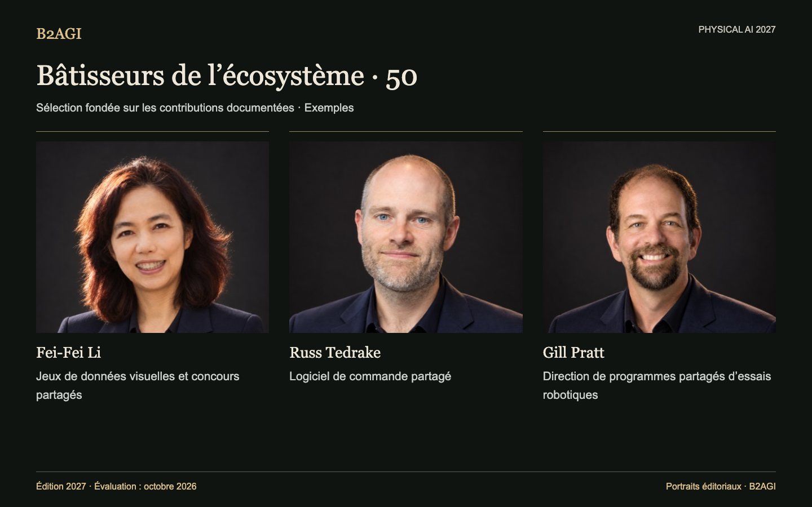

# B2AGI Physical AI · Bâtisseurs de l’écosystème : 50 · 2027

Portraits éditoriaux.

Présente les personnes qui mettent à disposition des outils, installations, formations, normes ou financements pour d’autres chercheurs et entreprises. Chaque profil précise leur contribution.

Édition 2027 · Évaluation d’octobre 2026 · Sélection par contribution. Les identifiants ne sont pas des rangs.

Motifs et portée des éléments probants : original anglais.

### Profils pour commencer

[Fei-Fei Li](people/fei-fei-li--e013/README.md) · [Russ Tedrake](people/russ-tedrake--e022/README.md) · [Gill Pratt](people/gill-pratt--p010/README.md)

| ID | Nom | Contribution / rôle |
| --- | --- | --- |
| E001 | [Aaron Ames](people/aaron-ames--e001/README.md) | Outils partagés de planification de la marche |
| E002 | [Aaron Prather](people/aaron-prather--e002/README.md) | Ateliers d’essais industriels |
| E003 | [Andra Keay](people/andra-keay--e003/README.md) | Soutien à la communauté robotique |
| E004 | [Ayanna Howard](people/ayanna-howard--e004/README.md) | Transfert de technologies STEM accessibles |
| E005 | [Brian Gerkey](people/brian-gerkey--e005/README.md) | Architecture robotique ouverte |
| E052 | [Bruce Leak](people/bruce-leak--e052/README.md) | Soutien aux fondateurs et aux conseils d’administration |
| E047 | [Cho Kyu-nam](people/cho-kyu-nam--e047/README.md) | Débat public du secteur |
| E007 | [Christian Hubicki](people/christian-hubicki--e007/README.md) | Formation en commande et simulation |
| E008 | [Craig Schlenoff](people/craig-schlenoff--e008/README.md) | Évaluation robotique partagée |
| E053 | [Cyril Ebersweiler](people/cyril-ebersweiler--e053/README.md) | Soutien aux jeunes entreprises de matériel |
| P006 | [Daniela Rus](people/daniela-rus--p006/README.md) | Encadrement doctoral en robotique |
| E009 | [Dennis Hong](people/dennis-hong--e009/README.md) | Plateformes de recherche et d’éducation |
| E010 | [Elena Messina](people/elena-messina--e010/README.md) | Normes et essais conjoints |
| E011 | [Elham Tabassi](people/elham-tabassi--e011/README.md) | Cadre de gestion des risques de l’IA |
| E012 | [Erico Guizzo](people/erico-guizzo--e012/README.md) | Ressources éditoriales sur la robotique |
| E013 | [Fei-Fei Li](people/fei-fei-li--e013/README.md) | Jeux de données visuelles et concours partagés |
| E014 | [Francesca Rossi](people/francesca-rossi--e014/README.md) | Éthique de conception des systèmes autonomes |
| P009 | [Geordie Rose](people/geordie-rose--p009/README.md) | Investissement et soutien de partenaires robotiques |
| P010 | [Gill Pratt](people/gill-pratt--p010/README.md) | Direction de programmes partagés d’essais robotiques |
| E050 | [Han Jae-kwon](people/han-jae-kwon--e050/README.md) | Éducation robotique destinée au public |
| E044 | [He Wang](people/he-wang--e044/README.md) | Banc d’évaluation et outils partagés de préhension dextre |
| E015 | [Henrik Christensen](people/henrik-christensen--e015/README.md) | Feuilles de route robotiques partagées |
| P036 | [Jiyang Gao](people/jiyang-gao--p036/README.md) | Coordination de programmes de jeux de données et de modèles |
| E036 | [Jung Kim](people/jung-kim--e036/README.md) | Programmes de développement de jeunes entreprises |
| P015 | [Karol Hausman](people/karol-hausman--p015/README.md) | Infrastructure d’apprentissage robotique |
| E016 | [Li Zexiang](people/li-zexiang--e016/README.md) | Formation entrepreneuriale et soutien à la fabrication |
| E037 | [Liang Jing](people/liang-jing--e037/README.md) | Fonctionnement de groupes de normalisation |
| E051 | [Lior Susan](people/lior-susan--e051/README.md) | Organisation de jeunes entreprises industrielles |
| E030 | [Liu Lianqing](people/liu-lianqing--e030/README.md) | Encadrement doctoral en robotique |
| E017 | [Matt Beane](people/matt-beane--e017/README.md) | Recherche sur la transformation du travail et des compétences |
| E018 | [Matthew Johnson-Roberson](people/matthew-johnson-roberson--e018/README.md) | Encadrement doctoral en robotique |
| E055 | [Mayank Mittal](people/mayank-mittal--e055/README.md) | Infrastructure publique d’apprentissage robotique |
| E056 | [Morgan Quigley](people/morgan-quigley--e056/README.md) | Architecture de ROS |
| E020 | [Pieter Abbeel](people/pieter-abbeel--e020/README.md) | Formation en commande robotique |
| E049 | [Qin Xiugong](people/qin-xiugong--e049/README.md) | Terminologie partagée des normes |
| E048 | [Qu Daokui](people/qu-daokui--e048/README.md) | Valorisation de la recherche |
| E022 | [Russ Tedrake](people/russ-tedrake--e022/README.md) | Logiciel de commande partagé |
| E023 | [Ryan Gariepy](people/ryan-gariepy--e023/README.md) | Échanges et formation de développeurs |
| E024 | [Rémi Cadène / Remi Cadene](people/remi-cadene-remi-cadene--e024/README.md) | Outils ouverts d’apprentissage robotique |
| E039 | [Shi Lin](people/shi-lin--e039/README.md) | Rédaction conjointe de normes d’évaluation |
| E025 | [Sun Lining](people/sun-lining--e025/README.md) | Programmes régionaux de recherche et de formation de talents |
| E026 | [Tom Ryden](people/tom-ryden--e026/README.md) | Exploitation d’installations partagées |
| E027 | [Tully Foote](people/tully-foote--e027/README.md) | Conventions d’unités et de coordonnées de ROS |
| E028 | [Vincent Vanhoucke](people/vincent-vanhoucke--e028/README.md) | Constitution d’équipes de recherche |
| E043 | [Wang Tianmiao](people/wang-tianmiao--e043/README.md) | Soutien aux talents et aux jeunes entreprises |
| E045 | [Wei Kai](people/wei-kai--e045/README.md) | Rédaction conjointe de normes d’évaluation |
| E054 | [Wendy Tan White](people/wendy-tan-white--e054/README.md) | Organisation partagée du développement |
| E032 | [Xiong Rong](people/xiong-rong--e032/README.md) | Plateformes de recherche pour étudiants |
| E041 | [Yuh Joon-ku](people/yuh-joon-ku--e041/README.md) | Édition de programmes de recherche |
| E029 | [Zhang Jianwei](people/zhang-jianwei--e029/README.md) | Coordination de recherches entre institutions |

Version anglaise : [B2AGI Physical AI People · Ecosystem Builders 50 · 2027](../../ECOSYSTEM_BUILDERS_50.md)
