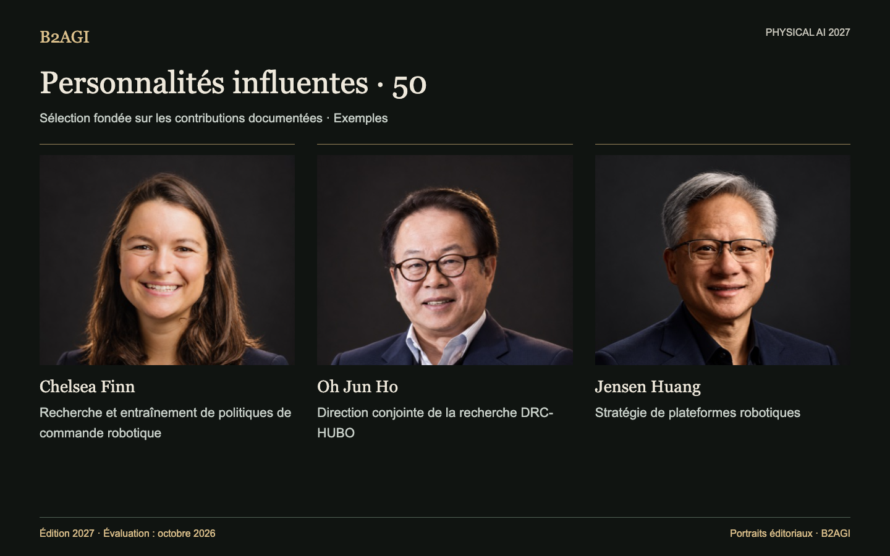

# B2AGI Physical AI · Personnalités influentes : 50 · 2027

Portraits éditoriaux.

La sélection porte sur les méthodes de recherche, la conception robotique, la direction de projets et les décisions d’exploitation ou de stratégie. Les résultats collectifs sont attribués avec les contributions des collaborateurs.

Édition 2027 · Évaluation d’octobre 2026 · Sélection par contribution. Les identifiants ne sont pas des rangs.

Motifs et portée des éléments probants : original anglais.

### Profils pour commencer

[Chelsea Finn](people/chelsea-finn--e006/README.md) · [Oh Jun Ho](people/oh-jun-ho--e019/README.md) · [Jensen Huang](people/jensen-huang--p013/README.md)

| ID | Nom | Contribution / rôle |
| --- | --- | --- |
| P001 | [Abhinav Gupta](people/abhinav-gupta--p001/README.md) | Recherche sur la navigation sémantique |
| P002 | [Anca Dragan](people/anca-dragan--p002/README.md) | Planification de mouvements tenant compte de l’intention |
| P003 | [Andrea Thomaz](people/andrea-thomaz--p003/README.md) | Stratégie de produits de livraison hospitalière |
| P043 | [Brett Adcock](people/brett-adcock--p043/README.md) | Stratégie industrielle des humanoïdes |
| E006 | [Chelsea Finn](people/chelsea-finn--e006/README.md) | Recherche et entraînement de politiques de commande robotique |
| P004 | [Chen Jianyu](people/chen-jianyu--p004/README.md) | Auteur correspondant de travaux de recherche |
| P048 | [Cheon Hong-seok](people/cheon-hong-seok--p048/README.md) | Gestion partagée d’activités robotiques |
| P005 | [Chris Urmson](people/chris-urmson--p005/README.md) | Décision d’exploitation du transport de fret sans conducteur |
| P007 | [Deepak Pathak](people/deepak-pathak--p007/README.md) | Recherche sur la locomotion adaptative |
| P029 | [Ding Han](people/ding-han--p029/README.md) | Direction du développement de l’usinage robotique de surfaces |
| P008 | [Euisun Chung](people/euisun-chung--p008/README.md) | Participation stratégique au capital |
| P034 | [Hang Zhao](people/hang-zhao--p034/README.md) | Direction de la recherche sur les modèles de fondation |
| P011 | [Hod Lipson](people/hod-lipson--p011/README.md) | Recherche sur l’automodélisation robotique |
| P050 | [Huang Xiaoqing](people/huang-xiaoqing--p050/README.md) | Recherche sur la commande de robots dans le cloud |
| P040 | [Hyoun Jin Kim](people/hyoun-jin-kim--p040/README.md) | Recherche sur la manipulation aérienne |
| P038 | [In So Kweon](people/in-so-kweon--p038/README.md) | Direction conjointe de la recherche DRC-HUBO |
| P042 | [Jaeheung Park](people/jaeheung-park--p042/README.md) | Recherche sur la commande de l’équilibre |
| P012 | [Jeff Cardenas](people/jeff-cardenas--p012/README.md) | Stratégie d’entrée sur le marché industriel |
| P049 | [Jemin Hwangbo](people/jemin-hwangbo--p049/README.md) | Recherche sur la commande de la simulation au réel |
| P013 | [Jensen Huang](people/jensen-huang--p013/README.md) | Stratégie de plateformes robotiques |
| P014 | [Jonathan Hurst](people/jonathan-hurst--p014/README.md) | Conception du matériel bipède |
| P016 | [Ken Goldberg](people/ken-goldberg--p016/README.md) | Recherche sur la préhension fondée sur l’apprentissage |
| P039 | [Kim Yong-jae](people/kim-yong-jae--p039/README.md) | Recherche sur les robots d’assistance légers |
| P037 | [Kyoungchul Kong](people/kyoungchul-kong--p037/README.md) | Direction d’équipes de robots d’assistance |
| P047 | [Kyu-Jin Cho](people/kyu-jin-cho--p047/README.md) | Conception de robots à rigidité variable |
| P041 | [Leng Xiaokun](people/leng-xiaokun--p041/README.md) | Stratégie de financement de la recherche sur les humanoïdes |
| P017 | [Linxi “Jim” Fan](people/linxi-jim-fan--p017/README.md) | Recherche sur la génération de récompenses |
| P018 | [Marc Raibert](people/marc-raibert--p018/README.md) | Recherche sur la locomotion dynamique |
| P019 | [Masayoshi Son](people/masayoshi-son--p019/README.md) | Décisions de transactions stratégiques |
| P020 | [Melonee Wise](people/melonee-wise--p020/README.md) | Organisation des produits et de l’ingénierie |
| P021 | [Nick Paine](people/nick-paine--p021/README.md) | Conception et commande d’actionneurs |
| P051 | [Nikita Rudin](people/nikita-rudin--p051/README.md) | Recherche sur l’entraînement parallèle à la locomotion |
| E019 | [Oh Jun Ho](people/oh-jun-ho--e019/README.md) | Direction conjointe de la recherche DRC-HUBO |
| P022 | [Oussama Khatib](people/oussama-khatib--p022/README.md) | Recherche sur la téléopération sous-marine |
| P023 | [Park Jong Hoon](people/park-jong-hoon--p023/README.md) | Stratégie d’intégration verticale |
| P024 | [Peng Zhihui](people/peng-zhihui--p024/README.md) | Direction du développement de produits robotiques |
| P030 | [Qiao Hong](people/qiao-hong--p030/README.md) | Recherche sur les méthodes de commande robotique |
| P035 | [Richie Chen](people/richie-chen--p035/README.md) | Développement conjoint d’ACR |
| P025 | [Rodney Brooks](people/rodney-brooks--p025/README.md) | Commande robotique en couches |
| E021 | [Rolf Dieter Schraft](people/rolf-dieter-schraft--e021/README.md) | Recherche sur les méthodes de programmation robotique |
| P026 | [Sabine Hauert](people/sabine-hauert--p026/README.md) | Direction de la recherche sur la commande d’essaims |
| P044 | [Seok Sang-ok](people/seok-sang-ok--p044/README.md) | Stratégie de services robotiques intégrés |
| P027 | [Sergey Levine](people/sergey-levine--p027/README.md) | Recherche sur le retour visuel fondé sur l’apprentissage |
| P033 | [Wang Hesheng](people/wang-hesheng--p033/README.md) | Recherche conjointe sur la perception |
| E033 | [Wang Tianran](people/wang-tianran--e033/README.md) | Direction du développement de produits robotiques industriels |
| P028 | [Wang Xingxing](people/wang-xingxing--p028/README.md) | Conception et commande de quadrupèdes |
| P032 | [Wang Yaonan](people/wang-yaonan--p032/README.md) | Direction de projets d’inspection industrielle |
| E034 | [Zhao Mingguo](people/zhao-mingguo--e034/README.md) | Direction conjointe de la recherche sur le football humanoïde |
| P046 | [Zhou Jian](people/zhou-jian--p046/README.md) | Investissement dans la recherche sur les humanoïdes |
| P031 | [Zhu Qiuguo](people/zhu-qiuguo--p031/README.md) | Recherche sur la commande de stabilité des quadrupèdes |

Version anglaise : [B2AGI Physical AI People · Influence 50 · 2027](../../INFLUENCE_50.md)
