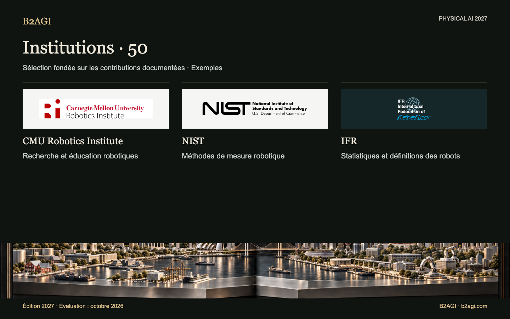

# B2AGI Physical AI · Institutions : 50 · 2027

Illustration conceptuelle.

Réunit des institutions et programmes contribuant à la recherche, aux essais, à la normalisation, à la réglementation, au développement industriel et à l’accès aux marchés de capitaux. La rédaction technique, le financement, la certification et le soutien opérationnel sont distingués.

Édition 2027 · Évaluation d’octobre 2026 · Sélection par contribution. Les identifiants ne sont pas des rangs.

Motifs et portée des éléments probants : original anglais.

### Profils pour commencer

[NIST](institutions/nist--i033/README.md) · [KAIST](institutions/kaist--i018/README.md) · [MassRobotics](institutions/massrobotics--i027/README.md)

| ID | Nom | Contribution / rôle |
| --- | --- | --- |
| I001 | [ARM Institute](institutions/arm-institute--i001/README.md) | Soutien à l’adoption dans la fabrication |
| I003 | [ASTM F45](institutions/astm-f45--i003/README.md) | Normes de performance des robots mobiles |
| I047 | [Beijing Humanoid Robot Innovation Center](institutions/beijing-humanoid-robot-innovation-center--i047/README.md) | Données partagées d’entraînement robotique |
| I004 | [BIGAI](institutions/bigai--i004/README.md) | Outils partagés de recherche robotique |
| I005 | [CESI](institutions/cesi--i005/README.md) | Corédaction de lignes directrices sur la qualité des données de l’IA incarnée |
| I006 | [CMU Robotics Institute](institutions/cmu-robotics-institute--i006/README.md) | Recherche et éducation robotiques |
| I007 | [DARPA SubT](institutions/darpa-subt--i007/README.md) | Environnements physiques partagés d’essais |
| I008 | [DFKI Robotics Innovation Center](institutions/dfki-robotics-innovation-center--i008/README.md) | Recherche robotique industrielle |
| I009 | [ETRI](institutions/etri--i009/README.md) | Transfert technologique robotique |
| I010 | [euRobotics](institutions/eurobotics--i010/README.md) | Écosystème de recherche robotique |
| I011 | [FAA](institutions/faa--i011/README.md) | Autorisation de livraison de colis au-delà de la portée visuelle |
| I012 | [Harvard Wyss Institute](institutions/harvard-wyss-institute--i012/README.md) | Recherche et licences de robots d’assistance |
| I013 | [HIT Robotics Technology and Systems Research Unit](institutions/hit-robotics-technology-and-systems-research-unit--i013/README.md) | Infrastructure de recherche en robotique physique |
| I014 | [HKEX / HKSCC](institutions/hkex-hkscc--i014/README.md) | Accès à la cotation et à la compensation |
| I015 | [IEC Robotics Product Safety Standards](institutions/iec-robotics-product-safety-standards--i015/README.md) | Normes de sécurité des produits robotiques |
| I016 | [IFR](institutions/ifr--i016/README.md) | Statistiques et définitions des robots |
| I017 | [ISO/TC 299](institutions/iso-tc-299--i017/README.md) | Élaboration de normes robotiques |
| I018 | [KAIST](institutions/kaist--i018/README.md) | Plateformes partagées de recherche sur les humanoïdes |
| I020 | [KEIT](institutions/keit--i020/README.md) | Financement de la recherche robotique |
| I022 | [KIAT](institutions/kiat--i022/README.md) | Financement de la R&D robotique |
| I023 | [KIRIA](institutions/kiria--i023/README.md) | Essais et certification de robots |
| I024 | [KITECH](institutions/kitech--i024/README.md) | Recherche sur les jumeaux numériques robotiques |
| I050 | [KRX](institutions/krx--i050/README.md) | Accès à la cotation et aux informations publiques des entreprises robotiques |
| I025 | [KTL](institutions/ktl--i025/README.md) | Essais de robots portés sur le corps |
| I026 | [LeRobot / Hugging Face](institutions/lerobot-hugging-face--i026/README.md) | Infrastructure partagée d’apprentissage robotique |
| I027 | [MassRobotics](institutions/massrobotics--i027/README.md) | Installations partagées de développement |
| I028 | [MIIT](institutions/miit--i028/README.md) | Politique d’applications robotiques |
| I029 | [MIT CSAIL](institutions/mit-csail--i029/README.md) | Recherche sur l’interaction humain-robot |
| I030 | [NASA Jet Propulsion Laboratory](institutions/nasa-jet-propulsion-laboratory--i030/README.md) | Exploitation de robots d’exploration planétaire |
| I031 | [Nasdaq](institutions/nasdaq--i031/README.md) | Accès des entreprises robotiques aux marchés boursiers |
| I048 | [National Robot Testing and Evaluation Center, Shanghai Headquarters](institutions/national-robot-testing-and-evaluation-center-shanghai-headquarters--i048/README.md) | Certification robotique à Shanghai |
| I053 | [New York Stock Exchange / NYSE](institutions/new-york-stock-exchange-nyse--i053/README.md) | Accès historique des émetteurs à la négociation boursière |
| I032 | [NHTSA](institutions/nhtsa--i032/README.md) | Rapports de rappels de systèmes de conduite automatisée |
| I054 | [NIOSH / Center for Occupational Robotics Research](institutions/niosh-center-for-occupational-robotics-research--i054/README.md) | Recherche et recommandations sur les risques de robotique au travail |
| I033 | [NIST](institutions/nist--i033/README.md) | Méthodes de mesure robotique |
| I034 | [Open Robotics / OSRF](institutions/open-robotics-osrf--i034/README.md) | Infrastructure ouverte de logiciels robotiques |
| I035 | [Open X-Embodiment consortium](institutions/open-x-embodiment-consortium--i035/README.md) | Données et modèles partagés d’apprentissage |
| I036 | [OSHA Robotics Safety Guidance](institutions/osha-robotics-safety-guidance--i036/README.md) | Recommandations de sécurité robotique au travail |
| I037 | [POSTECH](institutions/postech--i037/README.md) | Recherche et évaluation conjointes de robots hospitaliers |
| I038 | [RAI Institute](institutions/rai-institute--i038/README.md) | Outils publics d’apprentissage robotique |
| I039 | [SAC](institutions/sac--i039/README.md) | Administration des normes nationales |
| I040 | [SEC](institutions/sec--i040/README.md) | Examen des informations publiques des émetteurs |
| I041 | [Shanghai AI Lab](institutions/shanghai-ai-lab--i041/README.md) | Recherche partagée en simulation |
| I051 | [Shanghai Stock Exchange](institutions/shanghai-stock-exchange--i051/README.md) | Accès au marché des émetteurs industriels |
| I052 | [Shenzhen Stock Exchange](institutions/shenzhen-stock-exchange--i052/README.md) | Accès au marché des émetteurs industriels |
| I046 | [SIA](institutions/sia--i046/README.md) | Transfert technologique industriel |
| I042 | [Toyota Research Institute](institutions/toyota-research-institute--i042/README.md) | Recherche sur l’apprentissage et la commande robotiques |
| I043 | [UC Berkeley BAIR: RAIL BridgeData](institutions/uc-berkeley-bair-rail-bridgedata--i043/README.md) | Outils partagés de données et d’entraînement robotiques |
| I044 | [XbotPark](institutions/xbotpark--i044/README.md) | Soutien à la fabrication de jeunes entreprises |
| I045 | [Zhejiang University Robotics Research](institutions/zhejiang-university-robotics-research--i045/README.md) | Éducation robotique |

Version anglaise : [B2AGI Physical AI Institutions 50 · 2027](../../INSTITUTIONS_50.md)
