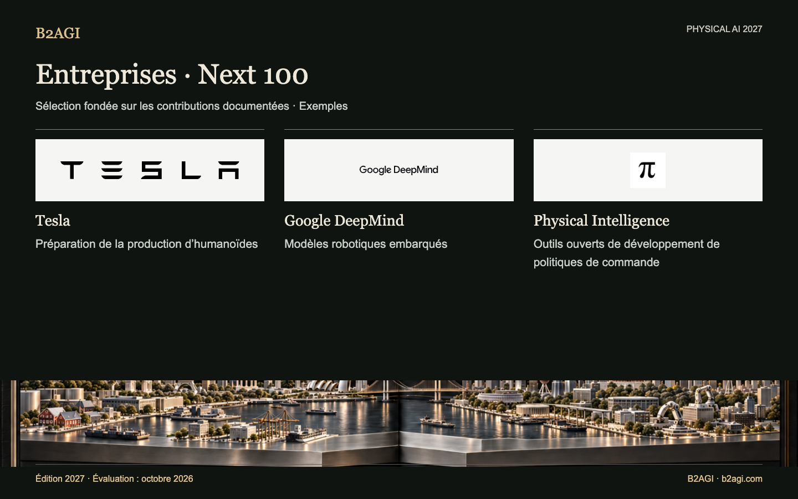

# B2AGI Physical AI · Entreprises : Next 100 · 2027

Illustration conceptuelle.

Réunit des produits, modèles d’action et applications en développement, en essais de prototypes ou en validation de recherche. Current et Next qualifient la contribution sélectionnée, et non toutes les activités de l’entreprise.

Édition 2027 · Évaluation d’octobre 2026 · Sélection par contribution. Les identifiants ne sont pas des rangs.

Motifs et portée des éléments probants : original anglais.

### Profils pour commencer

[Tesla](companies/tesla--n080/README.md) · [Google DeepMind](companies/google-deepmind--n029/README.md) · [Physical Intelligence](companies/physical-intelligence--n059/README.md)

| ID | Nom | Contribution / rôle |
| --- | --- | --- |
| N001 | [1X Technologies](companies/1x-technologies--n001/README.md) | Apprentissage de politiques de commande du corps entier |
| N100 | [AeiROBOT](companies/aeirobot--n100/README.md) | Plateformes de recherche et de compétition |
| N002 | [Aeva](companies/aeva--n002/README.md) | Détection industrielle |
| N003 | [Aigen](companies/aigen--n003/README.md) | Essais agricoles sur le terrain |
| N004 | [Alibaba](companies/alibaba--n004/README.md) | Modèles de perception et d’action robotiques |
| N005 | [Ambarella](companies/ambarella--n005/README.md) | Développement de l’intégration de l’inférence robotique |
| N006 | [Anthropic](companies/anthropic--n006/README.md) | Recherche sur la commande par modèles de langage |
| N007 | [Apple](companies/apple--n007/README.md) | Interaction robotique et données d’apprentissage |
| N008 | [Apptronik](companies/apptronik--n008/README.md) | Essais d’humanoïdes chez les clients |
| N009 | [Astribot](companies/astribot--n009/README.md) | Recherche sur les politiques de commande de manipulation |
| N010 | [Autodesk](companies/autodesk--n010/README.md) | Assemblage fondé sur l’apprentissage |
| N011 | [BeingBeyond](companies/beingbeyond--n011/README.md) | Apprentissage robotique à partir de vidéos |
| N012 | [BeyondHoneycomb](companies/beyondhoneycomb--n012/README.md) | Détection de l’état de cuisson |
| N013 | [bitsensing](companies/bitsensing--n013/README.md) | Essais de navettes avec radar |
| N101 | [Black Sesame](companies/black-sesame--n101/README.md) | Kits de calcul robotique |
| N014 | [ByteDance](companies/bytedance--n014/README.md) | Recherche sur les modèles d’action robotiques |
| N015 | [Config](companies/config--n015/README.md) | Données robotiques et modèles de tâches |
| N016 | [DEEPX](companies/deepx--n016/README.md) | Calcul robotique en périphérie |
| N018 | [EngineAI](companies/engineai--n018/README.md) | Outils d’apprentissage et de déploiement |
| N019 | [Faraday Dynamics](companies/faraday-dynamics--n019/README.md) | Actionneurs robotiques |
| N104 | [Flexion Robotics](companies/flexion-robotics--n104/README.md) | Politiques de commande pour les tâches du corps entier |
| N021 | [Flexxbotics](companies/flexxbotics--n021/README.md) | Intégration de l’inspection et de la reprise de fabrication |
| N022 | [Floatic](companies/floatic--n022/README.md) | Essais de préparation collaborative des commandes |
| N023 | [Fourier Intelligence](companies/fourier-intelligence--n023/README.md) | Outils d’entraînement et de déploiement robotiques |
| N024 | [Galaxea AI](companies/galaxea-ai--n024/README.md) | Apprentissage de la manipulation physique |
| C044 | [Gecko Robotics](companies/gecko-robotics--c044/README.md) | Inspection de composants assistée par robots |
| N025 | [Generalist AI](companies/generalist-ai--n025/README.md) | Recherche sur les modèles de manipulation |
| N026 | [Genesis AI](companies/genesis-ai--n026/README.md) | Développement de la manipulation physique |
| N027 | [Genisom AI](companies/genisom-ai--n027/README.md) | Outils de développement de logiciels robotiques |
| N028 | [Gole Robotics](companies/gole-robotics--n028/README.md) | Essais de transport sur chantier |
| N029 | [Google DeepMind](companies/google-deepmind--n029/README.md) | Modèles robotiques embarqués |
| N111 | [Hello Robot](companies/hello-robot--n111/README.md) | Développement de la manipulation mobile à vocabulaire ouvert |
| N031 | [Helm.ai](companies/helm-ai--n031/README.md) | Développement de modèles de conduite |
| N032 | [Hexagon](companies/hexagon--n032/README.md) | Entraînement et validation d’humanoïdes |
| N033 | [Honda](companies/honda--n033/README.md) | Assistance à la téléopération dextre |
| N113 | [Hugging Face](companies/hugging-face--n113/README.md) | Recherche sur les modèles compacts de perception à action |
| N034 | [Intel](companies/intel--n034/README.md) | Recherche sur la commande robotique neuromorphique |
| N035 | [Intrinsic](companies/intrinsic--n035/README.md) | Intégration de l’IA dans la fabrication |
| N036 | [JD.com](companies/jd-com--n036/README.md) | Apprentissage d’actions à partir de plusieurs sources |
| N039 | [KNOWIN](companies/knowin--n039/README.md) | Recherche sur les politiques de commande en boucle fermée |
| N040 | [Leju Robotics](companies/leju-robotics--n040/README.md) | Outils de développement robotique |
| N041 | [LG Electronics](companies/lg-electronics--n041/README.md) | Développement de la manipulation domestique |
| N042 | [LimX Dynamics](companies/limx-dynamics--n042/README.md) | Outils de développement liés au matériel |
| N043 | [Lumos Robotics](companies/lumos-robotics--n043/README.md) | Plateformes de données de manipulation |
| N044 | [Machina Labs](companies/machina-labs--n044/README.md) | Formage en boucle fermée |
| N045 | [MakinaRocks](companies/makinarocks--n045/README.md) | Modèles de maintenance robotique |
| N102 | [Maven Robotics](companies/maven-robotics--n102/README.md) | Développement du déploiement logistique |
| N046 | [Mentee Robotics / Mentee by Mobileye](companies/mentee-robotics-mentee-by-mobileye--n046/README.md) | Apprentissage de la manipulation physique |
| N047 | [Meta](companies/meta--n047/README.md) | Bancs d’évaluation de robotique collaborative |
| N048 | [Microsoft](companies/microsoft--n048/README.md) | Modèles de planification et d’action robotiques |
| N096 | [Mobilint](companies/mobilint--n096/README.md) | Recherche sur l’intégration d’encodeurs de politiques robotiques |
| N097 | [Mobiltech](companies/mobiltech--n097/README.md) | Actifs de données spatiales |
| N049 | [MORAI](companies/morai--n049/README.md) | Outils de simulation de conduite |
| N051 | [Near Earth Autonomy](companies/near-earth-autonomy--n051/README.md) | Intégration d’aéronefs autonomes |
| N052 | [NEURA Robotics](companies/neura-robotics--n052/README.md) | Plateformes d’apprentissage robotique |
| N054 | [Noetix Robotics](companies/noetix-robotics--n054/README.md) | Outils d’apprentissage par renforcement |
| N095 | [Nota AI](companies/nota-ai--n095/README.md) | Environnement d’exécution de l’inférence robotique |
| N055 | [Nuro](companies/nuro--n055/README.md) | Essais de robotaxis avec des employés |
| N056 | [Outrider](companies/outrider--n056/README.md) | Essais de véhicules autonomes dans les cours logistiques |
| N057 | [PaXini](companies/paxini--n057/README.md) | Manipulation tactile |
| N058 | [Persona AI](companies/persona-ai--n058/README.md) | Soudage téléopéré |
| N059 | [Physical Intelligence](companies/physical-intelligence--n059/README.md) | Outils ouverts de développement de politiques de commande |
| N060 | [Qualcomm](companies/qualcomm--n060/README.md) | Environnement de calcul robotique |
| N061 | [Raion Robotics](companies/raion-robotics--n061/README.md) | Développement de la commande de quadrupèdes |
| N062 | [RealMan](companies/realman--n062/README.md) | Données robotiques et téléopération |
| N064 | [Realtime Robotics](companies/realtime-robotics--n064/README.md) | Optimisation de la planification des mouvements |
| N065 | [Reliable Robotics](companies/reliable-robotics--n065/README.md) | Recherche sur la détection et l’évitement à bord d’aéronefs |
| N109 | [Rhoda AI](companies/rhoda-ai--n109/README.md) | Recherche sur la manipulation industrielle préentraînée sur vidéo |
| N066 | [Richtech Robotics](companies/richtech-robotics--n066/README.md) | Manipulation de boissons par IA |
| N110 | [RIVR](companies/rivr--n110/README.md) | Essais de livraison de colis avec perception du terrain |
| N067 | [RLWRLD](companies/rlwrld--n067/README.md) | Recherche sur les politiques de commande physique |
| N105 | [RoboForce](companies/roboforce--n105/README.md) | Projets pilotes de robots industriels |
| N068 | [RobotEra](companies/robotera--n068/README.md) | Développement de politiques prédictives de manipulation |
| N069 | [ROBROS](companies/robros--n069/README.md) | Tri de blocs fondé sur l’apprentissage |
| N070 | [Sanctuary AI](companies/sanctuary-ai--n070/README.md) | Apprentissage de tâches de contact |
| N071 | [Saronic](companies/saronic--n071/README.md) | Essais de navires de surface autonomes |
| C088 | [Siemens](companies/siemens--c088/README.md) | Essais d’intégration en usine |
| N073 | [Skild AI](companies/skild-ai--n073/README.md) | Manipulation avec plusieurs robots |
| N074 | [Sony](companies/sony--n074/README.md) | Apprentissage de l’utilisation d’outils |
| N075 | [Spirit AI](companies/spirit-ai--n075/README.md) | Soutien au déploiement de politiques de commande physique |
| N103 | [Standard Bots](companies/standard-bots--n103/README.md) | Développement et éducation robotiques |
| N076 | [Sunday](companies/sunday--n076/README.md) | Développement de robotique domestique |
| N078 | [TARS Robotics](companies/tars-robotics--n078/README.md) | Données de manipulation et kits de développement |
| N079 | [Tencent](companies/tencent--n079/README.md) | Intégration de plateformes robotiques |
| N080 | [Tesla](companies/tesla--n080/README.md) | Préparation de la production d’humanoïdes |
| N108 | [Torc Robotics](companies/torc-robotics--n108/README.md) | Validation du transport autonome de fret sur autoroute |
| N107 | [Toyota Motor Corporation / Toyota Research Institute](companies/toyota-motor-corporation-toyota-research-institute--n107/README.md) | Développement de politiques de manipulation du corps entier |
| N081 | [Vayu Robotics](companies/vayu-robotics--n081/README.md) | Mobilité de livraison fondée sur l’apprentissage |
| N082 | [Vention](companies/vention--n082/README.md) | Outils de perception industrielle |
| N083 | [Vueron](companies/vueron--n083/README.md) | Essais de détection routière |
| N084 | [Waabi](companies/waabi--n084/README.md) | Intégration de camions autonomes |
| N112 | [Wayve](companies/wayve--n112/README.md) | Recherche sur la commande de conduite par le langage |
| N085 | [WIRobotics](companies/wirobotics--n085/README.md) | Modèles robotiques de recherche |
| N086 | [Wonik Robotics](companies/wonik-robotics--n086/README.md) | Mains robotiques équipées de capteurs |
| N087 | [World Labs](companies/world-labs--n087/README.md) | Développement de simulations robotiques générées |
| N088 | [X Square Robot](companies/x-square-robot--n088/README.md) | Outils d’entraînement de politiques de commande |
| N089 | [Xiaomi](companies/xiaomi--n089/README.md) | Recherche sur les modèles d’action physique |
| N092 | [Xingyuanzhi](companies/xingyuanzhi--n092/README.md) | Développement de la perception et de l’action robotiques |
| N090 | [XPENG Robotics / IRON](companies/xpeng-robotics-iron--n090/README.md) | Développement du matériel d’humanoïdes |
| N093 | [Yuequan Bionic](companies/yuequan-bionic--n093/README.md) | Prototypes de mains biomimétiques |

Version anglaise : [B2AGI Physical AI Companies · Next 100 · 2027](../../NEXT_100.md)

<!-- B2AGI EPAI SIGNATURE -->
---

**B2AGI | EPAI**  
Embodied Physical Agentic Intelligence  
[Research & Publications](https://b2agi.com/) · [White Paper](https://github.com/b2agi/physical-ai-white-paper-2027) · [Industry Atlas](https://github.com/b2agi/physical-ai-ranking-2027)
<!-- /B2AGI EPAI SIGNATURE -->
