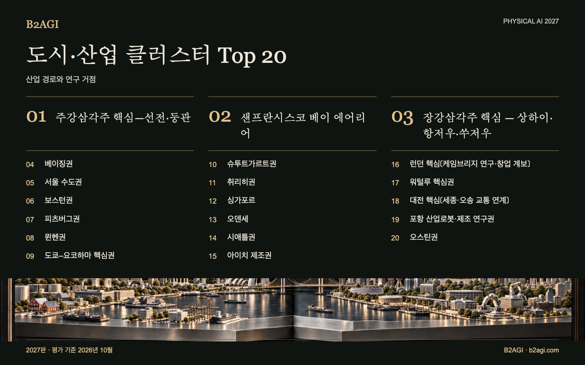

# B2AGI 피지컬 AI 도시·산업 클러스터 순위 20 · 2027

연구와 제조, 고객 도입이 만나는 산업권 20곳을 다룬다. 권역마다 범위가 다르므로 프로필에 실제 활동 장소를 따로 적었다.

2027판 · 2026년 10월 평가 · 정성 순위

선정 근거·근거 범위: 영문 원문.

### 먼저 읽을 사례

[주강삼각주 핵심—선전·둥관](clusters/pearl-river-delta-core-shenzhendongguan--cluster-01/README.md) · [샌프란시스코 베이 에어리어](clusters/san-francisco-bay-area--cluster-02/README.md) · [장강삼각주 핵심 — 상하이·항저우·쑤저우](clusters/yangtze-river-delta-core-shanghaihangzhousuzhou--cluster-03/README.md)

| 순위 | 이름 | 기여·역할 |
| --- | --- | --- |
| 1 | [주강삼각주 핵심—선전·둥관](clusters/pearl-river-delta-core-shenzhendongguan--cluster-01/README.md) | 로봇공학, 인큐베이션 및 제조 인프라 접근성 |
| 2 | [샌프란시스코 베이 에어리어](clusters/san-francisco-bay-area--cluster-02/README.md) | 로봇 플랫폼, 학습 연구 및 공유 시설 |
| 3 | [장강삼각주 핵심 — 상하이·항저우·쑤저우](clusters/yangtze-river-delta-core-shanghaihangzhousuzhou--cluster-03/README.md) | 로봇 학습 인프라·제품 개발·물리 시스템 연구 |
| 4 | [베이징권](clusters/beijing-region--cluster-04/README.md) | 로봇 학습, 주행 시험 및 성장 자금 지원 |
| 5 | [서울 수도권](clusters/seoul-capital-area--cluster-05/README.md) | 건물 내 배송, 로봇 개발 및 자본 조달 |
| 6 | [보스턴권](clusters/boston-region--cluster-06/README.md) | 하드웨어 스타트업 및 로봇공학 공동 실험 |
| 7 | [피츠버그권](clusters/pittsburgh-region--cluster-07/README.md) | 연구 성과 이전 및 제조 실증 |
| 8 | [뮌헨권](clusters/munich-region--cluster-08/README.md) | 산업 물류 통합 및 성장 자금 조달 |
| 9 | [도쿄–요코하마 핵심권](clusters/tokyoyokohama-core--cluster-09/README.md) | 로봇 제어, 통합 및 테스트 환경 접근 |
| 10 | [슈투트가르트권](clusters/stuttgart-region--cluster-10/README.md) | AI 기반 조작 및 자동차 테스트 인프라 |
| 11 | [취리히권](clusters/zurich-region--cluster-11/README.md) | 학습 기반 검사 제어 및 연구 상용화 |
| 12 | [싱가포르](clusters/singapore--cluster-12/README.md) | 고객 인프라를 위한 로봇 통합 |
| 13 | [오덴세](clusters/odense--cluster-13/README.md) | 이동로봇·협동로봇 개발 |
| 14 | [시애틀권](clusters/seattle-region--cluster-14/README.md) | 물류 도입 기업, 드론 엔지니어링 및 로봇 데이터 도구 |
| 15 | [아이치 제조권](clusters/aichi-manufacturing-region--cluster-15/README.md) | 제조 개발 및 로봇 시험 시설 |
| 16 | [런던 핵심〔케임브리지 연구·창업 계보〕](clusters/london-core-cambridge-research-and-startup-lineage--cluster-16/README.md) | 동작 모델, 로봇 학습 및 주행 기술 개발 |
| 17 | [워털루 핵심권](clusters/waterloo-core--cluster-17/README.md) | 산업용 AMR, 자동화 통합 및 서비스 |
| 18 | [대전 핵심〔세종·오송 교통 연계〕](clusters/daejeon-core-sejongosong-transport-links--cluster-18/README.md) | 연구 플랫폼, 기술 이전 및 실증 연구소 |
| 19 | [포항 산업로봇·제조 연구권](clusters/pohang-industrial-robotics-and-manufacturing-research-region--cluster-19/README.md) | 로봇 제조 및 철강 산업 연계 개발 |
| 20 | [오스틴권](clusters/austin-region--cluster-20/README.md) | 휴머노이드 개발, 고객 대상 실증 및 성장 자금 확보 |

[Atlas](README.md) · [English edition](https://github.com/b2agi/physical-ai-ranking-2027/blob/3dd209a29d38d56f07918da165a50c87dce9a058/) · [JSON](data/ranking2027.ko.json) · [CSV](data/ranking2027.ko.csv)

영문판: [B2AGI Physical AI City & Cluster Ranking 20 · 2027](../../CLUSTERS.md)

<!-- B2AGI EPAI SIGNATURE -->
---

**B2AGI | EPAI**  
Embodied Physical Agentic Intelligence  
[Research & Publications](https://b2agi.com/) · [White Paper](https://github.com/b2agi/physical-ai-white-paper-2027) · [Industry Atlas](https://github.com/b2agi/physical-ai-ranking-2027)
<!-- /B2AGI EPAI SIGNATURE -->
