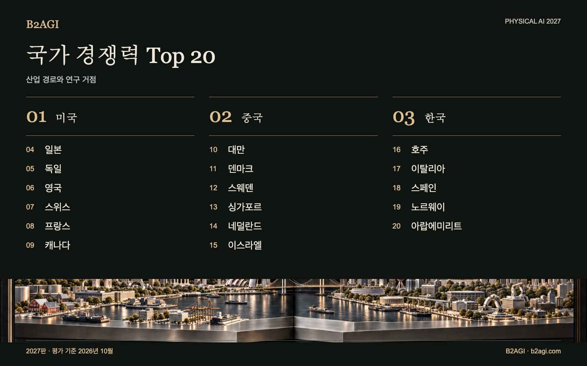

# B2AGI 피지컬 AI 국가 경쟁력 순위 20 · 2027

20개 국가·경제권의 연구 역량과 제품 개발, 고객 운영을 비교했다. 미래 산업 역량도 평가에 포함했다. 순위는 다섯 관점에 따른 정성 평가이며 종합 점수를 합산한 결과가 아니다.

2027판 · 2026년 10월 평가 · 정성 순위

선정 근거·근거 범위: 영문 원문.

### 먼저 읽을 사례

[한국](countries/south-korea--country-03/README.md) · [미국](countries/united-states--country-01/README.md) · [중국](countries/china--country-02/README.md)

| 순위 | 이름 | 기여·역할 |
| --- | --- | --- |
| 1 | [미국](countries/united-states--country-01/README.md) | 로봇 플랫폼·고객 도입·성장자금 |
| 2 | [중국](countries/china--country-02/README.md) | 로봇 하드웨어·제조 공급망 |
| 3 | [한국](countries/south-korea--country-03/README.md) | 로봇 협업·학습 제어·연구 사업화 |
| 4 | [일본](countries/japan--country-04/README.md) | 공장 공정의 인지·동작 계획 |
| 5 | [독일](countries/germany--country-05/README.md) | 산업용 조작·시스템 통합·시험 |
| 6 | [영국](countries/united-kingdom--country-06/README.md) | 온디바이스 로봇 모델·정교한 조작 학습 |
| 7 | [스위스](countries/switzerland--country-07/README.md) | 산업 검사와 학습 기반 제어 |
| 8 | [프랑스](countries/france--country-08/README.md) | 개방형 로봇 학습 도구·조작 모델 |
| 9 | [캐나다](countries/canada--country-09/README.md) | 조작 학습·자율주행 트럭 통합 |
| 10 | [대만](countries/taiwan--country-10/README.md) | 반도체 제조·패키징·로봇 인프라 |
| 11 | [덴마크](countries/denmark--country-11/README.md) | 이동로봇 물류·협동로봇 플랫폼 |
| 12 | [스웨덴](countries/sweden--country-12/README.md) | 산업 연계 연구·박사급 인력 양성 |
| 13 | [싱가포르](countries/singapore--country-13/README.md) | 전력 터널 점검의 현지 시스템 통합 |
| 14 | [네덜란드](countries/netherlands--country-14/README.md) | 창고 시스템 통합·자동화 투자자금 |
| 15 | [이스라엘](countries/israel--country-15/README.md) | 조작 기술 개발·국가 AI 컴퓨팅 |
| 16 | [호주](countries/australia--country-16/README.md) | 자율 채굴 운영·건설 실증 |
| 17 | [이탈리아](countries/italy--country-17/README.md) | 산업 시스템 통합·창고 검증 |
| 18 | [스페인](countries/spain--country-18/README.md) | 로봇·AI 검사 기술 개발 |
| 19 | [노르웨이](countries/norway--country-19/README.md) | 휴머노이드 설계·제조 개발 |
| 20 | [아랍에미리트](countries/united-arab-emirates--country-20/README.md) | 자율주행 여객 서비스 도입·운영 |

[Atlas](README.md) · [English edition](https://github.com/b2agi/physical-ai-ranking-2027/blob/3dd209a29d38d56f07918da165a50c87dce9a058/) · [JSON](data/ranking2027.ko.json) · [CSV](data/ranking2027.ko.csv)

영문판: [B2AGI Physical AI Country Ranking 20 · 2027](../../README.md#country-overview)

<!-- B2AGI EPAI SIGNATURE -->
---

**B2AGI | EPAI**  
Embodied Physical Agentic Intelligence  
[Research & Publications](https://b2agi.com/) · [White Paper](https://github.com/b2agi/physical-ai-white-paper-2027) · [Industry Atlas](https://github.com/b2agi/physical-ai-ranking-2027)
<!-- /B2AGI EPAI SIGNATURE -->
