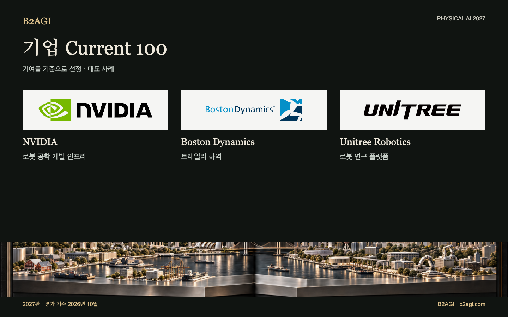

# B2AGI 피지컬 AI 기업 선정 · Current 100 · 2027

생산·운영·교육·연구에 채택된 기술과 제품을 다룬다. 완료된 기술 이전과 자본 기여도 포함했다. 각 기업이 맡은 고객 작업과 공급 역할을 확인할 수 있다.

2027판 · 2026년 10월 평가 · 기여별 선정 · ID는 순위를 뜻하지 않는다.

선정 근거·근거 범위: 영문 원문.

### 먼저 읽을 사례

[NVIDIA](companies/nvidia--c067/README.md) · [Boston Dynamics](companies/boston-dynamics--c016/README.md) · [Unitree Robotics](companies/unitree-robotics--c095/README.md)

| ID | 이름 | 기여·역할 |
| --- | --- | --- |
| C001 | [42dot](companies/42dot--c001/README.md) | 운행 요청 및 예약 |
| C002 | [AgiBot](companies/agibot--c002/README.md) | 생산 라인 로봇 도입 |
| C003 | [Agile Robots](companies/agile-robots--c003/README.md) | 물류 자동화 통합 |
| C004 | [Agility Robotics](companies/agility-robotics--c004/README.md) | 토트(tote) 이송 |
| N099 | [에이딘로보틱스 / AIDIN Robotics](companies/aidin-robotics--n099/README.md) | 힘 감지 부품 |
| C005 | [Amazon](companies/amazon--c005/README.md) | 주문 처리 분야 도입 |
| C006 | [Ambi Robotics](companies/ambi-robotics--c006/README.md) | 물류 분류 |
| C007 | [AMP Robotics / AMP](companies/amp-robotics-amp--c007/README.md) | 자재 분류 |
| C008 | [ANYbotics](companies/anybotics--c008/README.md) | 산업용 검사 |
| C009 | [Applied Intuition](companies/applied-intuition--c009/README.md) | 차량 시뮬레이션 및 테스트 |
| C010 | [Autonomous a2z](companies/autonomous-a2z--c010/README.md) | 감독형 승객 셔틀 |
| C011 | [Baidu](companies/baidu--c011/README.md) | 무인 승객 운송 서비스 |
| C012 | [Bedrock Robotics](companies/bedrock-robotics--c012/README.md) | 자율 굴착 |
| C013 | [Berkshire Grey](companies/berkshire-grey--c013/README.md) | 소포 분류 |
| C101 | [BlackRock](companies/blackrock--c101/README.md) | 로봇공학 투자 펀드 |
| C015 | [Booster Robotics](companies/booster-robotics--c015/README.md) | 연구 및 대회용 로봇 |
| C016 | [Boston Dynamics](companies/boston-dynamics--c016/README.md) | 트레일러 하역 |
| C017 | [Brain Corp](companies/brain-corp--c017/README.md) | 자율 주행 청소 |
| C018 | [Built Robotics](companies/built-robotics--c018/README.md) | 자율 태양광 설비 시공 |
| C019 | [Burro](companies/burro--c019/README.md) | 농장 내 운송 |
| C020 | [Carbon Robotics](companies/carbon-robotics--c020/README.md) | 레이저 제초 |
| C021 | [CATL](companies/catl--c021/README.md) | 제조 공정 도입 및 배터리 |
| C022 | [Cognex](companies/cognex--c022/README.md) | 산업용 검사 비전 시스템 |
| C023 | [Corvus Robotics](companies/corvus-robotics--c023/README.md) | 재고 관리용 드론 |
| C024 | [Coupang](companies/coupang--c024/README.md) | 풀필먼트(주문 처리) 운영 |
| C025 | [Covariant](companies/covariant--c025/README.md) | 학습 기반 피킹 |
| C026 | [DeepRobotics](companies/deeprobotics--c026/README.md) | 터널 점검 하드웨어 |
| C029 | [Dexterity](companies/dexterity--c029/README.md) | 트레일러 적재 |
| C030 | [Diligent Robotics](companies/diligent-robotics--c030/README.md) | 병원 내 물품 배송 |
| C104 | [DJI](companies/dji--c104/README.md) | 항공 인프라 점검 장비 공급 |
| C105 | [Doosan Robotics](companies/doosan-robotics--c105/README.md) | 로봇 조작 연구 플랫폼 공급 |
| C032 | [Dreame Technology](companies/dreame-technology--c032/README.md) | 가정용 청소기 인식 기능 |
| C033 | [Dyna Robotics](companies/dyna-robotics--c033/README.md) | 의류 접기 |
| C034 | [Ecovacs](companies/ecovacs--c034/README.md) | 가정용 청소 |
| N017 | [Elephant Robotics](companies/elephant-robotics--n017/README.md) | 교육용 로봇 키트 |
| N020 | [Farm-ng](companies/farm-ng--n020/README.md) | 농업 개발 플랫폼 |
| C035 | [Field AI](companies/field-ai--c035/README.md) | 건설 현장 검사 자율화 |
| C036 | [Figure AI](companies/figure-ai--c036/README.md) | 휴머노이드 공장 파일럿 |
| C037 | [Flexiv](companies/flexiv--c037/README.md) | 힘 제어 기반 식품 가공 |
| C038 | [Formic](companies/formic--c038/README.md) | 포장 및 팔레타이징 서비스 |
| C039 | [ForwardX Robotics](companies/forwardx-robotics--c039/README.md) | 창고 피킹 지원 |
| C040 | [Foxglove](companies/foxglove--c040/README.md) | 로봇 로그 분석 |
| C041 | [Galbot](companies/galbot--c041/README.md) | 생산 라인 로봇 공급 |
| C043 | [Gaussian Robotics / Gausium](companies/gaussian-robotics-gausium--c043/README.md) | 매장 청소 |
| C045 | [Geek+](companies/geek--c045/README.md) | 창고 내 물류 이송 |
| C046 | [GelSight](companies/gelsight--c046/README.md) | 촉각 연구용 계측 장비 |
| C047 | [GXO](companies/gxo--c047/README.md) | 고객 물류 통합 |
| C048 | [HAI Robotics](companies/hai-robotics--c048/README.md) | 창고 로봇 시스템 |
| N030 | [HaptX](companies/haptx--n030/README.md) | 촉각 원격 조작 |
| C049 | [Hesai](companies/hesai--c049/README.md) | LiDAR(라이다) 부품 |
| C050 | [Horizon Robotics](companies/horizon-robotics--c050/README.md) | 운전자 보조 컴퓨팅 |
| C051 | [Hyundai Motor Group](companies/hyundai-motor-group--c051/README.md) | 전략적 로봇 기업 지분 보유 |
| C052 | [InOrbit](companies/inorbit--c052/README.md) | 로봇 운영 도구 |
| C053 | [Intuitive Surgical](companies/intuitive-surgical--c053/README.md) | 로봇 보조 기관지 내시경 시술 |
| N037 | [JLG — Canvas Robotics 사업](companies/jlg-canvas-robotics--n037/README.md) | 건설 로봇 기술 이전 |
| C054 | [John Deere](companies/john-deere--c054/README.md) | 선별적 살포 |
| C055 | [Keenon Robotics](companies/keenon-robotics--c055/README.md) | 레스토랑 및 호텔 서비스 로봇 |
| C057 | [Kodiak Robotics / Kodiak AI](companies/kodiak-robotics-kodiak-ai--c057/README.md) | 오프로드 운송 |
| C058 | [Locus Robotics](companies/locus-robotics--c058/README.md) | 피킹 보조 |
| C061 | [Meituan](companies/meituan--c061/README.md) | 자율 배송 운영 |
| C062 | [Mobile Industrial Robots / MiR](companies/mobile-industrial-robots-mir--c062/README.md) | AMR 컨테이너 운송 |
| C063 | [Momenta](companies/momenta--c063/README.md) | 양산형 주행 지능 |
| C064 | [Mytra](companies/mytra--c064/README.md) | 재고 버퍼링 및 순서화(sequencing) |
| C065 | [NAVER / NAVER LABS](companies/naver-naver-labs--c065/README.md) | 건물 통합형 로봇 운영 |
| C066 | [Nearthlab](companies/nearthlab--c066/README.md) | 풍력 발전기 점검 |
| N053 | [Nimble Robotics](companies/nimble-robotics--n053/README.md) | 로봇 기반 풀필먼트 솔루션 공급 |
| C067 | [NVIDIA](companies/nvidia--c067/README.md) | 로봇공학 개발 인프라 |
| C068 | [Orbbec](companies/orbbec--c068/README.md) | 깊이 감지 |
| C069 | [OrionStar](companies/orionstar--c069/README.md) | 공장 공정 간 자재 운반 |
| C070 | [OSARO](companies/osaro--c070/README.md) | 학습 기반 포장 |
| C071 | [Parallel Domain](companies/parallel-domain--c071/README.md) | 합성 인지 데이터 |
| C072 | [Path Robotics](companies/path-robotics--c072/README.md) | 로봇 용접 |
| C073 | [Pickle Robot](companies/pickle-robot--c073/README.md) | 트레일러 하역 |
| C074 | [Plus One Robotics](companies/plus-one-robotics--c074/README.md) | 소포 비전 인식 및 예외 상황 처리 |
| C075 | [Pudu Robotics](companies/pudu-robotics--c075/README.md) | 사무실 청소 |
| C076 | [Quicktron](companies/quicktron--c076/README.md) | 창고 선반 이송 |
| C078 | [RightHand Robotics](companies/righthand-robotics--c078/README.md) | 창고 피킹 |
| C079 | [Roborock](companies/roborock--c079/README.md) | 물체 집어 올리기 및 청소 |
| C080 | [ROBOTIS](companies/robotis--c080/README.md) | 연구용 액추에이터 및 플랫폼 |
| C081 | [Roboto AI](companies/roboto-ai--c081/README.md) | 로봇 운영 분석 |
| C082 | [Robust.AI](companies/robust-ai--c082/README.md) | 협동형 토트(tote) 운반 |
| C083 | [Rockwell Automation](companies/rockwell-automation--c083/README.md) | MES와 AMR의 통합 |
| C084 | [Saildrone](companies/saildrone--c084/README.md) | 해양 관측 |
| C085 | [Samsung Electronics](companies/samsung-electronics--c085/README.md) | 전략적 로봇 기업 소유권 확보 |
| C086 | [Sarcos → Palladyne AI](companies/sarcos-palladyne-ai--c086/README.md) | 유지보수 자동화 소프트웨어 |
| C087 | [Seoul Robotics](companies/seoul-robotics--c087/README.md) | 공장 내 차량 인식 |
| N072 | [Shadow Robot](companies/shadow-robot--n072/README.md) | 정교한 조작이 가능한 연구용 핸드 공급 |
| C090 | [SoftBank](companies/softbank--c090/README.md) | 창고 자동화 지분 및 투자 법인 |
| C091 | [Standard Robots](companies/standard-robots--c091/README.md) | AMR을 이용한 팔레트 운송 |
| C092 | [Superbin](companies/superbin--c092/README.md) | AI 기반 재활용품 수거 |
| C093 | [Symbotic](companies/symbotic--c093/README.md) | 물류 자동화 시스템 |
| C094 | [Syrius Robotics / Syrius Technology](companies/syrius-robotics-syrius-technology--c094/README.md) | 피킹 보조 AMR |
| C103 | [UBTECH](companies/ubtech--c103/README.md) | 산업용 휴머노이드 공급 및 공장 작업 |
| C095 | [Unitree Robotics](companies/unitree-robotics--c095/README.md) | 로봇 연구 플랫폼 |
| C096 | [Universal Robots](companies/universal-robots--c096/README.md) | 온실 수확용 하드웨어 |
| C097 | [Viam](companies/viam--c097/README.md) | 로봇 운영 소프트웨어 |
| C098 | [VisionNav Robotics](companies/visionnav-robotics--c098/README.md) | 자율 주행 지게차 물류 |
| C102 | [Waymo](companies/waymo--c102/README.md) | 무인 승객 운송 서비스 운영 |
| C099 | [XYZ Robotics](companies/xyz-robotics--c099/README.md) | 창고 하역용 장비 공급 |
| C100 | [Zipline](companies/zipline--c100/README.md) | 자율 항공 배송 |

[Atlas](README.md) · [English edition](https://github.com/b2agi/physical-ai-ranking-2027/blob/3dd209a29d38d56f07918da165a50c87dce9a058/) · [JSON](data/ranking2027.ko.json) · [CSV](data/ranking2027.ko.csv)

영문판: [B2AGI Physical AI Companies · Current 100 · 2027](../../CURRENT_100.md)

<!-- B2AGI EPAI SIGNATURE -->
---

**B2AGI | EPAI**  
Embodied Physical Agentic Intelligence  
[Research & Publications](https://b2agi.com/) · [White Paper](https://github.com/b2agi/physical-ai-white-paper-2027) · [Industry Atlas](https://github.com/b2agi/physical-ai-ranking-2027)
<!-- /B2AGI EPAI SIGNATURE -->
