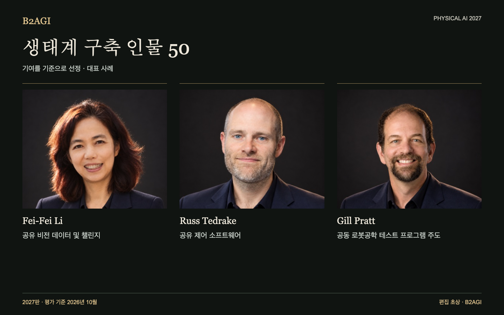

# 생태계 구축 인물 50

연구자와 기업이 함께 쓰는 도구와 시설, 교육·표준·금융 지원을 만든 사람들이다. 각자가 제공한 자원과 역할을 기록했다.

2027판 · 2026년 10월 평가 · 기여별 선정 · ID는 순위를 뜻하지 않는다.

선정 근거·근거 범위: 영문 원문.

### 먼저 읽을 사례

[Fei-Fei Li](people/fei-fei-li--e013/README.md) · [Russ Tedrake](people/russ-tedrake--e022/README.md) · [Gill Pratt](people/gill-pratt--p010/README.md)

| ID | 이름 | 기여·역할 |
| --- | --- | --- |
| E001 | [Aaron Ames](people/aaron-ames--e001/README.md) | 공용 보행 계획 도구 |
| E002 | [Aaron Prather](people/aaron-prather--e002/README.md) | 산업계 테스트 워크숍 |
| E003 | [Andra Keay](people/andra-keay--e003/README.md) | 로봇공학 커뮤니티 지원 |
| E004 | [Ayanna Howard](people/ayanna-howard--e004/README.md) | 접근성 높은 STEM 기술 이전 |
| E005 | [Brian Gerkey](people/brian-gerkey--e005/README.md) | 개방형 로봇공학 아키텍처 |
| E052 | [Bruce Leak](people/bruce-leak--e052/README.md) | 창업자 및 이사회 지원 |
| E047 | [조규남](people/cho-kyu-nam--e047/README.md) | 공개적인 업계 논의 |
| E007 | [Christian Hubicki](people/christian-hubicki--e007/README.md) | 제어 및 시뮬레이션 교육 |
| E008 | [Craig Schlenoff](people/craig-schlenoff--e008/README.md) | 로봇공학 공동 평가 |
| E053 | [Cyril Ebersweiler](people/cyril-ebersweiler--e053/README.md) | 하드웨어 스타트업 지원 |
| P006 | [Daniela Rus](people/daniela-rus--p006/README.md) | 로봇공학 박사 과정 멘토링 |
| E009 | [Dennis Hong / 데니스 홍](people/dennis-hong--e009/README.md) | 연구 및 교육 플랫폼 |
| E010 | [Elena Messina](people/elena-messina--e010/README.md) | 공동 표준 및 테스트 |
| E011 | [Elham Tabassi](people/elham-tabassi--e011/README.md) | AI 리스크 관리 프레임워크 |
| E012 | [Erico Guizzo](people/erico-guizzo--e012/README.md) | 로봇공학 관련 편집 콘텐츠 |
| E013 | [Fei-Fei Li](people/fei-fei-li--e013/README.md) | 공유 비전 데이터 및 챌린지 |
| E014 | [Francesca Rossi](people/francesca-rossi--e014/README.md) | 자율 시스템 설계 윤리 |
| P009 | [Geordie Rose](people/geordie-rose--p009/README.md) | 로봇공학 파트너 투자 및 지원 |
| P010 | [Gill Pratt](people/gill-pratt--p010/README.md) | 공동 로봇공학 테스트 프로그램 주도 |
| E050 | [한재권 / Han Jae-kwon](people/han-jae-kwon--e050/README.md) | 대중 대상 로봇공학 교육 |
| E044 | [왕허 / He Wang](people/he-wang--e044/README.md) | 공동 정교한 파지 벤치마크 및 도구 |
| E015 | [Henrik Christensen](people/henrik-christensen--e015/README.md) | 공동 로봇공학 로드맵 |
| P036 | [Jiyang Gao](people/jiyang-gao--p036/README.md) | 데이터셋 및 모델 프로그램 조정 |
| E036 | [김정 / Jung Kim](people/jung-kim--e036/README.md) | 스타트업 육성 프로그램 |
| P015 | [Karol Hausman](people/karol-hausman--p015/README.md) | 로봇 학습 인프라 |
| E016 | [Li Zexiang / 리쩌샹](people/li-zexiang--e016/README.md) | 스타트업 교육 및 제조 지원 |
| E037 | [량징 梁靓](people/liang-jing--e037/README.md) | 표준화 실무 그룹 운영 |
| E051 | [Lior Susan](people/lior-susan--e051/README.md) | 산업 분야 스타트업 조직화 |
| E030 | [Liu Lianqing](people/liu-lianqing--e030/README.md) | 로봇공학 박사 과정 지도 |
| E017 | [Matt Beane](people/matt-beane--e017/README.md) | 업무 및 기술 전환 연구 |
| E018 | [Matthew Johnson-Roberson](people/matthew-johnson-roberson--e018/README.md) | 로봇공학 박사 과정 지도 |
| E055 | [Mayank Mittal](people/mayank-mittal--e055/README.md) | 공개 로봇 학습 인프라 |
| E056 | [Morgan Quigley](people/morgan-quigley--e056/README.md) | ROS 아키텍처 |
| E020 | [Pieter Abbeel](people/pieter-abbeel--e020/README.md) | 로봇 제어 교육 |
| E049 | [친슈공 秦修功](people/qin-xiugong--e049/README.md) | 공통 표준 용어 |
| E048 | [취다오쿠이 / Qu Daokui](people/qu-daokui--e048/README.md) | 연구 성과의 사업화 |
| E022 | [Russ Tedrake](people/russ-tedrake--e022/README.md) | 공유 제어 소프트웨어 |
| E023 | [Ryan Gariepy](people/ryan-gariepy--e023/README.md) | 개발자 교류 및 교육 |
| E024 | [Rémi Cadène / Remi Cadene](people/remi-cadene-remi-cadene--e024/README.md) | 오픈 로봇 학습 도구 |
| E039 | [스린 石霖](people/shi-lin--e039/README.md) | 공동 평가 표준 제정 참여 |
| E025 | [Sun Lining](people/sun-lining--e025/README.md) | 지역 연구 및 인재 양성 프로그램 |
| E026 | [Tom Ryden](people/tom-ryden--e026/README.md) | 공용 시설 운영 |
| E027 | [Tully Foote](people/tully-foote--e027/README.md) | ROS 단위 및 좌표계 관례 |
| E028 | [Vincent Vanhoucke](people/vincent-vanhoucke--e028/README.md) | 연구팀 구성 |
| E043 | [왕톈먀오 / Wang Tianmiao](people/wang-tianmiao--e043/README.md) | 인재 및 스타트업 지원 |
| E045 | [웨이카이 / Wei Kai](people/wei-kai--e045/README.md) | 공동 평가 표준 작성 |
| E054 | [Wendy Tan White](people/wendy-tan-white--e054/README.md) | 공동 개발 조직 |
| E032 | [Xiong Rong](people/xiong-rong--e032/README.md) | 학생 연구 플랫폼 |
| E041 | [여준구](people/yuh-joon-ku--e041/README.md) | 연구 의제 편집 |
| E029 | [Zhang Jianwei](people/zhang-jianwei--e029/README.md) | 다기관 연구 조정 |

[Atlas](README.md) · [English edition](https://github.com/b2agi/physical-ai-ranking-2027/blob/3dd209a29d38d56f07918da165a50c87dce9a058/) · [JSON](data/ranking2027.ko.json) · [CSV](data/ranking2027.ko.csv)
