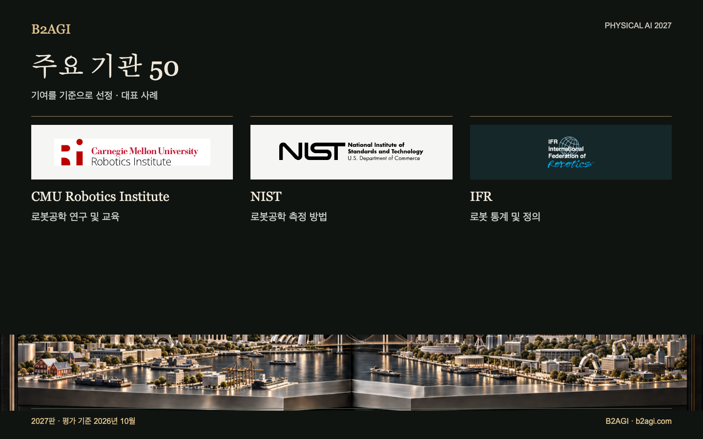

# B2AGI 피지컬 AI 주요 기관 50 · 2027

연구·시험·표준·규제·산업 지원·자본시장 접근에 기여한 기관과 프로그램을 모았다. 기술 저술과 자금 지원, 인증과 운영 지원을 구분해 적었다.

2027판 · 2026년 10월 평가 · 기여별 선정 · ID는 순위를 뜻하지 않는다.

선정 근거·근거 범위: 영문 원문.

### 먼저 읽을 사례

[NIST](institutions/nist--i033/README.md) · [KAIST](institutions/kaist--i018/README.md) · [MassRobotics](institutions/massrobotics--i027/README.md)

| ID | 이름 | 기여·역할 |
| --- | --- | --- |
| I001 | [ARM Institute](institutions/arm-institute--i001/README.md) | 제조 현장 도입 지원 |
| I003 | [ASTM F45](institutions/astm-f45--i003/README.md) | 이동 로봇 성능 표준 |
| I047 | [Beijing Humanoid Robot Innovation Center](institutions/beijing-humanoid-robot-innovation-center--i047/README.md) | 공유 로봇 학습 데이터 |
| I004 | [BIGAI](institutions/bigai--i004/README.md) | 공유 로봇공학 연구 도구 |
| I005 | [CESI](institutions/cesi--i005/README.md) | 체화지능 데이터 품질 지침 공동 작성 |
| I006 | [CMU Robotics Institute](institutions/cmu-robotics-institute--i006/README.md) | 로봇공학 연구 및 교육 |
| I007 | [DARPA SubT 활동단위](institutions/darpa-subt--i007/README.md) | 공용 물리적 테스트 환경 |
| I008 | [DFKI Robotics Innovation Center](institutions/dfki-robotics-innovation-center--i008/README.md) | 산업용 로봇 연구 |
| I009 | [ETRI](institutions/etri--i009/README.md) | 로봇 기술 이전 |
| I010 | [euRobotics](institutions/eurobotics--i010/README.md) | 로봇공학 연구 생태계 |
| I011 | [FAA](institutions/faa--i011/README.md) | BVLOS(가시권 밖) 택배 배송 승인 |
| I012 | [Harvard Wyss Institute](institutions/harvard-wyss-institute--i012/README.md) | 보조 로봇 연구 및 라이선스 계약 |
| I013 | [HIT 로봇기술·시스템 연구 단위](institutions/hit-robotics-technology-and-systems-research-unit--i013/README.md) | 물리적 로봇 연구 인프라 |
| I014 | [HKEX / HKSCC](institutions/hkex-hkscc--i014/README.md) | 상장·청산 접근 |
| I015 | [IEC 로봇 제품 안전 표준 활동](institutions/iec-robotics-product-safety-standards--i015/README.md) | 로봇 제품 안전 표준 |
| I016 | [IFR](institutions/ifr--i016/README.md) | 로봇 통계 및 정의 |
| I017 | [ISO/TC 299](institutions/iso-tc-299--i017/README.md) | 로봇공학 표준 개발 |
| I018 | [KAIST](institutions/kaist--i018/README.md) | 공용 휴머노이드 연구 플랫폼 |
| I020 | [KEIT / 한국산업기술기획평가원](institutions/keit--i020/README.md) | 로봇공학 연구 자금 지원 |
| I022 | [KIAT / 한국산업기술진흥원](institutions/kiat--i022/README.md) | 로봇공학 R&D 자금 지원 |
| I023 | [KIRIA / 한국로봇산업진흥원](institutions/kiria--i023/README.md) | 로봇 시험 및 인증 |
| I024 | [KITECH / 한국생산기술연구원](institutions/kitech--i024/README.md) | 로봇 디지털 트윈 연구 |
| I050 | [한국거래소 / KRX](institutions/krx--i050/README.md) | 로봇 기업 상장·공시 접근 |
| I025 | [KTL / 한국산업기술시험원](institutions/ktl--i025/README.md) | 웨어러블 로봇 시험 |
| I026 | [LeRobot / Hugging Face](institutions/lerobot-hugging-face--i026/README.md) | 공유 로봇 학습 인프라 |
| I027 | [MassRobotics](institutions/massrobotics--i027/README.md) | 공유 개발 시설 |
| I028 | [MIIT](institutions/miit--i028/README.md) | 로봇 활용 정책 |
| I029 | [MIT CSAIL](institutions/mit-csail--i029/README.md) | 인간-로봇 상호작용 연구 |
| I030 | [NASA Jet Propulsion Laboratory](institutions/nasa-jet-propulsion-laboratory--i030/README.md) | 행성 탐사 로봇 운용 |
| I031 | [Nasdaq](institutions/nasdaq--i031/README.md) | 로봇 기업의 공개 시장 진입 |
| I048 | [국가로봇검측평정센터 상하이 본부](institutions/national-robot-testing-and-evaluation-center-shanghai-headquarters--i048/README.md) | 상하이 로봇 인증 |
| I053 | [New York Stock Exchange / NYSE](institutions/new-york-stock-exchange-nyse--i053/README.md) | 발행사의 과거 거래 이력 |
| I032 | [NHTSA](institutions/nhtsa--i032/README.md) | 자율주행 관련 리콜 보고 |
| I054 | [NIOSH / Center for Occupational Robotics Research](institutions/niosh-center-for-occupational-robotics-research--i054/README.md) | 산업용 로봇 관련 위험 연구 및 지침 |
| I033 | [NIST](institutions/nist--i033/README.md) | 로봇공학 측정 방법 |
| I034 | [Open Robotics / OSRF](institutions/open-robotics-osrf--i034/README.md) | 오픈 로보틱스 소프트웨어 인프라 |
| I035 | [Open X-Embodiment consortium](institutions/open-x-embodiment-consortium--i035/README.md) | 공유 학습 데이터 및 모델 |
| I036 | [OSHA 로봇 안전 안내 활동](institutions/osha-robotics-safety-guidance--i036/README.md) | 작업장 로봇 안전 지침 |
| I037 | [POSTECH](institutions/postech--i037/README.md) | 병원 로봇 공동 연구 및 평가 |
| I038 | [RAI Institute（원자료 Boston Dynamics AI Institute）](institutions/rai-institute--i038/README.md) | 공개 로봇 학습 도구 |
| I039 | [SAC](institutions/sac--i039/README.md) | 국가 표준 관리 |
| I040 | [SEC](institutions/sec--i040/README.md) | 발행사 공시 검토 |
| I041 | [Shanghai AI Lab](institutions/shanghai-ai-lab--i041/README.md) | 공동 시뮬레이션 연구 |
| I051 | [Shanghai Stock Exchange / 상하이증권거래소](institutions/shanghai-stock-exchange--i051/README.md) | 산업 분야 발행사의 시장 진입 |
| I052 | [Shenzhen Stock Exchange / 선전증권거래소](institutions/shenzhen-stock-exchange--i052/README.md) | 산업 분야 발행사의 시장 진입 |
| I046 | [SIA](institutions/sia--i046/README.md) | 산업 기술 이전 |
| I042 | [Toyota Research Institute](institutions/toyota-research-institute--i042/README.md) | 로봇 학습 및 제어 연구 |
| I043 | [UC Berkeley BAIR: RAIL BridgeData](institutions/uc-berkeley-bair-rail-bridgedata--i043/README.md) | 로봇 데이터 및 학습 도구 공유 |
| I044 | [XbotPark](institutions/xbotpark--i044/README.md) | 스타트업 제조 지원 |
| I045 | [Zhejiang University 로봇 연구 활동](institutions/zhejiang-university-robotics-research--i045/README.md) | 로봇공학 교육 |

[Atlas](README.md) · [English edition](https://github.com/b2agi/physical-ai-ranking-2027/blob/3dd209a29d38d56f07918da165a50c87dce9a058/) · [JSON](data/ranking2027.ko.json) · [CSV](data/ranking2027.ko.csv)

영문판: [B2AGI Physical AI Institutions 50 · 2027](../../INSTITUTIONS_50.md)

<!-- B2AGI EPAI SIGNATURE -->
---

**B2AGI | EPAI**  
Embodied Physical Agentic Intelligence  
[Research & Publications](https://b2agi.com/) · [White Paper](https://github.com/b2agi/physical-ai-white-paper-2027) · [Industry Atlas](https://github.com/b2agi/physical-ai-ranking-2027)
<!-- /B2AGI EPAI SIGNATURE -->
