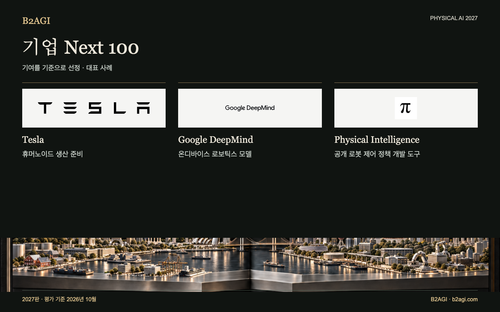

# 기업 Next 100

개발과 시제품 시험, 연구 검증 단계의 제품·행동 모델·응용을 다룬다. Current·Next 구분은 이 목록에 선정된 기여를 기준으로 하며, 기업 전체 사업의 단계와는 다를 수 있다.

2027판 · 2026년 10월 평가 · 기여별 선정 · ID는 순위를 뜻하지 않는다.

선정 근거·근거 범위: 영문 원문.

### 먼저 읽을 사례

[Tesla](companies/tesla--n080/README.md) · [Google DeepMind](companies/google-deepmind--n029/README.md) · [Physical Intelligence](companies/physical-intelligence--n059/README.md)

| ID | 이름 | 기여·역할 |
| --- | --- | --- |
| N001 | [1X Technologies](companies/1x-technologies--n001/README.md) | 전신 제어 정책 학습 |
| N100 | [에이로봇 / AeiROBOT](companies/aeirobot--n100/README.md) | 연구 및 대회용 플랫폼 |
| N002 | [Aeva](companies/aeva--n002/README.md) | 산업용 감지 기술 |
| N003 | [Aigen](companies/aigen--n003/README.md) | 농업 현장 시험 |
| N004 | [Alibaba](companies/alibaba--n004/README.md) | 로봇의 지각 및 행동 모델 |
| N005 | [Ambarella](companies/ambarella--n005/README.md) | 로봇 추론 통합 개발 |
| N006 | [Anthropic](companies/anthropic--n006/README.md) | 언어 모델 제어 연구 |
| N007 | [Apple](companies/apple--n007/README.md) | 로봇 상호작용 및 학습 데이터 |
| N008 | [Apptronik](companies/apptronik--n008/README.md) | 휴머노이드 고객 시범 운용 |
| N009 | [Astribot](companies/astribot--n009/README.md) | 조작 제어 정책 연구 |
| N010 | [Autodesk](companies/autodesk--n010/README.md) | 학습 기반 조립 |
| N011 | [BeingBeyond](companies/beingbeyond--n011/README.md) | 비디오 기반 로봇 학습 |
| N012 | [BeyondHoneycomb](companies/beyondhoneycomb--n012/README.md) | 조리 상태 감지 |
| N013 | [bitsensing](companies/bitsensing--n013/README.md) | 레이더 셔틀 시범 운행 |
| N101 | [Black Sesame](companies/black-sesame--n101/README.md) | 로봇공학용 컴퓨팅 키트 |
| N014 | [ByteDance](companies/bytedance--n014/README.md) | 로봇 동작 모델 연구 |
| N015 | [Config](companies/config--n015/README.md) | 로봇 데이터 및 작업 모델 |
| N016 | [DEEPX（한국）](companies/deepx--n016/README.md) | 로봇용 엣지 컴퓨팅 |
| N018 | [EngineAI](companies/engineai--n018/README.md) | 학습 및 배포 도구 |
| N019 | [Faraday Dynamics](companies/faraday-dynamics--n019/README.md) | 로봇 액추에이터 |
| N104 | [Flexion Robotics](companies/flexion-robotics--n104/README.md) | 전신 작업 제어 정책 |
| N021 | [Flexxbotics](companies/flexxbotics--n021/README.md) | 검사 및 재작업 공정 통합 |
| N022 | [Floatic](companies/floatic--n022/README.md) | 협업형 피킹 시범 운영 |
| N023 | [Fourier Intelligence](companies/fourier-intelligence--n023/README.md) | 로봇 학습 및 배포 도구 |
| N024 | [Galaxea AI](companies/galaxea-ai--n024/README.md) | 물리적 조작 학습 |
| C044 | [Gecko Robotics](companies/gecko-robotics--c044/README.md) | 로봇을 이용한 부품 검사 |
| N025 | [Generalist AI](companies/generalist-ai--n025/README.md) | 조작 모델 연구 |
| N026 | [Genesis AI](companies/genesis-ai--n026/README.md) | 물리적 조작 개발 |
| N027 | [Genisom AI](companies/genisom-ai--n027/README.md) | 로봇 소프트웨어 개발 도구 |
| N028 | [Gole Robotics](companies/gole-robotics--n028/README.md) | 건설 현장 자재 운송 시험 |
| N029 | [Google DeepMind](companies/google-deepmind--n029/README.md) | 온디바이스 로보틱스 모델 |
| N111 | [Hello Robot](companies/hello-robot--n111/README.md) | 개방 어휘 이동형 로봇 조작 개발 |
| N031 | [Helm.ai](companies/helm-ai--n031/README.md) | 주행 모델 개발 |
| N032 | [Hexagon](companies/hexagon--n032/README.md) | 휴머노이드 학습 및 검증 |
| N033 | [Honda](companies/honda--n033/README.md) | 정교한 원격 조작 보조 |
| N113 | [Hugging Face](companies/hugging-face--n113/README.md) | 컴팩트한 '인지-행동(perception-to-action)' 모델 연구 |
| N034 | [Intel](companies/intel--n034/README.md) | 뉴로모픽 로봇 제어 연구 |
| N035 | [Intrinsic](companies/intrinsic--n035/README.md) | AI 제조 통합 |
| N036 | [JD.com](companies/jd-com--n036/README.md) | 다중 소스 기반 행동 학습 |
| N039 | [KNOWIN](companies/knowin--n039/README.md) | 폐루프 제어 정책 연구 |
| N040 | [Leju Robotics](companies/leju-robotics--n040/README.md) | 로봇 개발 도구 |
| N041 | [LG Electronics](companies/lg-electronics--n041/README.md) | 가정용 조작 기능 개발 |
| N042 | [LimX Dynamics](companies/limx-dynamics--n042/README.md) | 하드웨어 연동 개발 도구 |
| N043 | [Lumos Robotics](companies/lumos-robotics--n043/README.md) | 조작 데이터 플랫폼 |
| N044 | [Machina Labs](companies/machina-labs--n044/README.md) | 폐루프 성형 |
| N045 | [MakinaRocks / 마키나락스](companies/makinarocks--n045/README.md) | 로봇 유지보수 모델 |
| N102 | [Maven Robotics](companies/maven-robotics--n102/README.md) | 물류 현장 도입 개발 |
| N046 | [Mentee Robotics / Mentee by Mobileye](companies/mentee-robotics-mentee-by-mobileye--n046/README.md) | 물리적 조작 학습 |
| N047 | [Meta](companies/meta--n047/README.md) | 협동 로봇 벤치마크 |
| N048 | [Microsoft](companies/microsoft--n048/README.md) | 로봇 계획 및 행동 모델 |
| N096 | [모빌린트 / Mobilint](companies/mobilint--n096/README.md) | 로봇 제어 정책 인코더 통합 연구 |
| N097 | [모빌테크 / Mobiltech](companies/mobiltech--n097/README.md) | 공간 데이터 자산 |
| N049 | [MORAI](companies/morai--n049/README.md) | 주행 시뮬레이션 도구 |
| N051 | [Near Earth Autonomy](companies/near-earth-autonomy--n051/README.md) | 자율 비행 항공기 통합 |
| N052 | [NEURA Robotics](companies/neura-robotics--n052/README.md) | 로봇 학습 플랫폼 |
| N054 | [Noetix Robotics](companies/noetix-robotics--n054/README.md) | 강화 학습 도구 |
| N095 | [노타 / Nota AI](companies/nota-ai--n095/README.md) | 로봇 추론 런타임 |
| N055 | [Nuro](companies/nuro--n055/README.md) | 로보택시 임직원 대상 시험 운행 |
| N056 | [Outrider](companies/outrider--n056/README.md) | 자율 야드(yard) 주행 시험 |
| N057 | [PaXini](companies/paxini--n057/README.md) | 촉각 기반 조작 |
| N058 | [Persona AI](companies/persona-ai--n058/README.md) | 원격 조작 용접 |
| N059 | [Physical Intelligence](companies/physical-intelligence--n059/README.md) | 공개 로봇 제어 정책 개발 도구 |
| N060 | [Qualcomm](companies/qualcomm--n060/README.md) | 로봇공학 컴퓨팅 환경 |
| N061 | [Raion Robotics / 라이온로보틱스](companies/raion-robotics--n061/README.md) | 4족 보행 로봇 제어 개발 |
| N062 | [RealMan](companies/realman--n062/README.md) | 로봇 데이터 및 원격 조작 |
| N064 | [Realtime Robotics](companies/realtime-robotics--n064/README.md) | 동작 계획 최적화 |
| N065 | [Reliable Robotics](companies/reliable-robotics--n065/README.md) | 항공기 탑재형 탐지 및 회피(detect-and-avoid) 연구 |
| N109 | [Rhoda AI](companies/rhoda-ai--n109/README.md) | 비디오 사전 학습 기반 산업용 조작 연구 |
| N066 | [Richtech Robotics](companies/richtech-robotics--n066/README.md) | AI 기반 음료 조작 |
| N110 | [RIVR](companies/rivr--n110/README.md) | 지형 인식 기반 택배 배송 시험 |
| N067 | [RLWRLD](companies/rlwrld--n067/README.md) | 물리적 제어 정책 연구 |
| N105 | [RoboForce](companies/roboforce--n105/README.md) | 산업용 로봇 시범 운용 |
| N068 | [RobotEra](companies/robotera--n068/README.md) | 예측형 조작 제어 정책 개발 |
| N069 | [ROBROS](companies/robros--n069/README.md) | 학습 기반 블록 분류 |
| N070 | [Sanctuary AI](companies/sanctuary-ai--n070/README.md) | 접촉 작업 학습 |
| N071 | [Saronic](companies/saronic--n071/README.md) | 자율 주행 수상 선박 시험 |
| C088 | [Siemens](companies/siemens--c088/README.md) | 공장 통합 시험 |
| N073 | [Skild AI](companies/skild-ai--n073/README.md) | 다중 로봇 조작 |
| N074 | [Sony](companies/sony--n074/README.md) | 도구 사용 학습 |
| N075 | [Spirit AI](companies/spirit-ai--n075/README.md) | 물리적 환경에서의 제어 정책 배포 지원 |
| N103 | [Standard Bots](companies/standard-bots--n103/README.md) | 로봇 개발 및 교육 |
| N076 | [Sunday](companies/sunday--n076/README.md) | 가정용 로봇 개발 |
| N078 | [TARS Robotics](companies/tars-robotics--n078/README.md) | 조작 데이터 및 개발 키트 |
| N079 | [Tencent](companies/tencent--n079/README.md) | 로봇 플랫폼 통합 |
| N080 | [Tesla](companies/tesla--n080/README.md) | 휴머노이드 생산 준비 |
| N108 | [Torc Robotics](companies/torc-robotics--n108/README.md) | 고속도로 자율 화물 운송 검증 |
| N107 | [Toyota Motor Corporation / Toyota Research Institute](companies/toyota-motor-corporation-toyota-research-institute--n107/README.md) | 전신 조작 제어 정책 개발 |
| N081 | [Vayu Robotics](companies/vayu-robotics--n081/README.md) | 학습 기반 배송 모빌리티 |
| N082 | [Vention](companies/vention--n082/README.md) | 산업용 인식 도구 |
| N083 | [Vueron](companies/vueron--n083/README.md) | 도로 주행 감지 테스트 |
| N084 | [Waabi](companies/waabi--n084/README.md) | 자율주행 트럭 통합 |
| N112 | [Wayve](companies/wayve--n112/README.md) | 언어 기반 주행 제어 연구 |
| N085 | [WIRobotics](companies/wirobotics--n085/README.md) | 연구용 로봇 모델 |
| N086 | [Wonik Robotics / 원익로보틱스](companies/wonik-robotics--n086/README.md) | 감지 기능 탑재 로봇 핸드 |
| N087 | [World Labs](companies/world-labs--n087/README.md) | 생성형 로봇 시뮬레이션 개발 |
| N088 | [X Square Robot](companies/x-square-robot--n088/README.md) | 제어 정책 학습 도구 |
| N089 | [Xiaomi](companies/xiaomi--n089/README.md) | 물리적 동작 모델 연구 |
| N092 | [Xingyuanzhi](companies/xingyuanzhi--n092/README.md) | 로봇 인지 및 동작 개발 |
| N090 | [XPENG Robotics / IRON](companies/xpeng-robotics-iron--n090/README.md) | 휴머노이드 하드웨어 개발 |
| N093 | [Yuequan Bionic](companies/yuequan-bionic--n093/README.md) | 생체 모방형 손 시제품 |

[Atlas](README.md) · [English edition](https://github.com/b2agi/physical-ai-ranking-2027/blob/3dd209a29d38d56f07918da165a50c87dce9a058/) · [JSON](data/ranking2027.ko.json) · [CSV](data/ranking2027.ko.csv)
