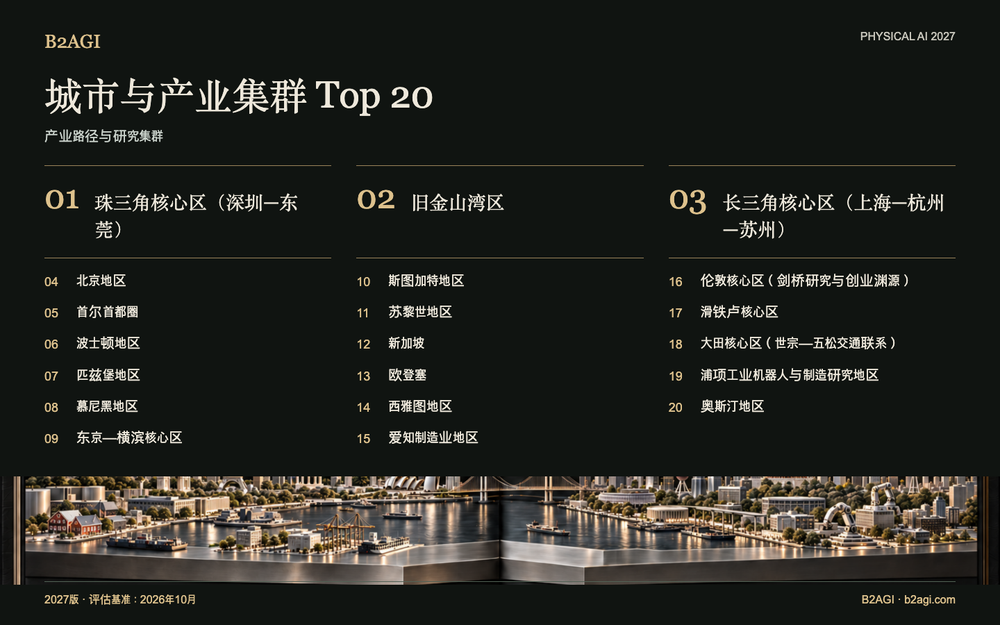

# 城市与产业集群 Top 20

选取20个连接研究、制造与客户应用的产业区域。各区域边界不同，具体活动地点见各条目。

2027版 · 2026年10月评估 · 定性排名

入选依据与证据范围：英文原文。

### 推荐阅读条目

[珠三角核心区（深圳—东莞）](clusters/pearl-river-delta-core-shenzhendongguan--cluster-01/README.md) · [旧金山湾区](clusters/san-francisco-bay-area--cluster-02/README.md) · [长三角核心区（上海—杭州—苏州）](clusters/yangtze-river-delta-core-shanghaihangzhousuzhou--cluster-03/README.md)

| 排名 | 名称 | 贡献与角色 |
| --- | --- | --- |
| 1 | [珠三角核心区（深圳—东莞）](clusters/pearl-river-delta-core-shenzhendongguan--cluster-01/README.md) | 机器人工程、孵化与制造资源对接 |
| 2 | [旧金山湾区](clusters/san-francisco-bay-area--cluster-02/README.md) | 机器人平台、学习研究与共享设施 |
| 3 | [长三角核心区（上海—杭州—苏州）](clusters/yangtze-river-delta-core-shanghaihangzhousuzhou--cluster-03/README.md) | 训练基础设施、机器人产品与物理系统研究 |
| 4 | [北京地区](clusters/beijing-region--cluster-04/README.md) | 机器人学习、驾驶测试与成长型资金 |
| 5 | [首尔首都圈](clusters/seoul-capital-area--cluster-05/README.md) | 楼宇内配送、机器人开发及资本获取 |
| 6 | [波士顿地区](clusters/boston-region--cluster-06/README.md) | 硬件初创企业与共享机器人实验 |
| 7 | [匹兹堡地区](clusters/pittsburgh-region--cluster-07/README.md) | 研究成果转化与制造示范 |
| 8 | [慕尼黑地区](clusters/munich-region--cluster-08/README.md) | 工业物流集成与增长融资 |
| 9 | [东京—横滨核心区](clusters/tokyoyokohama-core--cluster-09/README.md) | 机器人控制、集成及测试资源获取 |
| 10 | [斯图加特地区](clusters/stuttgart-region--cluster-10/README.md) | AI 操控与汽车测试基础设施 |
| 11 | [苏黎世地区](clusters/zurich-region--cluster-11/README.md) | 基于学习机制的检测控制与研究成果商业化 |
| 12 | [新加坡](clusters/singapore--cluster-12/README.md) | 面向客户基础设施的机器人集成 |
| 13 | [欧登塞](clusters/odense--cluster-13/README.md) | 移动机器人与协作机器人开发 |
| 14 | [西雅图地区](clusters/seattle-region--cluster-14/README.md) | 物流应用企业、无人机工程与机器人数据工具 |
| 15 | [爱知制造业地区](clusters/aichi-manufacturing-region--cluster-15/README.md) | 制造开发与机器人测试设施 |
| 16 | [伦敦核心区（剑桥研究与创业渊源）](clusters/london-core-cambridge-research-and-startup-lineage--cluster-16/README.md) | 动作模型、机器人学习与驾驶技术开发 |
| 17 | [滑铁卢核心区](clusters/waterloo-core--cluster-17/README.md) | 工业级自主移动机器人（AMR）、自动化集成与服务 |
| 18 | [大田核心区（世宗—五松交通联系）](clusters/daejeon-core-sejongosong-transport-links--cluster-18/README.md) | 研发平台、技术转移与演示实验室 |
| 19 | [浦项工业机器人与制造研究地区](clusters/pohang-industrial-robotics-and-manufacturing-research-region--cluster-19/README.md) | 机器人制造与钢铁产业发展 |
| 20 | [奥斯汀地区](clusters/austin-region--cluster-20/README.md) | 人形机器人开发、客户试用与增长资本 |

[Atlas](README.md) · [English edition](https://github.com/b2agi/physical-ai-ranking-2027/blob/3dd209a29d38d56f07918da165a50c87dce9a058/) · [JSON](data/ranking2027.zh-CN.json) · [CSV](data/ranking2027.zh-CN.csv)
