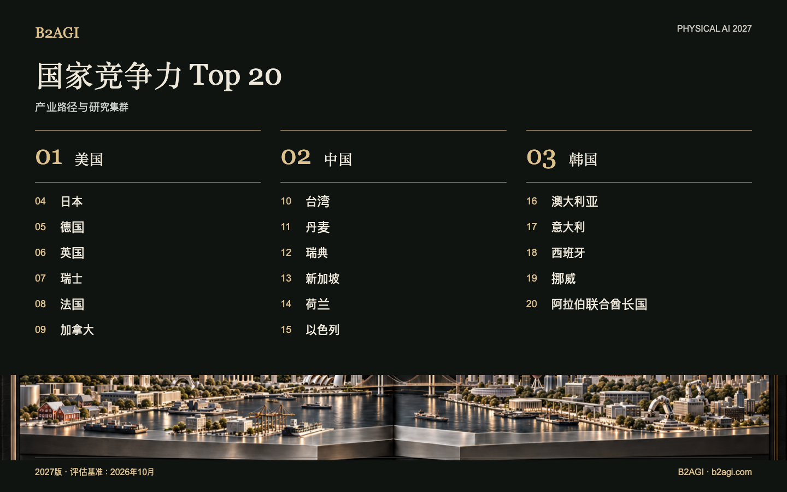

# B2AGI Physical AI 国家竞争力排名20 · 2027

比较20个国家与经济体的研究能力、产品开发、客户运营及未来产业能力。排名依据五个分析视角作出定性判断，未采用综合分数。

2027版 · 2026年10月评估 · 定性排名

入选依据与证据范围：英文原文。

### 推荐阅读条目

[中国](countries/china--country-02/README.md) · [美国](countries/united-states--country-01/README.md) · [韩国](countries/south-korea--country-03/README.md)

| 排名 | 名称 | 贡献与角色 |
| --- | --- | --- |
| 1 | [美国](countries/united-states--country-01/README.md) | 机器人平台、客户部署与增长资本 |
| 2 | [中国](countries/china--country-02/README.md) | 机器人硬件与集成制造网络 |
| 3 | [韩国](countries/south-korea--country-03/README.md) | 机器人协同、学习型控制与研究成果商业化 |
| 4 | [日本](countries/japan--country-04/README.md) | 工厂流程中的感知与运动规划 |
| 5 | [德国](countries/germany--country-05/README.md) | 工业操作、集成与测试 |
| 6 | [英国](countries/united-kingdom--country-06/README.md) | 端侧机器人模型与灵巧学习 |
| 7 | [瑞士](countries/switzerland--country-07/README.md) | 用于工业检测的学习型控制技术 |
| 8 | [法国](countries/france--country-08/README.md) | 开放式机器人学习工具与操作模型 |
| 9 | [加拿大](countries/canada--country-09/README.md) | 操作学习与自动驾驶卡车集成 |
| 10 | [台湾](countries/taiwan--country-10/README.md) | 半导体制造、封装与机器人技术基础设施 |
| 11 | [丹麦](countries/denmark--country-11/README.md) | 移动物流与协作机器人平台 |
| 12 | [瑞典](countries/sweden--country-12/README.md) | 面向产业应用的机器人研究与博士培养 |
| 13 | [新加坡](countries/singapore--country-13/README.md) | 电力隧道巡检的本土集成 |
| 14 | [荷兰](countries/netherlands--country-14/README.md) | 仓储集成与自动化融资 |
| 15 | [以色列](countries/israel--country-15/README.md) | 操作技术开发与国家级AI算力 |
| 16 | [澳大利亚](countries/australia--country-16/README.md) | 自动采矿与建筑施工的现场试验 |
| 17 | [意大利](countries/italy--country-17/README.md) | 工业集成与仓储验证 |
| 18 | [西班牙](countries/spain--country-18/README.md) | 机器人工程与AI检测技术开发 |
| 19 | [挪威](countries/norway--country-19/README.md) | 人形机器人工程与制造开发 |
| 20 | [阿拉伯联合酋长国](countries/united-arab-emirates--country-20/README.md) | 自动驾驶客运服务的应用与运营 |

[Atlas](README.md) · [English edition](https://github.com/b2agi/physical-ai-ranking-2027/blob/3dd209a29d38d56f07918da165a50c87dce9a058/) · [JSON](data/ranking2027.zh-CN.json) · [CSV](data/ranking2027.zh-CN.csv)

英文版：[B2AGI Physical AI Country Ranking 20 · 2027](../../README.md#country-overview)
