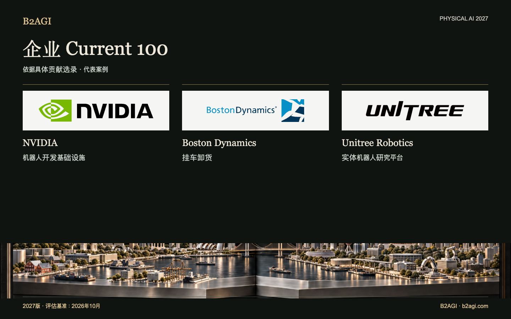

# B2AGI Physical AI 企业选录 · Current 100 · 2027

收录已用于生产、运营、教育或研究的技术与产品，以及已完成的技术转移和资本贡献。各条目说明企业承担的客户任务或供应角色。

2027版 · 2026年10月评估 · 按贡献选录 · ID不代表排名。

入选依据与证据范围：英文原文。

### 推荐阅读条目

[NVIDIA](companies/nvidia--c067/README.md) · [Boston Dynamics](companies/boston-dynamics--c016/README.md) · [Unitree Robotics](companies/unitree-robotics--c095/README.md)

| ID | 名称 | 贡献与角色 |
| --- | --- | --- |
| C001 | [42dot](companies/42dot--c001/README.md) | 乘车请求与预约 |
| C002 | [AgiBot](companies/agibot--c002/README.md) | 生产线机器人部署 |
| C003 | [Agile Robots](companies/agile-robots--c003/README.md) | 物流自动化集成 |
| C004 | [Agility Robotics](companies/agility-robotics--c004/README.md) | 料箱转运 |
| N099 | [AIDIN Robotics](companies/aidin-robotics--n099/README.md) | 力传感组件 |
| C005 | [Amazon](companies/amazon--c005/README.md) | 订单履约应用 |
| C006 | [Ambi Robotics](companies/ambi-robotics--c006/README.md) | 物流分拣 |
| C007 | [AMP Robotics / AMP](companies/amp-robotics-amp--c007/README.md) | 物料分拣 |
| C008 | [ANYbotics](companies/anybotics--c008/README.md) | 工业检测 |
| C009 | [Applied Intuition](companies/applied-intuition--c009/README.md) | 车辆仿真与测试 |
| C010 | [Autonomous a2z](companies/autonomous-a2z--c010/README.md) | 有人监督的载客班车服务 |
| C011 | [Baidu](companies/baidu--c011/README.md) | 无人驾驶客运服务 |
| C012 | [Bedrock Robotics](companies/bedrock-robotics--c012/README.md) | 自动挖掘 |
| C013 | [Berkshire Grey](companies/berkshire-grey--c013/README.md) | 包裹分拣 |
| C101 | [BlackRock](companies/blackrock--c101/README.md) | 机器人产业投资基金 |
| C015 | [Booster Robotics](companies/booster-robotics--c015/README.md) | 科研与竞赛机器人 |
| C016 | [Boston Dynamics](companies/boston-dynamics--c016/README.md) | 挂车卸货 |
| C017 | [Brain Corp](companies/brain-corp--c017/README.md) | 自主清洁 |
| C018 | [Built Robotics](companies/built-robotics--c018/README.md) | 自主太阳能设施建设 |
| C019 | [Burro](companies/burro--c019/README.md) | 农场运输 |
| C020 | [Carbon Robotics](companies/carbon-robotics--c020/README.md) | 激光除草 |
| C021 | [CATL](companies/catl--c021/README.md) | 制造业应用与电池 |
| C022 | [Cognex](companies/cognex--c022/README.md) | 工业检测视觉系统 |
| C023 | [Corvus Robotics](companies/corvus-robotics--c023/README.md) | 库存盘点无人机 |
| C024 | [Coupang](companies/coupang--c024/README.md) | 订单履约作业 |
| C025 | [Covariant](companies/covariant--c025/README.md) | 学习型拣选 |
| C026 | [DeepRobotics](companies/deeprobotics--c026/README.md) | 隧道巡检硬件 |
| C029 | [Dexterity](companies/dexterity--c029/README.md) | 挂车装载 |
| C030 | [Diligent Robotics](companies/diligent-robotics--c030/README.md) | 医院内部配送 |
| C104 | [DJI](companies/dji--c104/README.md) | 空中基础设施巡检设备供应 |
| C105 | [Doosan Robotics](companies/doosan-robotics--c105/README.md) | 机器人操作研究平台供应 |
| C032 | [Dreame Technology](companies/dreame-technology--c032/README.md) | 家居清洁感知能力 |
| C033 | [Dyna Robotics](companies/dyna-robotics--c033/README.md) | 衣物折叠 |
| C034 | [Ecovacs](companies/ecovacs--c034/README.md) | 家居清洁 |
| N017 | [Elephant Robotics](companies/elephant-robotics--n017/README.md) | 教育机器人套件 |
| N020 | [Farm-ng](companies/farm-ng--n020/README.md) | 农业开发平台 |
| C035 | [Field AI](companies/field-ai--c035/README.md) | 施工巡检自主控制 |
| C036 | [Figure AI](companies/figure-ai--c036/README.md) | 人形机器人工厂试点应用 |
| C037 | [Flexiv](companies/flexiv--c037/README.md) | 力控食品加工 |
| C038 | [Formic](companies/formic--c038/README.md) | 包装与码垛服务 |
| C039 | [ForwardX Robotics](companies/forwardx-robotics--c039/README.md) | 仓库拣选辅助 |
| C040 | [Foxglove](companies/foxglove--c040/README.md) | 机器人日志分析 |
| C041 | [Galbot](companies/galbot--c041/README.md) | 生产线机器人供应 |
| C043 | [Gaussian Robotics / Gausium](companies/gaussian-robotics-gausium--c043/README.md) | 门店清洁 |
| C045 | [Geek+](companies/geek--c045/README.md) | 仓储搬运 |
| C046 | [GelSight](companies/gelsight--c046/README.md) | 触觉研究设备 |
| C047 | [GXO](companies/gxo--c047/README.md) | 客户物流集成 |
| C048 | [HAI Robotics](companies/hai-robotics--c048/README.md) | 仓储机器人系统 |
| N030 | [HaptX](companies/haptx--n030/README.md) | 触觉遥操作 |
| C049 | [Hesai](companies/hesai--c049/README.md) | 激光雷达（LiDAR）组件 |
| C050 | [Horizon Robotics](companies/horizon-robotics--c050/README.md) | 驾驶辅助计算 |
| C051 | [Hyundai Motor Group](companies/hyundai-motor-group--c051/README.md) | 战略性机器人业务股权 |
| C052 | [InOrbit](companies/inorbit--c052/README.md) | 机器人运营工具 |
| C053 | [Intuitive Surgical](companies/intuitive-surgical--c053/README.md) | 机器人辅助支气管镜检查 |
| N037 | [JLG — Canvas Robotics](companies/jlg-canvas-robotics--n037/README.md) | 建筑机器人技术转让 |
| C054 | [John Deere](companies/john-deere--c054/README.md) | 选择性喷洒 |
| C055 | [Keenon Robotics](companies/keenon-robotics--c055/README.md) | 餐厅与酒店服务机器人 |
| C057 | [Kodiak Robotics / Kodiak AI](companies/kodiak-robotics-kodiak-ai--c057/README.md) | 越野运输 |
| C058 | [Locus Robotics](companies/locus-robotics--c058/README.md) | 拣选辅助 |
| C061 | [Meituan](companies/meituan--c061/README.md) | 自动配送运营 |
| C062 | [Mobile Industrial Robots / MiR](companies/mobile-industrial-robots-mir--c062/README.md) | AMR 容器运输 |
| C063 | [Momenta](companies/momenta--c063/README.md) | 量产级驾驶智能 |
| C064 | [Mytra](companies/mytra--c064/README.md) | 库存缓冲与排序 |
| C065 | [NAVER / NAVER LABS](companies/naver-naver-labs--c065/README.md) | 建筑集成式机器人运营 |
| C066 | [Nearthlab](companies/nearthlab--c066/README.md) | 风力涡轮机检测 |
| N053 | [Nimble Robotics](companies/nimble-robotics--n053/README.md) | 机器人履约服务供应 |
| C067 | [NVIDIA](companies/nvidia--c067/README.md) | 机器人开发基础设施 |
| C068 | [Orbbec](companies/orbbec--c068/README.md) | 深度感知 |
| C069 | [OrionStar](companies/orionstar--c069/README.md) | 工厂工序间物料搬运 |
| C070 | [OSARO](companies/osaro--c070/README.md) | 基于学习技术的包装作业 |
| C071 | [Parallel Domain](companies/parallel-domain--c071/README.md) | 合成感知数据 |
| C072 | [Path Robotics](companies/path-robotics--c072/README.md) | 机器人焊接 |
| C073 | [Pickle Robot](companies/pickle-robot--c073/README.md) | 挂车卸货 |
| C074 | [Plus One Robotics](companies/plus-one-robotics--c074/README.md) | 包裹视觉识别与异常处理 |
| C075 | [Pudu Robotics](companies/pudu-robotics--c075/README.md) | 办公室清洁 |
| C076 | [Quicktron](companies/quicktron--c076/README.md) | 仓库货架搬运 |
| C078 | [RightHand Robotics](companies/righthand-robotics--c078/README.md) | 仓库拣选 |
| C079 | [Roborock](companies/roborock--c079/README.md) | 物体拾取与清洁 |
| C080 | [ROBOTIS](companies/robotis--c080/README.md) | 研究用执行器与平台 |
| C081 | [Roboto AI](companies/roboto-ai--c081/README.md) | 机器人运行分析 |
| C082 | [Robust.AI](companies/robust-ai--c082/README.md) | 协作式料箱运输 |
| C083 | [Rockwell Automation](companies/rockwell-automation--c083/README.md) | MES 与 AMR 集成 |
| C084 | [Saildrone](companies/saildrone--c084/README.md) | 海洋观测 |
| C085 | [Samsung Electronics](companies/samsung-electronics--c085/README.md) | 战略性机器人股权收购 |
| C086 | [Sarcos → Palladyne AI](companies/sarcos-palladyne-ai--c086/README.md) | 维护自动化软件 |
| C087 | [Seoul Robotics](companies/seoul-robotics--c087/README.md) | 工厂车辆感知 |
| N072 | [Shadow Robot](companies/shadow-robot--n072/README.md) | 灵巧型研究用机械手供应 |
| C090 | [SoftBank](companies/softbank--c090/README.md) | 仓储自动化股权与投资载体 |
| C091 | [Standard Robots](companies/standard-robots--c091/README.md) | AMR 托盘搬运 |
| C092 | [Superbin](companies/superbin--c092/README.md) | AI 回收收集 |
| C093 | [Symbotic](companies/symbotic--c093/README.md) | 物流自动化系统 |
| C094 | [Syrius Robotics / Syrius Technology](companies/syrius-robotics-syrius-technology--c094/README.md) | 拣选辅助型自主移动机器人 (AMR) |
| C103 | [UBTECH](companies/ubtech--c103/README.md) | 工业人形机器人供应及工厂作业任务 |
| C095 | [Unitree Robotics](companies/unitree-robotics--c095/README.md) | 实体机器人研究平台 |
| C096 | [Universal Robots](companies/universal-robots--c096/README.md) | 温室采摘硬件 |
| C097 | [Viam](companies/viam--c097/README.md) | 机器人机群运营软件 |
| C098 | [VisionNav Robotics](companies/visionnav-robotics--c098/README.md) | 自动叉车物流 |
| C102 | [Waymo](companies/waymo--c102/README.md) | 无人驾驶客运服务运营 |
| C099 | [XYZ Robotics](companies/xyz-robotics--c099/README.md) | 仓库卸货设备供应 |
| C100 | [Zipline](companies/zipline--c100/README.md) | 自主空中配送 |

[Atlas](README.md) · [English edition](https://github.com/b2agi/physical-ai-ranking-2027/blob/3dd209a29d38d56f07918da165a50c87dce9a058/) · [JSON](data/ranking2027.zh-CN.json) · [CSV](data/ranking2027.zh-CN.csv)

英文版：[B2AGI Physical AI Companies · Current 100 · 2027](../../CURRENT_100.md)

<!-- B2AGI EPAI SIGNATURE -->
---

**B2AGI | EPAI**  
Embodied Physical Agentic Intelligence  
[Research & Publications](https://b2agi.com/) · [White Paper](https://github.com/b2agi/physical-ai-white-paper-2027) · [Industry Atlas](https://github.com/b2agi/physical-ai-ranking-2027)
<!-- /B2AGI EPAI SIGNATURE -->
