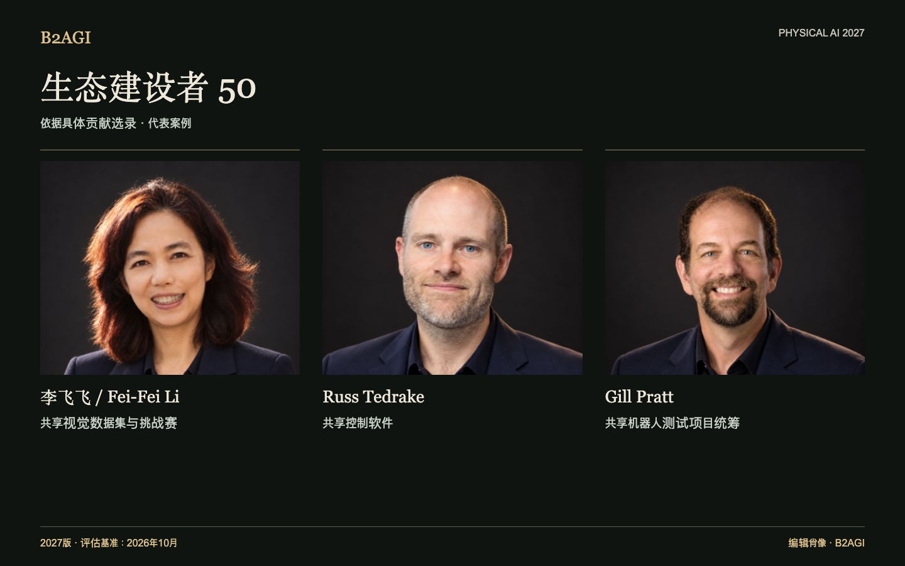

# 生态建设者 50

记录为研究者和企业提供工具、设施、教育、标准及金融支持的人物，并说明各自的具体贡献。

2027版 · 2026年10月评估 · 按贡献选录 · ID不代表排名。

入选依据与证据范围：英文原文。

### 推荐阅读条目

[李飞飞 / Fei-Fei Li](people/fei-fei-li--e013/README.md) · [Russ Tedrake](people/russ-tedrake--e022/README.md) · [Gill Pratt](people/gill-pratt--p010/README.md)

| ID | 名称 | 贡献与角色 |
| --- | --- | --- |
| E001 | [Aaron Ames](people/aaron-ames--e001/README.md) | 共享步态规划工具 |
| E002 | [Aaron Prather](people/aaron-prather--e002/README.md) | 行业测试研讨会 |
| E003 | [Andra Keay](people/andra-keay--e003/README.md) | 机器人技术社群支持 |
| E004 | [Ayanna Howard](people/ayanna-howard--e004/README.md) | 无障碍 STEM 技术转移 |
| E005 | [Brian Gerkey](people/brian-gerkey--e005/README.md) | 开放式机器人架构 |
| E052 | [Bruce Leak](people/bruce-leak--e052/README.md) | 创始人与董事会支持 |
| E047 | [Cho Kyu-nam](people/cho-kyu-nam--e047/README.md) | 行业公开讨论 |
| E007 | [Christian Hubicki](people/christian-hubicki--e007/README.md) | 控制与仿真教育 |
| E008 | [Craig Schlenoff](people/craig-schlenoff--e008/README.md) | 机器人技术联合评估 |
| E053 | [Cyril Ebersweiler](people/cyril-ebersweiler--e053/README.md) | 硬件初创企业支持 |
| P006 | [Daniela Rus](people/daniela-rus--p006/README.md) | 机器人技术博士生指导 |
| E009 | [Dennis Hong](people/dennis-hong--e009/README.md) | 研究与教育平台 |
| E010 | [Elena Messina](people/elena-messina--e010/README.md) | 联合标准与测试 |
| E011 | [Elham Tabassi](people/elham-tabassi--e011/README.md) | AI 风险管理框架 |
| E012 | [Erico Guizzo](people/erico-guizzo--e012/README.md) | 机器人技术编辑资源 |
| E013 | [李飞飞 / Fei-Fei Li](people/fei-fei-li--e013/README.md) | 共享视觉数据和挑战 |
| E014 | [Francesca Rossi](people/francesca-rossi--e014/README.md) | 自主系统设计伦理 |
| P009 | [Geordie Rose](people/geordie-rose--p009/README.md) | 机器人合作伙伴的投资和支持 |
| P010 | [Gill Pratt](people/gill-pratt--p010/README.md) | 共享机器人测试项目统筹 |
| E050 | [Han Jae-kwon](people/han-jae-kwon--e050/README.md) | 面向公众的机器人教育 |
| E044 | [He Wang](people/he-wang--e044/README.md) | 共享灵巧抓取基准测试和工具 |
| E015 | [Henrik Christensen](people/henrik-christensen--e015/README.md) | 共享机器人技术路线图 |
| P036 | [Jiyang Gao](people/jiyang-gao--p036/README.md) | 数据集和模型项目协调 |
| E036 | [Jung Kim](people/jung-kim--e036/README.md) | 初创企业发展项目 |
| P015 | [Karol Hausman](people/karol-hausman--p015/README.md) | 机器人学习基础设施 |
| E016 | [Li Zexiang](people/li-zexiang--e016/README.md) | 创业教育和制造支持 |
| E037 | [Liang Jing](people/liang-jing--e037/README.md) | 标准工作组运作 |
| E051 | [Lior Susan](people/lior-susan--e051/README.md) | 工业初创企业的组建 |
| E030 | [Liu Lianqing](people/liu-lianqing--e030/README.md) | 机器人学博士生指导 |
| E017 | [Matt Beane](people/matt-beane--e017/README.md) | 关于工作与技能转型的研究 |
| E018 | [Matthew Johnson-Roberson](people/matthew-johnson-roberson--e018/README.md) | 机器人学博士生指导 |
| E055 | [Mayank Mittal](people/mayank-mittal--e055/README.md) | 机器人学习公共基础设施 |
| E056 | [Morgan Quigley](people/morgan-quigley--e056/README.md) | ROS 架构 |
| E020 | [Pieter Abbeel](people/pieter-abbeel--e020/README.md) | 机器人控制教育 |
| E049 | [Qin Xiugong](people/qin-xiugong--e049/README.md) | 共享标准术语 |
| E048 | [Qu Daokui](people/qu-daokui--e048/README.md) | 研究成果商业化 |
| E022 | [Russ Tedrake](people/russ-tedrake--e022/README.md) | 共享控制软件 |
| E023 | [Ryan Gariepy](people/ryan-gariepy--e023/README.md) | 开发者交流与教育 |
| E024 | [Rémi Cadène / Remi Cadene](people/remi-cadene-remi-cadene--e024/README.md) | 开源机器人学习工具 |
| E039 | [Shi Lin](people/shi-lin--e039/README.md) | 联合制定评估标准 |
| E025 | [Sun Lining](people/sun-lining--e025/README.md) | 区域性研究与人才培养计划 |
| E026 | [Tom Ryden](people/tom-ryden--e026/README.md) | 共享设施运营 |
| E027 | [Tully Foote](people/tully-foote--e027/README.md) | ROS 单位与坐标系规范 |
| E028 | [Vincent Vanhoucke](people/vincent-vanhoucke--e028/README.md) | 研究团队组建 |
| E043 | [Wang Tianmiao](people/wang-tianmiao--e043/README.md) | 人才与初创企业支持 |
| E045 | [Wei Kai](people/wei-kai--e045/README.md) | 联合制定评估标准 |
| E054 | [Wendy Tan White](people/wendy-tan-white--e054/README.md) | 共享开发组织 |
| E032 | [Xiong Rong](people/xiong-rong--e032/README.md) | 学生研究平台 |
| E041 | [Yuh Joon-ku](people/yuh-joon-ku--e041/README.md) | 研究议程编辑 |
| E029 | [Zhang Jianwei](people/zhang-jianwei--e029/README.md) | 跨机构研究协调 |

[Atlas](README.md) · [English edition](https://github.com/b2agi/physical-ai-ranking-2027/blob/3dd209a29d38d56f07918da165a50c87dce9a058/) · [JSON](data/ranking2027.zh-CN.json) · [CSV](data/ranking2027.zh-CN.csv)
