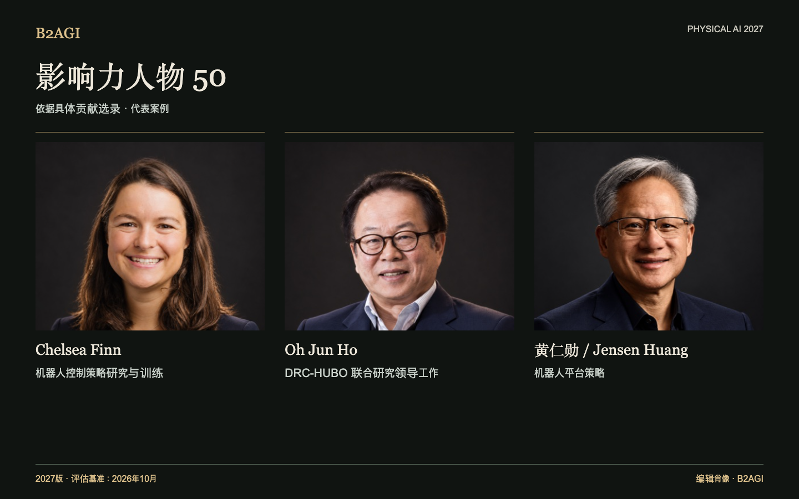

# 影响力人物 50

根据机器人设计、研究方法、具体项目的研究主导工作，以及运营和战略决策选录人物。共同成果注明合作方的贡献。

2027版 · 2026年10月评估 · 按贡献选录 · ID不代表排名。

入选依据与证据范围：英文原文。

### 推荐阅读条目

[Chelsea Finn](people/chelsea-finn--e006/README.md) · [Oh Jun Ho](people/oh-jun-ho--e019/README.md) · [黄仁勋 / Jensen Huang](people/jensen-huang--p013/README.md)

| ID | 名称 | 贡献与角色 |
| --- | --- | --- |
| P001 | [Abhinav Gupta](people/abhinav-gupta--p001/README.md) | 语义导航研究 |
| P002 | [Anca Dragan](people/anca-dragan--p002/README.md) | 意图感知运动规划 |
| P003 | [Andrea Thomaz](people/andrea-thomaz--p003/README.md) | 医院配送产品策略 |
| P043 | [Brett Adcock](people/brett-adcock--p043/README.md) | 人形机器人产业策略 |
| E006 | [Chelsea Finn](people/chelsea-finn--e006/README.md) | 机器人控制策略研究与训练 |
| P004 | [Chen Jianyu](people/chen-jianyu--p004/README.md) | 机器人研究通讯作者 |
| P048 | [Cheon Hong-seok](people/cheon-hong-seok--p048/README.md) | 机器人业务共同经营 |
| P005 | [Chris Urmson](people/chris-urmson--p005/README.md) | 客户运营决策 |
| P007 | [Deepak Pathak](people/deepak-pathak--p007/README.md) | 自适应行走研究 |
| P029 | [Ding Han](people/ding-han--p029/README.md) | 机器人表面加工领域的领导工作 |
| P008 | [Euisun Chung](people/euisun-chung--p008/README.md) | 战略性股权参与 |
| P034 | [Hang Zhao](people/hang-zhao--p034/README.md) | 基础模型研究的领导角色 |
| P011 | [Hod Lipson](people/hod-lipson--p011/README.md) | 机器人自建模研究 |
| P050 | [Huang Xiaoqing](people/huang-xiaoqing--p050/README.md) | 云机器人控制研究 |
| P040 | [Hyoun Jin Kim](people/hyoun-jin-kim--p040/README.md) | 空中操作研究 |
| P038 | [In So Kweon](people/in-so-kweon--p038/README.md) | DRC-HUBO 联合研究领导工作 |
| P042 | [Jaeheung Park](people/jaeheung-park--p042/README.md) | 平衡控制研究 |
| P012 | [Jeff Cardenas](people/jeff-cardenas--p012/README.md) | 工业市场进入策略 |
| P049 | [Jemin Hwangbo](people/jemin-hwangbo--p049/README.md) | “仿真到现实”（Sim-to-real）控制研究 |
| P013 | [黄仁勋 / Jensen Huang](people/jensen-huang--p013/README.md) | 机器人平台策略 |
| P014 | [Jonathan Hurst](people/jonathan-hurst--p014/README.md) | 双足机器人硬件设计 |
| P016 | [Ken Goldberg](people/ken-goldberg--p016/README.md) | 学习型抓取研究 |
| P039 | [Kim Yong-jae](people/kim-yong-jae--p039/README.md) | 轻量级辅助机器人研究 |
| P037 | [Kyoungchul Kong](people/kyoungchul-kong--p037/README.md) | 辅助机器人团队领导工作 |
| P047 | [Kyu-Jin Cho](people/kyu-jin-cho--p047/README.md) | 变刚度机器人设计 |
| P041 | [Leng Xiaokun](people/leng-xiaokun--p041/README.md) | 人形机器人研究资金投入策略 |
| P017 | [Linxi “Jim” Fan](people/linxi-jim-fan--p017/README.md) | 奖励生成（Reward-generation）研究 |
| P018 | [Marc Raibert](people/marc-raibert--p018/README.md) | 动态行走研究 |
| P019 | [Masayoshi Son](people/masayoshi-son--p019/README.md) | 战略交易决策 |
| P020 | [Melonee Wise](people/melonee-wise--p020/README.md) | 产品与工程组织架构 |
| P021 | [Nick Paine](people/nick-paine--p021/README.md) | 执行器设计与控制 |
| P051 | [Nikita Rudin](people/nikita-rudin--p051/README.md) | 大规模并行运动训练研究 |
| E019 | [Oh Jun Ho](people/oh-jun-ho--e019/README.md) | DRC-HUBO 联合研究领导工作 |
| P022 | [Oussama Khatib](people/oussama-khatib--p022/README.md) | 水下遥操作研究 |
| P023 | [Park Jong Hoon](people/park-jong-hoon--p023/README.md) | 垂直整合战略 |
| P024 | [Peng Zhihui](people/peng-zhihui--p024/README.md) | 机器人产品开发领导工作 |
| P030 | [Qiao Hong](people/qiao-hong--p030/README.md) | 机器人控制方法研究 |
| P035 | [Richie Chen](people/richie-chen--p035/README.md) | ACR 联合开发 |
| P025 | [Rodney Brooks](people/rodney-brooks--p025/README.md) | 分层机器人控制 |
| E021 | [Rolf Dieter Schraft](people/rolf-dieter-schraft--e021/README.md) | 机器人编程方法研究 |
| P026 | [Sabine Hauert](people/sabine-hauert--p026/README.md) | 群集控制研究的领导工作 |
| P044 | [Seok Sang-ok](people/seok-sang-ok--p044/README.md) | 集成机器人服务策略 |
| P027 | [Sergey Levine](people/sergey-levine--p027/README.md) | 基于学习的视觉反馈研究 |
| P033 | [Wang Hesheng](people/wang-hesheng--p033/README.md) | 联合感知研究 |
| E033 | [Wang Tianran](people/wang-tianran--e033/README.md) | 工业机器人产品开发领导工作 |
| P028 | [Wang Xingxing](people/wang-xingxing--p028/README.md) | 四足机器人设计与控制 |
| P032 | [Wang Yaonan](people/wang-yaonan--p032/README.md) | 工业检测项目负责人 |
| E034 | [Zhao Mingguo](people/zhao-mingguo--e034/README.md) | 人形机器人足球联合研究负责人 |
| P046 | [Zhou Jian](people/zhou-jian--p046/README.md) | 人形机器人研究投资 |
| P031 | [Zhu Qiuguo](people/zhu-qiuguo--p031/README.md) | 四足机器人稳定性控制研究 |

[Atlas](README.md) · [English edition](https://github.com/b2agi/physical-ai-ranking-2027/blob/3dd209a29d38d56f07918da165a50c87dce9a058/) · [JSON](data/ranking2027.zh-CN.json) · [CSV](data/ranking2027.zh-CN.csv)
