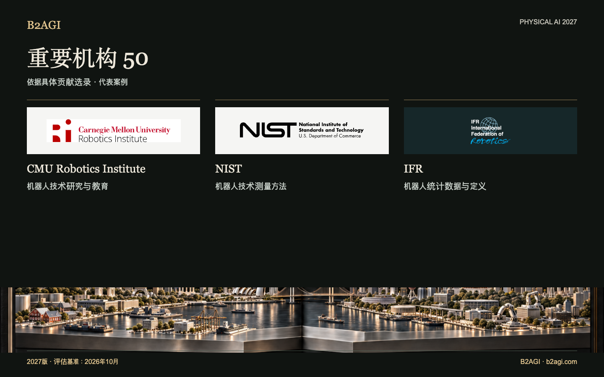

# B2AGI Physical AI 重要机构50 · 2027

收录在研究、测试、标准、监管、产业支持和资本市场准入方面作出贡献的机构与项目，区分技术著述、资助、认证和运营支持。

2027版 · 2026年10月评估 · 按贡献选录 · ID不代表排名。

入选依据与证据范围：英文原文。

### 推荐阅读条目

[NIST](institutions/nist--i033/README.md) · [KAIST](institutions/kaist--i018/README.md) · [MassRobotics](institutions/massrobotics--i027/README.md)

| ID | 名称 | 贡献与角色 |
| --- | --- | --- |
| I001 | [ARM Institute](institutions/arm-institute--i001/README.md) | 制造业应用推广支持 |
| I003 | [ASTM F45](institutions/astm-f45--i003/README.md) | 移动机器人性能标准 |
| I047 | [Beijing Humanoid Robot Innovation Center](institutions/beijing-humanoid-robot-innovation-center--i047/README.md) | 共享的机器人训练数据 |
| I004 | [BIGAI](institutions/bigai--i004/README.md) | 共享的机器人研究工具 |
| I005 | [CESI](institutions/cesi--i005/README.md) | 具身智能数据质量指导性文件共同起草 |
| I006 | [CMU Robotics Institute](institutions/cmu-robotics-institute--i006/README.md) | 机器人技术研究与教育 |
| I007 | [DARPA SubT](institutions/darpa-subt--i007/README.md) | 共享物理测试环境 |
| I008 | [DFKI Robotics Innovation Center](institutions/dfki-robotics-innovation-center--i008/README.md) | 工业机器人研究 |
| I009 | [ETRI](institutions/etri--i009/README.md) | 机器人技术转让 |
| I010 | [euRobotics](institutions/eurobotics--i010/README.md) | 机器人研究生态系统 |
| I011 | [FAA](institutions/faa--i011/README.md) | 超视距（BVLOS）包裹递送授权 |
| I012 | [Harvard Wyss Institute](institutions/harvard-wyss-institute--i012/README.md) | 辅助机器人研究与许可 |
| I013 | [HIT Robotics Technology and Systems Research Unit](institutions/hit-robotics-technology-and-systems-research-unit--i013/README.md) | 实体机器人研究基础设施 |
| I014 | [HKEX / HKSCC](institutions/hkex-hkscc--i014/README.md) | 上市与结算准入 |
| I015 | [IEC Robotics Product Safety Standards](institutions/iec-robotics-product-safety-standards--i015/README.md) | 机器人产品安全标准 |
| I016 | [IFR](institutions/ifr--i016/README.md) | 机器人统计数据与定义 |
| I017 | [ISO/TC 299](institutions/iso-tc-299--i017/README.md) | 机器人标准制定 |
| I018 | [KAIST](institutions/kaist--i018/README.md) | 共享人形机器人研究平台 |
| I020 | [KEIT](institutions/keit--i020/README.md) | 机器人研究经费 |
| I022 | [KIAT](institutions/kiat--i022/README.md) | 机器人研发经费 |
| I023 | [KIRIA](institutions/kiria--i023/README.md) | 机器人测试与认证 |
| I024 | [KITECH](institutions/kitech--i024/README.md) | 机器人数字孪生研究 |
| I050 | [KRX](institutions/krx--i050/README.md) | 机器人企业上市与信息披露准入 |
| I025 | [KTL](institutions/ktl--i025/README.md) | 可穿戴机器人测试 |
| I026 | [LeRobot / Hugging Face](institutions/lerobot-hugging-face--i026/README.md) | 共享机器人学习基础设施 |
| I027 | [MassRobotics](institutions/massrobotics--i027/README.md) | 共享开发设施 |
| I028 | [MIIT](institutions/miit--i028/README.md) | 机器人应用政策 |
| I029 | [MIT CSAIL](institutions/mit-csail--i029/README.md) | 人机交互研究 |
| I030 | [NASA Jet Propulsion Laboratory](institutions/nasa-jet-propulsion-laboratory--i030/README.md) | 行星机器人作业 |
| I031 | [Nasdaq](institutions/nasdaq--i031/README.md) | 机器人企业进入公开市场 |
| I048 | [National Robot Testing and Evaluation Center, Shanghai Headquarters](institutions/national-robot-testing-and-evaluation-center-shanghai-headquarters--i048/README.md) | 上海机器人认证 |
| I053 | [New York Stock Exchange / NYSE](institutions/new-york-stock-exchange-nyse--i053/README.md) | 发行人既往交易渠道 |
| I032 | [NHTSA](institutions/nhtsa--i032/README.md) | 自动驾驶召回报告 |
| I054 | [NIOSH / Center for Occupational Robotics Research](institutions/niosh-center-for-occupational-robotics-research--i054/README.md) | 职业环境下的机器人危害研究与指导 |
| I033 | [NIST](institutions/nist--i033/README.md) | 机器人技术测量方法 |
| I034 | [Open Robotics / OSRF](institutions/open-robotics-osrf--i034/README.md) | 开放式机器人软件基础设施 |
| I035 | [Open X-Embodiment consortium](institutions/open-x-embodiment-consortium--i035/README.md) | 共享学习数据与模型 |
| I036 | [OSHA Robotics Safety Guidance](institutions/osha-robotics-safety-guidance--i036/README.md) | 工作场所机器人安全指南 |
| I037 | [POSTECH](institutions/postech--i037/README.md) | 医院机器人联合研究与评估 |
| I038 | [RAI Institute](institutions/rai-institute--i038/README.md) | 公开的机器人学习工具 |
| I039 | [SAC](institutions/sac--i039/README.md) | 国家标准管理 |
| I040 | [SEC](institutions/sec--i040/README.md) | 发行人信息披露审查 |
| I041 | [Shanghai AI Lab](institutions/shanghai-ai-lab--i041/README.md) | 共享仿真研究 |
| I051 | [Shanghai Stock Exchange](institutions/shanghai-stock-exchange--i051/README.md) | 工业发行人市场准入 |
| I052 | [Shenzhen Stock Exchange](institutions/shenzhen-stock-exchange--i052/README.md) | 工业发行人市场准入 |
| I046 | [SIA](institutions/sia--i046/README.md) | 工业技术转移 |
| I042 | [Toyota Research Institute](institutions/toyota-research-institute--i042/README.md) | 机器人学习与控制研究 |
| I043 | [UC Berkeley BAIR: RAIL BridgeData](institutions/uc-berkeley-bair-rail-bridgedata--i043/README.md) | 共享机器人数据与训练工具 |
| I044 | [XbotPark](institutions/xbotpark--i044/README.md) | 初创企业制造支持 |
| I045 | [Zhejiang University Robotics Research](institutions/zhejiang-university-robotics-research--i045/README.md) | 机器人技术教育 |

[Atlas](README.md) · [English edition](https://github.com/b2agi/physical-ai-ranking-2027/blob/3dd209a29d38d56f07918da165a50c87dce9a058/) · [JSON](data/ranking2027.zh-CN.json) · [CSV](data/ranking2027.zh-CN.csv)

英文版：[B2AGI Physical AI Institutions 50 · 2027](../../INSTITUTIONS_50.md)

<!-- B2AGI EPAI SIGNATURE -->
---

**B2AGI | EPAI**  
Embodied Physical Agentic Intelligence  
[Research & Publications](https://b2agi.com/) · [White Paper](https://github.com/b2agi/physical-ai-white-paper-2027) · [Industry Atlas](https://github.com/b2agi/physical-ai-ranking-2027)
<!-- /B2AGI EPAI SIGNATURE -->
