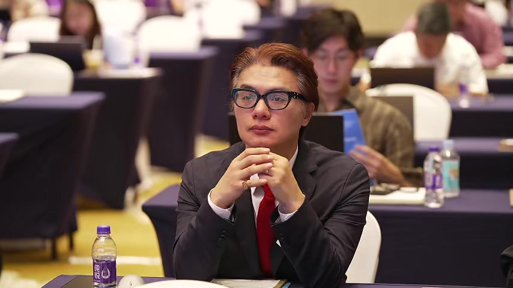
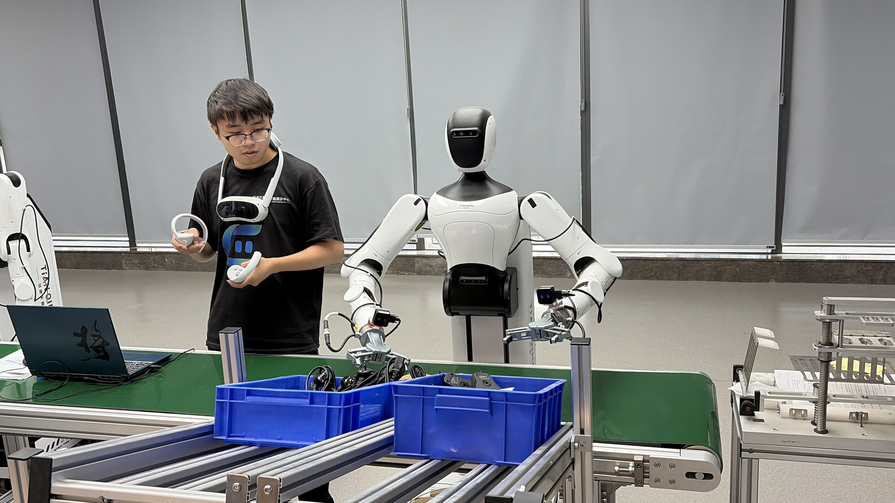

# THE ROBOT STOPPED. WHO CAN PROVE WHAT HAPPENED?

**Henry Chan Jung · B2AGI · 20 October 2026**

Last week, I spent four days at the ITU-T Focus Group on Embodied AI (FG-EAI) meeting in Hangzhou, China.

Near the end of the meeting, a discussion about AI-agent failure and assurance raised a question that has stayed with me.

**When an AI agent fails, who can establish what happened—and on what evidence can operations resume?**

Consider a factory operating a robot, an edge platform and a cloud AI agent supplied by three different companies.

*A robotics demonstration during my visit to Hangzhou, China.*

The agent issues a task. The network fails. The operator revokes the task. Eventually, the robot stops.

But did it already execute the command? Was the task reassigned to another agent? Could an old instruction still execute when the connection returns?

**Stopping physical motion, terminating digital authority, and establishing accountable system state are three different problems.**

This is not entirely new territory. In OAuth systems, RFC 7009 already recognizes that token revocation may take time to propagate. Some servers may know a token is invalid while others do not.

A physical command raises a further question: **what happened before revocation took effect?**

A cancelled instruction cannot move a fallen object back into place.

Now imagine the cloud records the task as revoked. The edge records forwarding the revocation. The robot has no corresponding receipt.

All three records may be authentic. They may describe different stages of the same event. Their clocks may disagree. And a valid digital signature can help establish a record's origin and integrity without proving that the physical action described actually occurred.

This leaves us with two separate questions.

**Evidence:** Can we establish what happened?

**Operation:** Did the system actually follow its authorization, stopping and recovery rules?

**A perfectly documented failure remains a failure.**

And an outcome that cannot be established must never be reported as a successful rollback.

I believe we need to test this across suppliers, not just within individual products.

Take one physical task. Introduce a network interruption, delayed revocation, conflicting records and a recovery attempt. Define which observations can be trusted, how the sequence of events will be assessed, and when the observation window ends.

Then determine what the operator can establish independently, what remains unknown, and what must be resolved before restarting.

Now consider the same system operating across national borders.

What if the critical records remain with a foreign supplier? What if those records cannot be shared because of contractual, security or data-transfer restrictions? What happens when the supplier is unavailable?

**An operator may have the authority to restart a system without the evidence needed to justify that decision.**

For me, this is a practical question of industrial sovereignty. It is not simply about where a robot was manufactured. It is about whether an operator can understand and recover its own operations without depending entirely on a supplier's account.

There is a financial dimension as well.

A robot may be technically impressive and commercially attractive. But what happens to its value when the operator cannot independently investigate a failure or restore operations without the supplier?

Investors, lenders and insurers must look beyond performance and price to consider expected downtime, recovery costs, contractual loss exposure and dependence on the supplier.

**A machine's value depends not only on what it can do, but also on what happens when it cannot.**

There is already relevant work underway.

ITU-T FG-EAI's WG5 covers connectivity and interoperability. ITU-T SG17's June 2026 meeting summary lists work items on Physical AI security (`X.sf-Pai`), autonomous-agent security (`X.aaia-sec`) and AI accountability (`XSTR.aam`).

I would like to see these efforts examined together against a concrete cross-supplier failure scenario.

**The test is whether an operator can reconstruct the incident and determine whether restarting is justified—even when a supplier is unavailable.**

**When a machine stops, accountability does not.**

---

Henry Chan Jung  
B2AGI | AI · Capital · Security · Global Cooperation

## References

- [ITU-T Focus Group on Embodied AI (FG-EAI) — Working Group Structure](https://www.itu.int/en/ITU-T/focusgroups/eai/Pages/default.aspx)
- [ITU-T SG17 — June 2026 Meeting Summary, Annex B](https://www.itu.int/en/ITU-T/studygroups/2025-2028/17/Pages/Jun26-summary.aspx)
- [IETF RFC 7009 — OAuth 2.0 Token Revocation, §2.1](https://www.rfc-editor.org/rfc/rfc7009.html#section-2.1)

## Published editions

[LinkedIn article](https://www.linkedin.com/pulse/robot-stopped-who-can-prove-what-happened-b2agi-yyt8c/) · [Facebook post](https://www.facebook.com/permalink.php?story_fbid=pfbid02R8cqskwJieMPRXpb8BQSjsnDXRHo5bX1KTTBz8UoyW5DcJWp1U6wSqBoFH8J82iel&id=61575474760233)

[Research & Field Notes](README.md) · [B2AGI Physical AI Rankings & Selections 2027](../README.md) · [Reuse terms](../RIGHTS.md)
